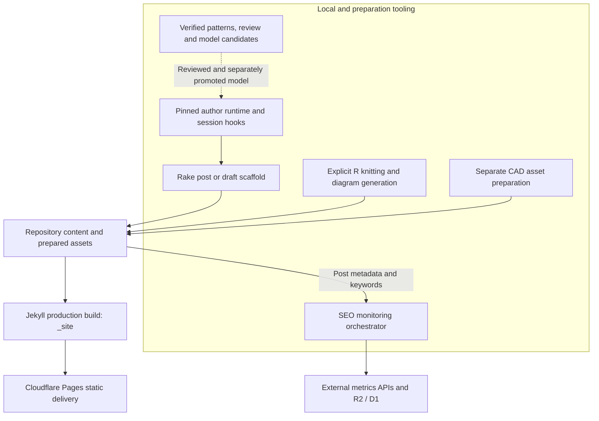

# Architecture

## Overview

The publishing core is a Jekyll static site: [repository content](./modules/blog-content.md), [layouts](./components/site-presentation.md), configuration, and assets become `_site/`, which the deployment workflow uploads to Cloudflare Pages. The repository also contains adjacent local or CI toolchains for [governed authoring](./modules/governed-post-authoring.md), [R-generated content and diagrams](./modules/r-publishing.md), [CAD assets](./modules/cad-assets.md), and [SEO monitoring](./modules/seo-monitoring.md). Those toolchains are not an application server embedded in the published site. External API calls and managed storage belong to preparation, monitoring, or delivery integrations rather than repository-owned HTTP endpoints. Sources: `_config.yml`, `Makefile.common`, `.github/workflows/deploy-on-cloudflare-pages.yml`, `_scripts/seo/monitor.py`.

[Production configuration](./config/build-and-automation.md) is Italian, uses Kramdown with GFM and KaTeX, sets category/title permalinks, and disables future-dated posts. Post and page defaults select their respective layouts; configured Jekyll plugins provide features including pagination, feeds, sitemap generation, and a table of contents. Source: `_config.yml`.

## Component Diagram



The governance edge is conditional: saving a candidate does not promote it to the current author model. R and CAD outputs enter the site as prepared files; the production build does not invoke every preparation pipeline. SEO consumes repository information independently of page delivery. Sources: `plugins/author-pattern-consolidator/index.js`, `_scripts/author-extraction/model-agent.mjs`, `Makefile.common`, `_scripts/seo/monitor.py`.

## Data Flow

```mermaid
sequenceDiagram
    participant User as Author
    participant Plugin as Local authoring plugin
    participant Runtime as Runtime compiler
    participant Rake as Rake
    participant Files as Repository files
    participant CI as Deployment workflow
    participant Build as Make and Jekyll
    participant Pages as Cloudflare Pages
    User->>Plugin: /create-post request via author_post_prepare
    Plugin->>Runtime: Compile, materialize and verify task runtime
    Runtime-->>Plugin: Bound profile, instructions and hashes
    Plugin->>Rake: Create one new post or draft
    Rake->>Files: Write frontmatter scaffold exclusively
    Plugin->>Files: Persist preparation receipt
    Plugin-->>User: Ready; activate session-context injection
    Note over User,Plugin: Subsequent context/generate hooks verify and inject instructions
    User->>Files: Authoring session writes article body
    User->>Plugin: author_post_finish(written)
    Plugin-->>User: End injection after integrity and body checks
    Note over User,Pages: Authoring completion does not trigger deployment
    User->>CI: Separate eligible push or workflow dispatch
    CI->>Build: make site
    Build->>Files: Produce _site
    CI->>Files: Check output directory and selected image references
    CI->>Pages: Deploy _site on non-PR events
```

The command directs the current session to use `author_post_prepare`; the plugin itself does not select a provider or generate prose. Runtime verification precedes Rake, and hook activation follows successful preparation. A pull-request workflow also builds and checks output, but skips deployment. Sources: `.opencode/commands/create-post.md`, `_scripts/author-extraction/post-authoring.mjs`, `_scripts/author-extraction/post-authoring-plugin.mjs`, `.github/workflows/deploy-on-cloudflare-pages.yml`.

## Key Design Decisions

### Keep static delivery separate from tooling

- **Context:** The same repository holds public content and operational tools.
- **Decision:** Jekyll produces deployable files; Docker-backed Make targets run build and preparation tools. `make dev` serves a local Jekyll preview with drafts and future posts enabled, unlike production settings.
- **Consequences:** The local preview server is not the production architecture. `_config.yml` explicitly excludes `_scripts`, `_dbt`, SEO configuration/artifacts, `.github`, R Markdown sources, and the consolidator plugin directory. These exclusions are specific, not a blanket guarantee that all tooling or documentation is private.

Sources: `_config.yml`, `Makefile.common`.

### Bind authoring to a specific reviewed model

The [project plugin](./modules/opencode-integration.md) configured by `opencode.json` exposes [consolidation, review, validation, and model-candidate tools](./api/native-author-tools.md). A separate local entrypoint, `.opencode/plugins/post-authoring.js`, installs post-preparation tools and session hooks. Both bind their repository root locally rather than accepting it from model input.

`runtime.mjs` reads `docs/author-pattern-results/v1.3/author-model.json` and requires its bytes to match the exact `GOVERNED_MODEL_SHA256` constant. A different model is rejected until the [routing policy](./modules/author-runtime.md) is explicitly reviewed and updated. Profiles are deterministically selected from the task's content type, features, and explicit contextual signals. Optional semantic context is conceptual only: it neither selects style nor imposes metaphors or discussion topics.

Runtime materialization writes a profile, instructions, and manifest into a runtime-ID-derived directory. Existing differing bytes cause a collision error rather than replacement. Preparation also records the request, task, target, scaffold hash, Rakefile hash, runtime identity, and instruction hashes. Subsequent hooks reverify the bound context before adding instructions.

Sources: `opencode.json`, `plugins/author-pattern-consolidator/index.js`, `.opencode/plugins/post-authoring.js`, `_scripts/author-extraction/runtime.mjs`, `_scripts/author-extraction/compile-author-runtime.mjs`, `_scripts/author-extraction/post-authoring.mjs`.

### Separate persistence, authorization, and publication

| Operation | Boundary |
|-----------|----------|
| Model submission | Validates hash-bound inputs and persists a separate immutable candidate under `author-model-candidates`; it does not overwrite or promote the current model. |
| Native review preparation | Produces a pending review sheet without creating human decisions. |
| Native `author_review_apply` | Remains fail-closed: the adapter throws `AUTHORIZATION_UNAVAILABLE` because hash-bound human release authorization is unavailable in this host. It never applies or publishes a review. |
| Post preparation | Creates only a new Rake post/draft scaffold after runtime verification; existing article targets are rejected. |
| Post completion or cancellation | Ends this session's runtime injection, without deployment or file removal. |
| Rake draft publication | Moves draft content into a dated `_posts` destination; this repository operation is separate from deploying `_site`. |
| CAD site packaging | Requires an already released canonical CAD source, release/Gate C evidence, and separate site-bundle consent. Site-package completion does not change the CAD release verdict. |

[Human review/release and model promotion](./concepts/governance-and-verification.md) must therefore remain distinct from successful candidate persistence. Likewise, an article scaffold or a packaged CAD export is not evidence of a deployed or independently validated release. Sources: `plugins/author-pattern-consolidator/index.js`, `_scripts/author-extraction/model-agent.mjs`, `_scripts/author-extraction/review-native.mjs`, `_scripts/author-extraction/post-authoring-plugin.mjs`, `Rakefile`, `.opencode/agents/cad-site-packager.md`.

### Make preprocessing explicit

`Makefile.common` separates output families:

| Target | Inputs and outputs | Part of production `site` prerequisites? |
|--------|--------------------|-----------------------------------------|
| `knitr` | Discovered R Markdown inputs to adjacent Markdown, through `R/build_one.R` | No |
| `cad` | OpenSCAD inputs to STL/3MF plus PNG preparation | No |
| `diagrams` | `R/diagrams/*.R` to SVG files under `assets/images/diagrams/` | Yes |
| `_site` / `site` | Docker image build and diagrams, then production `bundle exec jekyll build` | Publishing output |
| `seo` | Separate SEO image and monitor invocation using `.env` | No |

R and OpenSCAD paths can use detected native tools or Docker fallbacks. Diagram regeneration may fall back to an existing committed SVG when generation fails and that output exists. Thus, `make site` must not be described as automatically knitting all R Markdown or rebuilding/authorizing CAD bundles. `Rakefile` also offers explicit single-file knitting and content/CAD scaffolding tasks. Sources: `Makefile.common`, `Rakefile`.

### Limit deployment and observability claims

The deployment workflow runs for matching changes on `main`/`master`, matching pull requests, or manual dispatch. It builds with `make site`, checks that `_site` exists, and scans selected changed posts for local image references before non-PR deployment. Despite the validation step's name, the implemented checks are not a comprehensive crawl of rendered links. On push, a dependent job warms Cloudinary image URLs; individual fetch failures are tolerated. Cloudinary is an external image-delivery integration, not a server implemented here. Sources: `.github/workflows/deploy-on-cloudflare-pages.yml`, `_config.yml`.

Authoring completion checks runtime integrity, at least one context-hook application, and a nonempty article body changed from the scaffold. The hook count establishes observed hook execution, not provider delivery, model attention, factual correctness, or prose compliance. Activation is session-specific and is not inherited by child sessions. Sources: `_scripts/author-extraction/post-authoring-plugin.mjs`, `_scripts/author-extraction/post-authoring.mjs`.

## Independent SEO Pipeline

`_scripts/seo/monitor.py` orchestrates schema setup, post synchronization, keyword extraction, Google Trends consumption through SerpAPI, optional Google Search Console consumption, raw JSON storage in R2, and tabular storage in D1. It then runs R2-to-D1 ETL, attempts dbt compilation/application, checks alert thresholds, and conditionally generates a monthly report. Missing Search Console credentials skip that stage; several integration failures are logged without aborting the whole orchestration.

Persistence uses weekly Trends object keys, daily Search Console object keys, and database uniqueness constraints with `INSERT OR IGNORE` for duplicate handling. These are outbound integrations with external services, not public application routes. The `--dry-run` flag is not a guarantee of zero side effects: `d1.ensure_schema(SCHEMA_SQL)` is called unconditionally before the later guarded writes. Source: `_scripts/seo/monitor.py`.

## Verification and Packaging Caveats

- **Documentation exposure is unverified.** `_config.yml` has no explicit exclusion for `docs/` or `wiki/`. Their absence from the published package cannot be assumed; actual `_site` contents require a separate authorized inspection. Describing tooling as local/private in purpose does not establish that its evidence files are excluded from deployment.
- **Source review is not execution evidence.** This page describes inspected code and configuration as of 2026-10-15. No builds, tests, deployments, provider calls, or release operations were run for it. Existing documentation or recorded test PASS results are historical evidence, not newly reproduced guarantees of current output, security, or release readiness.
