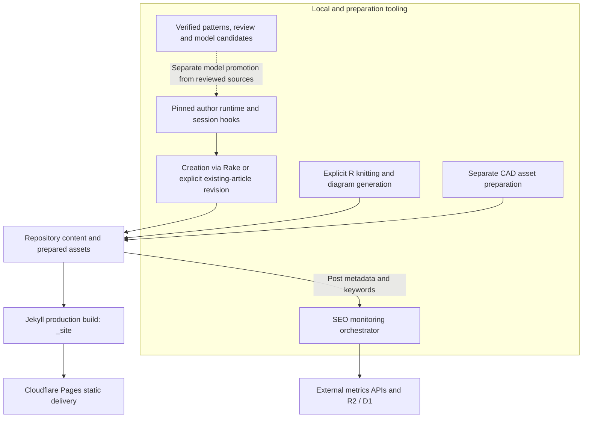
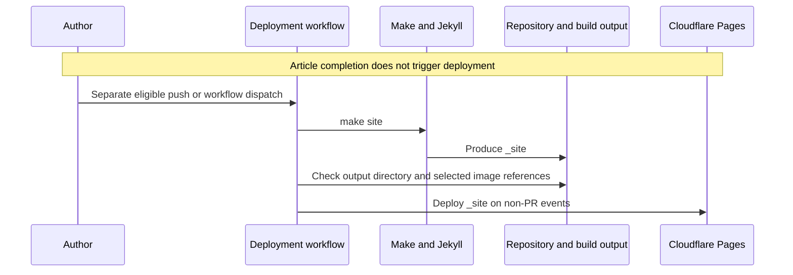

# Architecture

## Overview

The publishing core is a Jekyll static site: [repository content](./modules/blog-content.md), [layouts](./components/site-presentation.md), configuration, and assets become `_site/`, which the deployment workflow uploads to Cloudflare Pages. The repository also contains adjacent local or CI toolchains for [governed authoring](./modules/governed-post-authoring.md), [R-generated content and diagrams](./modules/r-publishing.md), [CAD assets](./modules/cad-assets.md), and [SEO monitoring](./modules/seo-monitoring.md). Those toolchains are not an application server embedded in the published site. External API calls and managed storage belong to preparation, monitoring, or delivery integrations rather than repository-owned HTTP endpoints. Sources: `_config.yml`, `Makefile.common`, `.github/workflows/deploy-on-cloudflare-pages.yml`, `_scripts/seo/monitor.py`.

[Production configuration](./config/build-and-automation.md) is Italian, uses Kramdown with GFM and KaTeX, sets category/title permalinks, and disables future-dated posts. Post and page defaults select their respective layouts; configured Jekyll plugins provide features including pagination, feeds, sitemap generation, and a table of contents. Source: `_config.yml`.

## Component Diagram



The governance edge is conditional: saving a candidate does not promote it to the current author model. Creation is *[create-only]* (see [Glossary](./glossary.md)): a verified runtime precedes permission-gated Rake scaffolding. Revision instead explicitly prepares an existing article with an original snapshot and editorial context; it never runs Rake. R and CAD outputs enter the site as prepared files; the production build does not invoke every preparation pipeline. SEO consumes repository information independently of page delivery. Sources: `plugins/author-pattern-consolidator/index.js`, `_scripts/author-extraction/model-agent.mjs`, `_scripts/author-extraction/post-authoring-plugin.mjs`, `_scripts/author-extraction/post-revision.mjs`, `Makefile.common`, `_scripts/seo/monitor.py`.

## Data Flow

### Article creation and revision

```mermaid
sequenceDiagram
    participant Writer as Current writing session
    participant Plugin as Local authoring plugin
    participant Host as Host permissions
    participant Runtime as Runtime compiler
    participant Rake as Rake
    participant Evidence as Preparation evidence
    participant Article as Target Markdown
    Writer->>Plugin: Explicit create or revise request
    Plugin->>Plugin: Check root, no active article, callable permission.assert
    Plugin->>Runtime: Compile task profile and validate inputs
    Plugin->>Host: Assert edit permission for target, evidence and runtime
    alt Creation: author_post_prepare
        Plugin->>Host: Assert shell permission for Rake invocation
        Plugin->>Evidence: Save request and task
        Plugin->>Runtime: Materialize and verify runtime
        Plugin->>Rake: Create one absent post or draft
        Rake->>Article: Write new frontmatter scaffold exclusively
        Plugin->>Evidence: Save creation receipt
    else Revision: author_post_revision_prepare
        Note over Plugin,Article: Existing target and approved references; no Rake or article edit
        Plugin->>Evidence: Save immutable original, request and reference context
        Plugin->>Runtime: Materialize and verify revision runtime
        Plugin->>Evidence: Save revision receipt
    end
    Plugin-->>Writer: Ready; activate runtime for this session
    Note over Writer,Plugin: Hooks reverify and inject instructions plus revision reference context
    Writer->>Article: Write or revise only the returned target
    opt Existing-article revision
        Writer->>Plugin: author_post_editorial_prepare
        Plugin-->>Writer: Current article hash and comparison schema
        Writer->>Plugin: author_post_editorial_submit with current quotes and hash
        Plugin->>Host: Assert edit permission for editorial evidence
        Plugin->>Evidence: Save validated immutable comparison candidate
    end
    Writer->>Plugin: author_post_finish(written)
    Plugin->>Article: Check context integrity and changed, nonempty content
    Note over Plugin,Evidence: Revision also requires a current ready_for_human_review candidate
    Plugin-->>Writer: End injection, not human approval or publication
```

Both commands keep writing in the current session; the plugin neither selects a provider nor generates prose. Creation's `written` check does not require the revision comparison. For revision, the comparison binds current article bytes and literal quotes to prepared reference excerpts; further article edits make it stale. The candidate remains pending human review even after successful completion. Sources: `.opencode/commands/create-post.md`, `.opencode/commands/revise-post.md`, `_scripts/author-extraction/post-authoring.mjs`, `_scripts/author-extraction/post-revision.mjs`, `_scripts/author-extraction/post-authoring-plugin.mjs`.

### Static publication



A pull-request workflow also builds and checks output, but skips deployment. Neither preparing nor finishing an article commits, pushes, or starts this workflow. Sources: `.opencode/commands/create-post.md`, `.opencode/commands/revise-post.md`, `.github/workflows/deploy-on-cloudflare-pages.yml`.

## Key Design Decisions

### Keep static delivery separate from tooling

- **Context:** The same repository holds public content and operational tools.
- **Decision:** Jekyll produces deployable files; Docker-backed Make targets run build and preparation tools. `make dev` serves a local Jekyll preview with drafts and future posts enabled, unlike production settings.
- **Consequences:** The local preview server is not the production architecture. `_config.yml` explicitly excludes `_scripts`, `_dbt`, SEO configuration/artifacts, `.github`, R Markdown sources, and the consolidator plugin directory. These exclusions are specific, not a blanket guarantee that all tooling or documentation is private.

Sources: `_config.yml`, `Makefile.common`.

### Bind authoring to a specific governed model

The [project plugin](./modules/opencode-integration.md) configured by `opencode.json` exposes [consolidation, review, validation, and model-candidate tools](./api/native-author-tools.md). A separate local entrypoint, `.opencode/plugins/post-authoring.js`, installs post-preparation tools and session hooks. Both bind their repository root locally rather than accepting it from model input.

`runtime.mjs` reads `docs/author-pattern-results/v1.3/author-model.json` and requires its bytes to match the exact `GOVERNED_MODEL_SHA256` constant. A different model is rejected until the [routing policy](./modules/author-runtime.md) is explicitly reviewed and updated. Profiles are deterministically selected from the task's content type, features, and explicit contextual signals. Optional semantic context is conceptual only: it neither selects style nor imposes metaphors or discussion topics.

Runtime materialization writes a profile, instructions, and manifest into a runtime-ID-derived directory. Existing differing bytes cause a collision error rather than replacement. Creation preparation records the request, task, target, scaffold hash, Rakefile hash, runtime identity, and instruction hashes. Revision separately preserves original article bytes, a new rewrite/expand task, and 2–4 distinct approved reference articles with bounded literal excerpts. Its immutable snapshot, receipt, and comparison reports live under `.opencode/authoring-revisions/<request-sha256>/<run-id>/`, not in `docs/`; runtimes retain their existing hash-addressed location.

Creation and revision share **one active article per session**. Both `context` and `generate` hooks reverify the bound runtime before *[context injection]* (see [Glossary](./glossary.md)); revision also verifies the snapshot, approved sources/corpus, and comparison context. Activation persists across reloads but is neither global nor inherited by child sessions. After `written` ends injection, further revision requires a fresh explicit preparation, not reuse of the creation receipt or remembered instructions. This is not a global lock against concurrent article edits.

Before either flow plans or writes, the plugin checks the **actual host's callable `permission.assert`**, not just its installed SDK version. Creation asserts edit and Rake shell permissions before native writes/process execution; revision preparation asserts edit only and does not run Rake or edit the article. Missing capability raises `AUTHOR_POST_HOST_UNSUPPORTED`; installing an SDK alone cannot add it to an older running host. These are host operation permissions, **not hash-bound human release authorization**.

Sources: `opencode.json`, `plugins/author-pattern-consolidator/index.js`, `.opencode/plugins/post-authoring.js`, `_scripts/author-extraction/runtime.mjs`, `_scripts/author-extraction/compile-author-runtime.mjs`, `_scripts/author-extraction/post-authoring.mjs`, `_scripts/author-extraction/post-authoring-plugin.mjs`, `_scripts/author-extraction/post-revision.mjs`, `docs/post-authoring.md`.

### Separate persistence, authorization, and publication

| Operation | Boundary |
|-----------|----------|
| Model submission | Validates hash-bound inputs and persists a separate immutable candidate under `author-model-candidates`; it does not overwrite or promote the current model. |
| Native review preparation | Produces a pending review sheet without creating human decisions. |
| Native `author_review_apply` | Remains fail-closed: the adapter throws `AUTHORIZATION_UNAVAILABLE` because hash-bound human release authorization is unavailable in this host. It never applies or publishes a review. |
| New-post preparation | Creates only a new Rake post/draft scaffold after runtime verification and host permission checks; existing article targets are rejected. |
| Existing-article revision preparation | Saves an immutable original and approved reference context, then activates a verified runtime; no Rake, rename, publication, or article edit occurs during preparation. |
| Revision editorial submission | Saves a quote/hash-bound comparison candidate for four aspects; validates literal evidence, not voice quality or human approval, and does not promote a model. |
| Article completion or cancellation | Ends this session's runtime injection, without deployment or file removal. Revision completion additionally requires a current comparison ready for human review; cancellation leaves snapshots and edits intact. |
| Rake draft publication | Moves draft content into a dated `_posts` destination; this repository operation is separate from deploying `_site`. |
| Static publication | Separate CI builds and deploys `_site` on eligible non-PR events; article completion is not a deployment gate or trigger. |
| CAD site packaging | Requires an already released canonical CAD source, release/Gate C evidence, and separate site-bundle consent. Site-package completion does not change the CAD release verdict. |

[Human review/release and model promotion](./concepts/governance-and-verification.md) must therefore remain distinct from successful candidate persistence or article completion. The revision report remains `candidate_pending_human` with `human_approval: false`, including when its verdict is `ready_for_human_review`. Likewise, an article scaffold or a packaged CAD export is not evidence of a deployed or independently validated release. Sources: `plugins/author-pattern-consolidator/index.js`, `_scripts/author-extraction/model-agent.mjs`, `_scripts/author-extraction/review-native.mjs`, `_scripts/author-extraction/post-authoring-plugin.mjs`, `_scripts/author-extraction/post-revision.mjs`, `Rakefile`, `.opencode/agents/cad-site-packager.md`, `.github/workflows/deploy-on-cloudflare-pages.yml`.

### Make preprocessing explicit

`Makefile.common` separates output families:

| Target | Inputs and outputs | Part of production `site` prerequisites? |
|--------|--------------------|-----------------------------------------|
| `knitr` | Discovered R Markdown inputs to adjacent Markdown, through `R/build_one.R` | No |
| `cad` | OpenSCAD inputs to STL/3MF plus PNG preparation | No |
| `diagrams` | `R/diagrams/*.R` to SVG files under `assets/images/diagrams/` | Yes |
| `_site` / `site` | Docker image build and diagrams, then production `bundle exec jekyll build` | Publishing output |
| `seo` | Separate SEO image and monitor invocation using `.env` | No |

R and OpenSCAD paths can use detected native tools or Docker fallbacks. Diagram regeneration may fall back to an existing committed SVG when generation fails and that output exists. Thus, `make site` must not be described as automatically knitting all R Markdown or rebuilding/authorizing CAD bundles. `Rakefile` also offers explicit single-file knitting and content/CAD scaffolding tasks. Sources: `Makefile.common`, `Rakefile`.

### Keep annotation, assets, and social preparation separate

`/annotate-post` is a separate [semantic annotation](./components/semantic-metadata.md#command-side-annotation-inputs) workflow, not an automatic creation/revision step. Its [read-only Wikidata oracle](./api/wikidata-oracle.md#session-binding-and-writer-boundary) accepts a semantic draft limited to `knowledge_prerequisites` and `difficulty_computed.semantic`; later in-memory link/image, hero, and social transformations are outside that acceptance. The command requires confirmed oracle closure, a final reread against the original snapshot, and one final write of the specified article document. This is a procedural writer boundary, not oracle-enforced validation of the final document.

**That final article-only write is not a zero-side-effect run.** Earlier steps can save targeted screenshot PNGs or a downloaded/cropped hero image. Screenshot instructions require a login pause when needed and a privacy-review summary; hero selection is best effort only when both `master` and `header.overlay_image` are absent. Unsplash download tracking and photographer attribution are command requirements, not evidence of successful tracking or licensing/privacy checks. Separate `image_credit` fields feed [template-rendered footer attribution](./components/site-presentation.md#hero-credits-and-alternative-text), not a duplicate body credit. Sources: `.opencode/commands/annotate-post.md:47–112,139–274`, `_layouts/post.html`, `_includes/image_credit.html`.

For eligible unsent `broadcast` mappings, the annotation command also drafts reviewable social copy before pushing, without invoking GitHub Models or Buffer in that step: it preserves existing channel text and uses `SOCIAL_COPY_PROMPT` and `text_budget` from `_scripts/broadcast.py`, **not the article runtime's voice**. The later [social broadcast](./modules/social-broadcast.md#pipeline-precedence-and-model-fallback) path prefers usable nonblank frontmatter copy and calls GitHub Models only for requested channels missing it. Even a complete prewritten set still undergoes Buffer discovery, image preparation where applicable, URL/hashtag assembly, and possible truncation before **Buffer draft** creation. That workflow follows successful deployment or manual dispatch; it neither proves public social publication nor turns `broadcast.sent` into article/model approval. Sources: `.opencode/commands/annotate-post.md:224–267`, `_scripts/broadcast.py:74–125,202–221,715–912`, `.github/workflows/broadcast-social.yml`.

### Limit deployment and observability claims

The deployment workflow runs for matching changes on `main`/`master`, matching pull requests, or manual dispatch. It builds with `make site`, checks that `_site` exists, and scans selected changed posts for local image references before non-PR deployment. Despite the validation step's name, the implemented checks are not a comprehensive crawl of rendered links. On push, a dependent job warms Cloudinary image URLs; individual fetch failures are tolerated. Cloudinary is an external image-delivery integration, not a server implemented here. Sources: `.github/workflows/deploy-on-cloudflare-pages.yml`, `_config.yml`.

Authoring completion checks runtime integrity, at least one context-hook application, and changed, nonempty article content: against the scaffold for creation, against the original file for revision. Revision also requires a comparison covering `opening`, `decision`, `technical_transition`, and `limitation`, with grounded quotes for applicable aspects, at least one applicable aspect, no outstanding `needs_revision`, and a report matching the latest article bytes. These checks do not validate editorial judgment. The hook count establishes observed hook execution, not provider delivery, model attention, factual correctness, or prose compliance. Sources: `_scripts/author-extraction/post-authoring-plugin.mjs`, `_scripts/author-extraction/post-authoring.mjs`, `_scripts/author-extraction/post-revision.mjs`.

## Independent SEO Pipeline

`_scripts/seo/monitor.py` orchestrates schema setup, post synchronization, keyword extraction, Google Trends consumption through SerpAPI, optional Google Search Console consumption, raw JSON storage in R2, and tabular storage in D1. It then runs R2-to-D1 ETL, attempts dbt compilation/application, checks alert thresholds, and conditionally generates a monthly report. Missing Search Console credentials skip that stage; several integration failures are logged without aborting the whole orchestration.

Persistence uses weekly Trends object keys, daily Search Console object keys, and database uniqueness constraints with `INSERT OR IGNORE` for duplicate handling. These are outbound integrations with external services, not public application routes. The `--dry-run` flag is not a guarantee of zero side effects: `d1.ensure_schema(SCHEMA_SQL)` is called unconditionally before the later guarded writes. Source: `_scripts/seo/monitor.py`.

## Verification and Packaging Caveats

- **Documentation exposure is unverified.** `_config.yml` has no explicit exclusion for `docs/` or `wiki/`. Their absence from the published package cannot be assumed; actual `_site` contents require a separate authorized inspection. Describing tooling as local/private in purpose does not establish that its evidence files are excluded from deployment.
- **Source review is not execution evidence.** The authoring, annotation, and social boundaries were incrementally source-reviewed on 2026-10-20; unaffected sections retain the earlier 2026-10-15 inspection. No builds, tests, deployments, external/provider calls, or release operations were run for this update. Existing documentation or recorded test PASS results are historical evidence, not newly reproduced guarantees of current output, security, or release readiness.
