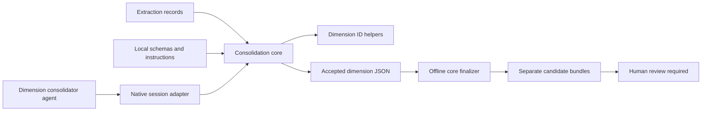

# Author Pattern Consolidation

## Purpose

Consolidation groups [previously extracted observations](./author-extraction.md) for exactly one dimension: `rhetorical`, `epistemic`, `semantic`, or `decisional`. The model proposes a defensible grouping; trusted code verifies its source bindings and exhaustive membership, derives support and IDs, and returns an accepted dimension record. A separate offline finalizer combines all four dimensions into **unreviewed candidate bundles**, not an approved author model.

The current contract is v0.6, with twenty approved articles and at most 240 projected observations per dimension. Technical acceptance establishes structural and provenance constraints; it does **not** establish conceptual similarity, correct grouping, distinctive authorship, or human approval. Sources: `consolidator.mjs`, `patterns.v0.6.schema.json`, and the consolidator agent's instructions.

## Key Files

Paths below are relative to `_scripts/author-extraction/` unless stated otherwise.

| File | Role |
| --- | --- |
| `consolidator.mjs` | Verifies records, projects one dimension, accepts candidates, verifies retained contracts, and assembles final bundles. |
| `consolidator-native.mjs` | Restricts caller identity, binds session state, enforces the single-submit budget, and independently checks core responses. |
| `patterns.v0.6.schema.json` | Self-contained current schema, including candidate shapes, dimension-specific IDs, and compatible final-group forms. |
| `rhetorical.mjs`, `semantic.mjs` | Assign membership-ordered rhetorical IDs and kind-specific semantic IDs. |
| `epistemic.mjs`, `decisional.mjs` | Assign classification-specific IDs with independent subtype counters. |
| `identifiers.mjs` | Formats identifiers according to explicitly retained or newer contract conventions. |
| `.opencode/agents/author-pattern-consolidator.md` | Bounds model access, qualitative judgments, language, and stop conditions. |
| `INTEGRATION.md` | Defines authorized persistence, current dataset selection, and the offline handoff. |

## Public API

### Core functions

Exported by `consolidator.mjs`; `recordsDirectory` is optional trusted caller configuration, not a model-supplied tool field.

| Function | Result |
| --- | --- |
| `prepareConsolidation(repoRoot, dimension, recordsDirectory)` | A `ready` projection with hashes and method metadata, or a `blocked` result with diagnostics. |
| `acceptDimensionCandidate(repoRoot, dimension, corpusHash, inputHash, candidateJson, recordsDirectory)` | Canonical accepted-dimension JSON after reloading and verifying the current inputs. |
| `verifyConsolidationInputs(repoRoot, corpusHash, acceptedDimensionJsons, recordsDirectory)` | Verified records and exactly one accepted record for each of the four dimensions. |
| `finalizeConsolidation(repoRoot, corpusHash, acceptedDimensionJsons, recordsDirectory)` | Canonical final-bundle JSON after input verification and schema validation. |

### Native adapter

`createConsolidationAdapter(coreApi, repoRoot, hostConfig)` exports `prepare`, `submit`, and host-side `abort(sessionId)`. The [model-facing tools](../api/native-author-tools.md) are `author_pattern_consolidation_prepare` and `author_pattern_consolidation_submit`. Only a host context identifying `author-pattern-consolidator`, with a valid session ID, is admitted. There is **no native finalization tool**.

Core and adapter operations return data rather than saving files. The integration guide requires separate authorization to persist the exact accepted `canonical_json`, without reformatting or an added newline, and to retain its native session/message/tool references.

## Dependencies



The core imports `verifyExtractionRecord` from `core.mjs?contract=1.3`, all four ID helpers, Node.js filesystem/path/crypto APIs, and Ajv's JSON Schema 2020 validator. The adapter also uses Ajv and retained schema versions. Neither component performs model inference itself; the agent supplies the qualitative proposal through the native interface. Sources: imports and exports in `consolidator.mjs` and `consolidator-native.mjs`.

## Verified Projection and Input Binding

### Dataset verification

`loadDataset` accepts only the approved extraction-result directories: v1.1 and v1.2 require `A01`–`A12`; v1.3 requires `A01`–`A20`. Records must match their filenames and extraction schema versions. Reads reject unsafe paths and oversized files; every record passes `verifyExtractionRecord` before projection.

The core and adapter default to `docs/author-extraction-results/v1.1`. The current integration explicitly selects `docs/author-extraction-results/v1.3` through host configuration; v1.3 is not an implicit default or a model-controlled path. Sources: `DATASETS`, `loadDataset`, and `approvedConfig`; `INTEGRATION.md`.

Preparation checks **all verified records** for processing eligibility, not merely observations in the requested dimension. Any ineligible record returns `blocked` with per-article `PROCESSING_NOT_TRACKED` or `PROCESSING_INCOMPLETE` diagnostics. Eligibility is an operational receipt, not proof of exhaustive cognitive attention or completed human review. A blocked native session is terminal: neither preparation nor submission can continue in that session. The agent must report diagnostics and stop, not switch directories or reconstruct observations.

### Projection and hashes

`projectObservations` selects only the requested dimension and sorts by observation ID. Each entry carries `observation_id`, `article_id`, `dimension`, `label`, `description`, `inference_kind`, and `evidence_refs` containing the original passage IDs and quotes. The agent must treat this text as untrusted data and preserve IDs, article assignments, and evidence unchanged; it cannot reread posts or borrow another dimension's observations.

The SHA-256 `corpus_hash` binds the sorted article IDs and verified record fingerprints. The `input_hash` additionally binds the dimension, projected observations, and method metadata. Current method metadata identifies `consolidate/6`, `observation-projection/1`, and `author-pattern-consolidator/0.6`, plus schema and instruction hashes. Acceptance recomputes these values from disk and rejects stale inputs with `INPUT_CHANGED`. Sources: `projectObservations`, `currentInputHash`, `readContract`, and `acceptDimensionCandidate`.

## Candidate Contract and Qualitative Boundaries

A candidate contains exactly `groups` and `unclustered_observations`. Every group has a label, description, rationale, variation notes, `abstraction_kind`, and at least two distinct `member_observation_ids`. Unclustered entries contain an observation ID and a nonblank reason. IDs, support mappings, counts, article lists, and provenance are not model-authored candidate fields.

| Dimension | Model-authored distinction |
| --- | --- |
| Rhetorical | Independent `pattern_scope`: `rhetorical_strategy`, `explanatory_device`, `editorial_format`, or `local_content_pattern`; and `author_relevance`: `candidate`, `uncertain`, or `unlikely`. No `classification`. |
| Epistemic and decisional | `classification`: `author_candidate`, `editorial_format`, or `thematic`. |
| Semantic | `semantic_kind`: `concept` or `relation`; no ontology nodes, triples, or newly invented relations. |

`observed_regularities` denotes a directly recurring pattern; `inferred_generalization` makes a higher-level interpretation that must be explicit and bounded in the rationale. Meaningful contextual differences belong in `variation_notes`. The agent writes these proposal texts and unclustered reasons in Italian, while IDs and enumerations remain unchanged.

Rhetorical scope does not determine author relevance: an editorial format may still be a candidate, while a frequent explanatory device may remain uncertain or unlikely. The instructions require a shared operation more specific than the generic presence of examples. Article totals alone establish neither independent evidence nor author distinctiveness; related series parts remain separate articles. Sources: candidate definitions in `patterns.v0.6.schema.json` and the agent instructions.

### Exhaustive membership partition

`validatePartition` requires every projected observation to appear **exactly once** across all groups and unclustered entries. Unknown IDs, wrong-dimension membership, reuse within or across groups, and omissions fail. The adapter independently validates the same partition against its prepared projection.

This is a [structural check](../concepts/governance-and-verification.md), **not a similarity test**. The code does not decide whether two descriptions express the same concept or whether a proposed abstraction is informative. A schema-valid exhaustive partition can still be conceptually poor; cautious model judgment and subsequent human review remain necessary. Sources: `validatePartition`, `validateCandidateAgainstPrepared`, and the agent's rhetorical-specificity instructions.

## Deterministic Accepted Records and IDs

`normalizedGroup` replaces membership IDs with sorted `{ observation_id, article_id }` support from verified observations. It derives `observation_count` from support length and `article_count` from distinct supporting articles. Unclustered article IDs are derived in the same way. Accepted groups may have multiple observations from just one article; finalization handles that distinction separately.

The helpers assign IDs using lexically sorted JSON arrays of supporting observation IDs, not labels, proposal order, locale, or perceived quality:

| Dimension | Current v0.6 ID convention | Ordering and counters |
| --- | --- | --- |
| Rhetorical | `APC::R0001` | Membership order; scope and relevance do not rank IDs. |
| Semantic | `SPC::C0001`, `SPC::R0001` | Kind, then membership; independent concept/relation counters. |
| Decisional | `DPC:A0001`, `DPC:E0001`, `DPC:T0001` | Classification code, then membership; independent A/E/T counters. |
| Epistemic | `EPC:A0001`, `EPC:E0001`, `EPC:T0001` | Classification code, then membership; independent A/E/T counters. |

A/E/T map to `author_candidate`/`editorial_format`/`thematic`. These IDs identify version-local review candidates, not permanent traits, ontology entities, or stable cross-version identities. Changed membership can change numbering.

**Current v0.6 legacy separators are not migrated.** Its observations retain forms such as `A01::O0001`, and rhetorical/semantic groups retain double colons. `identifiers.mjs` explicitly treats extraction v1.1–v1.3 and preparation/dimension v0.1–v0.6 as retained contracts, even though its default convention for newer contracts is a single colon. Its normalization helpers do not migrate artifacts or provenance. Preserve old IDs with their originating versioned record, corpus, and method; never relabel accepted JSON by hand. Sources: the four ID helpers, `identifiers.mjs`, and current schema ID definitions.

## Session Budget, Sealing, and Cancellation

The adapter serializes operations per session while reserving the submit budget before enqueueing validation work.

| Condition | Exact behavior |
| --- | --- |
| Preparation | The agent is instructed to prepare once. The adapter permits repeat ready preparations only without changing the bound dimension, corpus hash, or input hash; this does not reset attempts. |
| Blocked preparation | Sets session status to `blocked`; subsequent prepare or submit calls fail with `PROTOCOL_INVALID`. |
| Empty ready projection | The agent stops without submitting. Native submission rejects it; a parent may accept the empty dimension offline. |
| Submit budget | Exactly one attempt per session. After caller/state/cancellation checks, the counter increments **before** candidate size, input shape, preparation, binding, JSON, schema, partition, or core validation. Such failures consume the attempt. Concurrent submits cannot reserve a second attempt. |
| Rejected submit | Does not seal acceptance, but exhausts the budget; a later active-session submit returns `ATTEMPT_LIMIT`. Agent instructions prohibit repair, retry, or a replacement session. |
| Accepted submit | Only after checking the core's canonical JSON against the candidate and prepared data does the adapter return `{ status: "accepted", canonical_json }`, set `sealed`, and detach cancellation listeners. Subsequent operations fail with `PROTOCOL_INVALID`. |
| Cancellation | An aborted host signal or `abort(sessionId)` sets `aborted` and clears listeners. Further work fails with `CANCELLED`; checks after awaited core calls prevent returning a late result as accepted. The signal is not forwarded to the core as an interruption mechanism. |

Invalid caller context and already blocked, sealed, or aborted state are checked before incrementing the submit counter. Candidate JSON is limited to 256 KiB in UTF-8; prepared and accepted results are limited to 4 MiB, with a separate accepted-envelope size check. The core's strict parser also rejects duplicate object keys. Sources: `createConsolidationAdapter`, its state helpers, `validateAcceptedDimension`, and `parseStrictJson`.

## Offline Finalization and Human Approval

### Accepted files versus final bundles

An accepted dimension file is a separately authorized persisted copy of one native result's `canonical_json`, not its envelope or a final bundle. `finalizeConsolidation` requires exactly four unique accepted dimensions, all matching the current verified corpus and eligible processing state. It rechecks schemas, method/input bindings, source support, partition completeness, derived counts, and applicable ID ordering.

The verifier supports accepted dimension versions v0.1–v0.6 using each version's retained local schemas and instruction snapshot. Compatibility does not bypass source binding: old records must still match their own recomputed input hash and method against the selected current corpus. Retained dimensions need not be rerun merely to update another dimension. The final v0.6 bundle records each dimension's original method in `dimension_methods`. Sources: `CONTRACTS`, `verifyConsolidationInputsImpl`, and `INTEGRATION.md`.

### Candidate assembly

`makeFinalBundle` keeps semantic recurrences separate from author-pattern candidates:

- `author_patterns` contains `patterns`, `editorial_format`, `thematic`, `rhetorical_groups`, and nonsemantic unclustered observations.
- `semantic_recurrences` contains `concepts`, `relations`, and semantic unclustered observations. Recurring subject matter is not silently promoted into an author trait.
- A group supported by fewer than two distinct articles is removed from final groups; its support becomes unclustered with reason `LOCAL_ONLY`.
- Two distinct supporting articles produce `cross_article_candidate`; three or more produce `recurrent_candidate`. These are count-derived labels, not qualitative approvals.
- Retained rhetorical, semantic, decisional, and epistemic groups with assigned IDs keep those IDs. Older groups without those IDs use the finalizer's legacy prefix/dimension counters.
- Every final group has `review_status: "unreviewed"`; lists and support are deterministically sorted.

Offline assembly is deterministic and needs no further model inference. Neither accepted dimension records nor assembled candidate bundles grant human approval or authorize avatar use; review is a separate requirement. Sources: `makeFinalBundle`, `finalGroupFrom`, the current schema, and `INTEGRATION.md`.

## Usage Example

The native adapter delegates validated membership to the core with its host-bound repository, session hashes, and configured dataset; this is the actual call in `consolidator-native.mjs`:

```javascript
const canonicalJson = await coreCall(() => coreApi.acceptDimensionCandidate(
  repoRoot,
  state.dimension,
  state.corpusHash,
  state.inputHash,
  input.candidate_json,
  recordsDirectory,
));
```

The adapter then independently verifies the returned canonical dimension before sealing the session. It does not write a file or invoke the offline finalizer.
