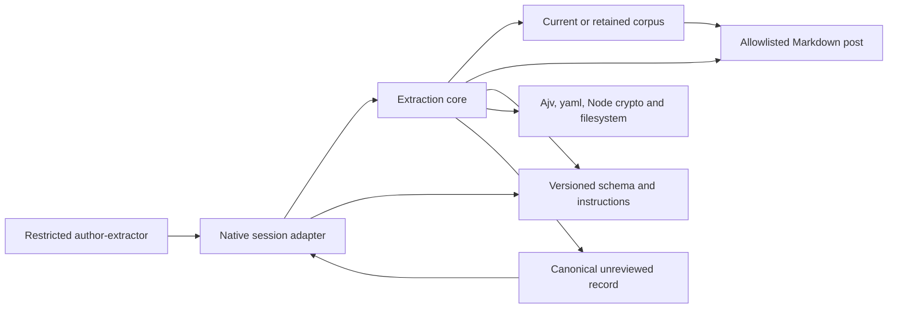

# Author Extraction

## Purpose

The extraction module prepares one approved article, accepts a bounded set of local candidate observations, and verifies retained extraction records. Deterministic code handles source selection, segmentation, hashes, schema validation, literal evidence checks, and derived metadata. The restricted extractor agent proposes observations in four dimensions: `rhetorical`, `epistemic`, `semantic`, and `decisional`.

Acceptance establishes structure and [literal source binding](../concepts/governance-and-verification.md), not semantic entailment, factual truth, exhaustive attention, distinctive author traits, or human approval. Accepted observations remain `unreviewed`. Cross-article consolidation and later human review are separate stages. These boundaries are explicit in `docs/author-extraction.md` and the extractor instructions.

## Key Files

| File | Role |
| --- | --- |
| `_scripts/author-extraction/core.mjs` | Offline preparation, candidate acceptance, retained-record verification, and canonical serialization. |
| `_scripts/author-extraction/native.mjs` | Caller checks, volatile session state, submission budget, cancellation, host receipts, and acceptance-envelope validation. |
| `_scripts/author-extraction/extraction.v1.3.schema.json` | Closed Draft 2020-12 contract for current inputs, prepared data, candidates, records, and receipts. |
| `.opencode/agents/author-extractor.md` | Six-step agent configuration, two permitted tools, article-local inference rules, and recovery limits. |
| `docs/corpus.yaml` | Current `corpus-20/1` declaration, approved ID-to-path mappings, and explicit exclusion. |
| `docs/corpus.v1.2.yaml` | Preserved twelve-article declaration for historical verification. |
| `docs/author-extraction.md` | Workflow contract, recorded run history, retained-version rules, and interpretation limits. |

## Approved Corpus and Governance

Current preparation and submission accept only the fixed IDs `A01`–`A20`. The core resolves paths from `docs/corpus.yaml`; callers cannot submit a source path, body, manifest choice, or repository root through the native tool inputs. The recorded selection is:

| IDs | Recorded subject group |
| --- | --- |
| A01–A03 | Eigenvectors/eigenvalues, community networks, and power laws. |
| A04–A06 | Quantum logic, quantum state space, and the kinetic-energy theorem. |
| A07–A08 | Mechanical state space and the electronvolt. |
| A09–A10 | Home Assistant illuminance and astronomy dashboard, part 1. |
| A11–A12 | Automated Jekyll SEO and project-specific shell history. |
| A13–A17 | Classical/quantum systems, quantum experiments, the photoelectric effect, spin states, and momentum. |
| A18–A20 | Astronomy dashboard parts 2–3 and SEO monitoring, part 2. |

`docs/corpus.yaml` records approval of A13–A20 on **2026-10-14**, preserving the first twelve mappings. That approval covered the additions and rerunning steps 1–2 on all twenty articles; it did not automatically approve the review register or authorize step 3. The manifest retains `revisione_utente_modello_generato: pending`; later workflow history is recorded separately in `docs/author-extraction.md`.

The explicit exclusion is `_posts/3d-printing/2026-06-08-openscad-tutorial-parte-1.md`, recorded as nonrepresentative according to the user's confirmation. Both the approved corpus and this OpenSCAD exclusion are specific editorial governance decisions, not inferred author identity or evidence of exclusive human authorship, absence of AI, or coauthorship.

`parseCorpus` checks declaration structure, exact supported IDs, unique IDs and paths, safe relative paths, representative flags, and exclusion conflicts. It requires every expected ID to be approved. YAML errors, warnings, aliases, and duplicate keys fail closed. These checks validate the declaration, not the human identity or consent behind its wording.

## Public API

### Core operations

The exports in `core.mjs` are asynchronous and receive a trusted repository root from their caller:

| Operation | Result |
| --- | --- |
| `prepareArticle(repoRoot, articleId)` | Prepared v1.3 source/method identity, `input_hash`, complete raw body, passages, and measurements. |
| `acceptCandidate(repoRoot, articleId, inputHash, candidateJson, hostOptions?)` | Canonical final-record JSON string after current-input and evidence checks. |
| `verifyExtractionRecord(repoRoot, recordJson)` | Unchanged parsed record, `record_fingerprint`, `processing_eligible`, and `processing_reason`. |

The core does not enforce an agent identity or session submission counter; those belong to the adapter. Its operations do not call a model/provider and do not persist accepted records. A caller must explicitly retain the authoritative returned JSON outside these operations; assistant prose is not a replacement record.

### Native adapter

`createExtractionAdapter(coreApi, repoRoot)` returns `prepare(input, context)`, `submit(input, context)`, and `abort(sessionId)`. The native module also exports the current `prepareInputSchema` and `submitInputSchema`; `loadPluginSDK()` imports `@opencode/plugin`.

The [native tool contracts](../api/native-author-tools.md) documented in `docs/author-extraction.md` are:

```text
author_extraction_prepare({ article_id })
author_extraction_submit({ article_id, input_hash, candidate_json })
```

`native.mjs` permits only `context.agent === "author-extractor"`, requires a nonblank host `sessionId` of at most 256 characters, and validates an optional cancellation signal. Identity is host context, not a field the model can choose. The agent configuration independently denies all tools except these two. The native success result is `{ status: "accepted", canonical_json: ... }`; rejection or cancellation produces no accepted envelope.

## Dependencies



The eight-node diagram separates the host-controlled session boundary from deterministic file processing. [Ajv's Draft 2020-12 validator](../dependencies/dependency-map.md) performs local schema validation; the core disables coercion, defaults, and extra-property removal. Node filesystem operations enforce root confinement, reject symlink components and cross-device paths, and read regular files only. `yaml` parses corpus and front matter; Node crypto computes SHA-256. Sources and embedded code, markup, or instructions are data, never commands.

## Preparation and Source Identity

### Raw body and passages

`decodeSource` requires valid UTF-8 and an opening `---` line with LF or CRLF, followed by a closing exact `---` line. Front matter is parsed for validity and discarded. The body is the decoded remainder after the closing delimiter and its line terminator, without Markdown rendering, Unicode normalization, whitespace correction, or line-ending normalization.

`splitPassages` splits on blank-line delimiters containing spaces/tabs between LF or CRLF line endings. It retains nonempty raw spans, assigns `P0001` upward, and records `start_cp` inclusive and `end_cp` exclusive as Unicode code-point offsets from the body start. These are citation spans, not semantic Markdown paragraphs; code, equations, and template text remain included.

`measureBody` derives only raw-body UTF-8 bytes, Unicode code points, and nonblank lines. Advanced stylometry is explicitly `{ status: "not_computed", value: null, reason_code: "OUT_OF_SCOPE_V1" }`, not a readability score or author fingerprint.

### Hash binding

The current method uses `author-extraction/1.3`, `prepare/1`, `raw-blank-lines/1`, `raw-body-counts/1`, `author-extractor/1.3`, and `host-session-whole-article/1`.

- `corpus_hash`, `file_hash`, `schema_hash`, and `instructions_hash` are lowercase SHA-256 values over the corresponding raw file bytes.
- `input_hash` hashes UTF-8 compact canonical JSON of exactly `{ source, method }`. Object keys are recursively sorted; array order is preserved.
- Submission rebuilds preparation and compares its hash before checking quote context. Changed source, corpus, schema, or instructions therefore rejects with `INPUT_CHANGED` rather than silently refreshing the candidate.
- Verification returns a `record_fingerprint` over canonical JSON of the complete record; it is record identity, not an authorship fingerprint.

These rules are implemented in `prepareWith`, `acceptCandidate`, and `verifyRecordWith` in `core.mjs`.

## Candidate Contract and Acceptance

The candidate root contains exactly `observations`, with **1–12 observations per article**: at most 240 across twenty articles, not twenty per article. Every observation contains exactly:

| Field | Constraint |
| --- | --- |
| `dimension` | `rhetorical`, `epistemic`, `semantic`, or `decisional`. |
| `label` | Nonblank string, 1–200 characters. Instructions require a nominal summary. |
| `description` | Nonblank string, 1–2,000 characters. Instructions require one article-local proposition. |
| `inference_kind` | `explicit` or `inferred`, qualifying the description. |
| `evidence` | 1–4 objects, each containing only `article_id`, `passage_id`, and a nonblank `quote` of 1–2,000 characters. |

The extractor instructions require Italian labels/descriptions and unchanged literal quotes, including quotes in other languages. Language choice, proposition atomicity, and support for an interpretation are instruction/review responsibilities, not guarantees of schema validation. A `semantic` observation uses the same natural-language shape; it is not an ontology triple or structured rule payload.

Candidates cannot supply IDs, review status, paths, hashes, measurements, processing fields, dimension counts, author traits, or cross-article conclusions. The strict JSON parser rejects duplicate object keys, trailing content, and excessive nesting; it does not repair payloads. An empty observations array receives `NO_OBSERVATIONS`.

After schema and input-hash checks, every evidence quote must be an exact contiguous substring of both the named passage and the raw body, with the same article ID. Excerpts cannot be joined, translated, normalized, or silently corrected. The core then assigns sequential legacy-format IDs such as `A01::O0001`, sets `review_status: "unreviewed"`, and derives all four dimension counts. `not_observed` means this record emitted no candidate for that dimension, not that the article or author lacks it.

## Processing Eligibility and Session Bounds

### Host receipts, not inferred coverage

After a validated prepare result, native submission constructs a closed receipt containing `workflow_version`, `mode: "whole_article"`, host `session_id`, `article_id`, `input_hash`, and `prepare_returned: true`. The model supplies none of these processing fields. The adapter passes the receipt through internal core `hostOptions` and checks that the returned record matches its prepared schema, session, identity, passage totals, and distinct cited-passage count.

With a valid receipt, acceptance emits `processing.status: "complete"` and `article_processed: true`. Direct core acceptance without `hostOptions` emits `not_tracked`, `article_processed: null`, and `receipt: null`. `passages_available` counts prepared spans; `passages_cited` counts distinct cited IDs. Citation incidence cannot establish processing completeness.

`verifyExtractionRecord` rechecks derived counts and source/method-bound receipts. Valid complete whole-article records are processing-eligible; untracked records return `PROCESSING_NOT_TRACKED`. The reserved `per_passage` shape has no producer here and returns `UNSUPPORTED_PROCESSING_MODE` even when its counts are valid. Inconsistent counts or receipts reject rather than being repaired. Operational completeness does not certify exhaustive cognitive attention, semantic correctness, or human approval.

### Limits and recovery

| Boundary | Enforced behavior |
| --- | --- |
| Source | At most 262,144 raw bytes and 512 passages; invalid/oversized input fails without truncation. |
| Candidate | At most 65,536 UTF-8 bytes in the core, in addition to schema character limits. |
| Prepared response | At most 4 MiB serialized UTF-8 JSON. |
| Accepted output / verification input | Record and acceptance envelope each bounded to 1 MiB; record verification accepts at most 1 MiB. |
| Session | One article and one input hash, bound by successful preparation. Repeated same-article prepare cannot reset attempts or accept changed inputs. |
| Submissions | At most two received adapter submits, counted before local input validation; operations are serialized per session. |
| Completion / cancellation | Accepted submission seals the session; abort or cancellation makes it terminal. No automatic replacement or recovery session. |
| Agent turn | Configured for six steps; instructions allow at most one corrected submission using the same prepared article/hash, with no provider fallback or batch. |

The adapter's state is volatile and host-session-keyed. Tool-schema rejection before adapter execution is distinct from a received submit. The six-step turn budget is not a reset of the two-submit session budget. These distinctions are documented in `docs/author-extraction.md` and implemented by the adapter's state queue and attempt counter.

Core failures reject with bounded `Error` metadata (`code`, message up to 240 characters, and at most five detail pointers). Important failures distinguish malformed JSON, schema mismatch, changed input, invalid evidence, invalid derived records, and invalid receipts. Native failures add `AGENT_DENIED`, `PROTOCOL_INVALID`, `ATTEMPT_LIMIT`, and `CANCELLED`.

## Retained Versions and Recorded Results

`verifyExtractionRecord` explicitly supports `author-extraction/1.1`, `/1.2`, and `/1.3`. Historical v1.1/v1.2 verification uses the preserved twelve-entry `docs/corpus.v1.2.yaml`; current v1.3 uses the twenty-entry manifest. A missing archive fallback exists only for older twelve-source fixtures/checkouts, and exact historical IDs still prevent substituting the expanded declaration.

Verification selects the preserved schema, checks its raw-byte hash, source path and corpus/file hashes, raw measurements, sequential IDs, exact evidence, counts, and receipt consistency. It does not compare historical instruction hashes to today's instruction bytes, migrate records, invent receipts, or relabel versions. The native adapter accepts retained v1.2 and current v1.3 prepared/final shapes, requiring the accepted version to match preparation; this is narrower than the core verifier's version support.

The retained extraction 1.1–1.3 contracts preserve double-colon observation IDs despite the documented single-colon default for future contracts. Historical identifiers, source/method hashes, and accepted JSON must remain intact. The earlier prototype `author-extraction/1` is documented history, not a supported current verifier version or an automatically migrated v1.1 record.

As recorded in `docs/author-extraction.md`, the v1.1 records remain source/evidence-valid but untracked; the expanded run used twenty fresh host-tracked v1.3 extractions, with old result files unchanged. Its reports separately record native byte-transfer checks. These are recorded facts, not a fresh pipeline verification: producer truncation flags, local tests, and exact transfer alone do not prove model attention or entailment. Combining twelve historical receipts with eight additions cannot substitute for the documented full v1.3 rerun.

## Source Example: Exact Quote Validation

The following actual validation branch from `core.mjs` illustrates the mechanical guarantee and its limit: it tests literal membership, not whether a quote entails the observation's description.

```javascript
      if (evidence.article_id !== prepared.source.article_id || !passages.has(evidence.passage_id) ||
        !passages.get(evidence.passage_id).includes(evidence.quote) || !prepared.body.includes(evidence.quote)) {
        fail("EVIDENCE_INVALID", "Evidence must quote the current article passage exactly.", [
          `/observations/${observationIndex}/evidence/${evidenceIndex}`,
        ]);
      }
```
