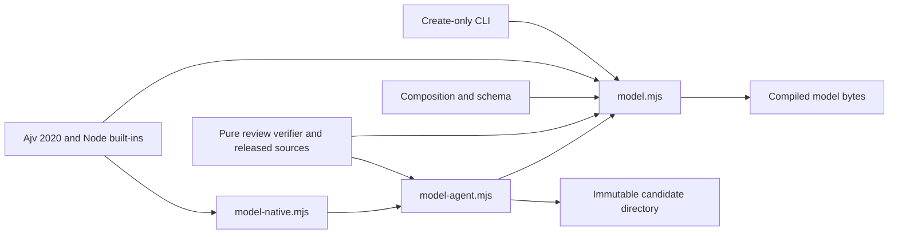

# Author Model Compiler

## Purpose

Step 4 composes **29 approved author patterns into six operational principles, four contextual profiles, six optional-use devices, and ten guardrails**, with three optional conceptual contexts. The output is `docs/author-pattern-results/v1.3/author-model.json`, using `author-model/1`. This is compact coordination, not another extraction, clustering pass, semantic merge, or per-pattern review. The [completed 52-decision review](./author-review.md) and original evidence membership remain unchanged.

The synthesis has the explicit status `compiled_synthesis_not_separately_human_reviewed`. Its sources are human-reviewed; the composition is not a new human approval, proof of stable personality, or a guarantee of semantic entailment. Source applicability and review notes remain authoritative if a compressed instruction seems broader. The module does not generate prose, select a provider, deploy a runtime, or publish to the website. A later task-specific runtime consumes the governed model.

Sources: `docs/author-model.md:3–33,184–207`; `model.mjs:225–254`.

## Key Files

Paths below are relative to `_scripts/author-extraction/` unless prefixed with `docs/`.

| File | Role |
| --- | --- |
| `model.mjs` | Read-only compiler, strict composition parser, lineage validator, canonical serialization, and provenance generation. |
| `author-model.schema.json` | Closed Draft 2020-12 contracts for authored compositions and compiled models. |
| `author-model.composition.json` | Checked-in, completed-review-bound synthesis, including contextual qualifications. |
| `compile-author-model.mjs` | Create-only CLI for the current artifact, or exact-byte verification with `--check`. |
| `model-agent.mjs` | Verified preparation projection and separate hash-addressed candidate persistence. |
| `model-native.mjs` | Host-identity checks, bounded tool schemas/results, session protocol, cancellation, and safe errors. |
| `docs/author-model.md` | Operational contract and documented verification boundaries. |
| `docs/author-pattern-results/v1.3/author-model.json` | Current compiled model, provenance, and complete 29-entry source ledger. |
| `docs/author-identifiers.md`, `docs/author-runtime.md` | Legacy-source preservation and canonical downstream identifier bindings. |

## Dependencies



The nine-node diagram separates compilation from writing: `model.mjs` returns bytes without filesystem writes; the CLI writes the current artifact, while `model-agent.mjs` writes only candidates. Internal dependencies include the pure `applyAuthorReview` verifier in `review.mjs`. External dependencies are Ajv's 2020 implementation and Node filesystem, path, crypto, assertion, and URL APIs.

Sources: imports and exports in `model.mjs`, `model-agent.mjs`, `model-native.mjs`, and `compile-author-model.mjs`.

## Coordinated Composition

### Principles and primary ownership

| ID | Operational purpose | Primary sources |
| --- | --- | --- |
| P01 | Orient exposition and practical adequacy to the actual purpose; do not turn project sufficiency into arbitrary scientific tolerance. | 3 |
| P02 | Calibrate claims, preferences, time dependence, information loss, and informative limits. | 6 |
| P03 | Explain grounded connections, historical antecedents, analogies, and contrasts without forced equivalence. | 4 |
| P04 | Coordinate models, appropriate formalism, hypothetical scenarios, and worked calculations. | 6 |
| P05 | Balance resource reuse, simplicity, optimization, and targeted adaptability. | 4 |
| P06 | Accompany the reader without imposing a rhetorical outline or serial template. | 6 |

Every approved author source belongs to **exactly one primary principle**. The same ID can also support a contextual rule, device, or guardrail, but these secondary uses do not become independently counted principles. Devices must reference their sources' primary principles; profiles must retain the primary principle of each contextual rule's sources. Missing coverage, overlapping primary ownership, ineligible lineage, duplicate component IDs, and dangling references fail validation.

Sources: `author-model.composition.json:4–41`; `model.mjs:131–183`.

### Profiles, devices, and guardrails

| Profile | Activation and limits |
| --- | --- |
| C01 — Scientific explanation | Physical/mathematical connections, necessary dimensional balance, and variable-condition extensions apply only to relevant scientific passages. Approximation tolerance depends on the problem, not personal preference. |
| C02 — Projects and tutorials | Motivate a real need or curiosity and a sufficient result; coordinate reuse, simplicity, and adaptability. Alternatives to external dependencies are conditional, not mandatory. Scientific formalism is not automatically imported. |
| C03 — Scope and planned continuations | Distinguish an informative omission, an internal deferral, and a genuinely planned later article. A topic or omission does not imply a series. |
| C04 — Restricted applications | Activate only the relevant phase-portrait, lighting-model, social-network analogy, or classical/quantum logic-or-measurement rule. These restrictions constrain broader P02/P03 wording. |

| Device | Selective use |
| --- | --- |
| D01 | A transition question that the following passage actually addresses. |
| D02 | A hypothetical scenario or a useful numerical calculation; these are distinct uses, not interchangeable evidence. |
| D03 | An explicit mathematical connection, historical antecedent, structural analogy, or bounded contrast. |
| D04 | Proportionate colloquial reassurance or a familiar reference, without assuming the reader's fear or education. |
| D05 | A real project motivation or a relevant application/consequence, without inventing a problem. |
| D06 | Informative delimitation or an explicitly planned continuation, never an obligatory ending. |

| Guardrail | Constraint |
| --- | --- |
| G01 | Contextual selection, not a checklist, fixed position, or rhetorical quota. |
| G02 | No invented biography, assumed shared discomfort, or disparagement of the reader. |
| G03 | Do not fabricate certainty, doubt, requirements, or equivalence between different information losses. |
| G04 | A connection, analogy, history, or numerical example is not proof or general validation. |
| G05 | Delimitations must be informative; do not omit essential steps or demand exhaustive caveats. |
| G06 | No automatic sequel: require a real plan and do not invent its content, destination, or timing. |
| G07 | Alternatives must be useful and supported; a placeholder does not restore original information or guarantee continuity. |
| G08 | No premature optimization, forced reuse, indiscriminate data collection, or flexibility added for its own sake. |
| G09 | Formalism and explanatory scaffolding are not imitation rituals; preserve their scientific scope. |
| G10 | Preserve local applicability and visible single-article support without claiming independent recurrence. |

Hypothetical scenarios are favored in scientific explanation and less frequent in tutorials; they do not replace operational instructions. Informative omissions must never imply that the reader could not understand. Article-local support does not itself narrow an explicitly approved broader formulation, such as resource reuse. Neither profiles nor devices impose a mandatory article outline.

Sources: `author-model.composition.json:42–227`; `docs/author-model.md:46–78`.

### Optional semantic context

The three semantic entries are S01 (bounded invariance, `SPC::C0001`), S02 (state spaces and representations, `SPC::C0002`), and S03 (a modeled system versus its associated object, `SPC::R0001`). Each has `optional: true` and `usage: "conceptual_context_only_not_style"`. They apply only when the actual discussion needs those concepts; they do not insert topics or metaphors into unrelated writing. State space and phase space are not universal synonyms, and system/object distinctions are not universal identity or separation claims.

With `includeSemanticContext: false`, the output has an empty semantic array and `reviewed_semantic_model: null` provenance. The released semantic output file is not required in that mode, but the underlying frozen review is still verified. Operative principles, profiles, devices, and guardrails remain unchanged.

Sources: `author-model.composition.json:229–247`; `author-model.schema.json:63–71`; `model.mjs:185–209,225–241`.

## Complete Source Index and Identifier Policy

`source_index` is a lineage ledger, **not another 29-rule instruction list**. The following table accounts for every entry in the current model. All have `generative_utility: usable`. Dimensions follow the source prefix: DPC is decisional, EPC epistemic, and APC rhetorical. “A/O” means article/observation counts. Row `i` supplies `entry_pointer: /reviewed_entries/i` and `applicability_pointer: /reviewed_entries/i/applicability`; audit index `a` supplies `review_notes_pointer: /audit/a/review/notes` in the hash-bound reviewed-author artifact.

| i | Source ID | Primary | Decision | Relevance | Risk | A/O | a |
| --- | --- | --- | --- | --- | --- | --- | --- |
| 0 | `DPC:A0001` | P05 | accept | contextual | medium | 2/2 | 0 |
| 1 | `DPC:A0002` | P05 | accept | contextual | low | 3/3 | 1 |
| 2 | `DPC:E0001` | P06 | accept | contextual | medium | 4/5 | 2 |
| 3 | `DPC:E0002` | P06 | accept | contextual | high | 2/2 | 3 |
| 4 | `DPC:T0003` | P04 | revise | contextual | medium | 2/2 | 6 |
| 5 | `DPC:T0005` | P05 | revise | contextual | high | 2/3 | 8 |
| 6 | `DPC:T0008` | P04 | revise | contextual | medium | 2/2 | 11 |
| 7 | `DPC:T0009` | P05 | revise | high | medium | 1/2 | 12 |
| 8 | `EPC:A0001` | P01 | accept | contextual | medium | 4/5 | 14 |
| 9 | `EPC:E0001` | P02 | accept | high | low | 2/2 | 15 |
| 10 | `EPC:T0001` | P02 | accept | contextual | medium | 3/3 | 16 |
| 11 | `EPC:T0003` | P02 | accept | contextual | medium | 2/2 | 18 |
| 12 | `EPC:T0008` | P02 | accept | contextual | low | 1/3 | 23 |
| 13 | `EPC:T0009` | P04 | revise | contextual | low | 1/2 | 24 |
| 14 | `EPC:T0010` | P02 | accept | contextual | low | 1/2 | 25 |
| 15 | `EPC:T0011` | P02 | accept | contextual | low | 2/2 | 26 |
| 16 | `EPC:T0014` | P04 | revise | contextual | low | 1/2 | 29 |
| 17 | `APC::R0001` | P06 | accept | contextual | medium | 4/4 | 30 |
| 18 | `APC::R0002` | P03 | accept | contextual | low | 2/2 | 31 |
| 19 | `APC::R0003` | P06 | accept | high | low | 5/5 | 32 |
| 20 | `APC::R0004` | P01 | accept | contextual | low | 2/2 | 33 |
| 21 | `APC::R0005` | P03 | accept | contextual | low | 2/2 | 34 |
| 22 | `APC::R0006` | P03 | accept | contextual | medium | 1/2 | 35 |
| 23 | `APC::R0007` | P06 | accept | contextual | high | 2/2 | 36 |
| 24 | `APC::R0008` | P03 | accept | contextual | medium | 2/2 | 37 |
| 25 | `APC::R0010` | P04 | revise | contextual | medium | 2/2 | 39 |
| 26 | `APC::R0011` | P06 | accept | contextual | medium | 2/2 | 40 |
| 27 | `APC::R0012` | P04 | accept | contextual | low | 2/2 | 41 |
| 28 | `APC::R0013` | P01 | accept | contextual | medium | 4/4 | 42 |

The six entries with one article retain `support_scope: single_article`; all others retain `multiple_articles_not_proof_of_independence`. [Counts and qualitative relevance, utility, and risk annotations](../concepts/governance-and-verification.md) are preserved, not converted into scores, inferred thresholds, or automatic exclusions. Notes belonging only to rejected/discarded groups do not become new principles.

New contracts use single-colon IDs such as `APC:R0001` and `SPC:C0001`. This immutable v1.3 composition and model retain exact legacy `APC::…` and `SPC::…` source IDs; EPC/DPC already use one colon. Neither compiler nor child silently normalizes them. The downstream runtime uses canonical single-colon references with `provenance.source_pattern_bindings` pointing to exact JSON locations in the hash-bound legacy model. This is a binding layer, not a rewrite. A future source migration must update structured references and provenance together and reject alias collisions.

Sources: `docs/author-pattern-results/v1.3/author-model.json:548–985`; `model.mjs:212–223`; `docs/author-identifiers.md:20–52`; `docs/author-runtime.md:161–174`.

## Public API

| Export | Behavior |
| --- | --- |
| `validateAuthorModelComposition(composition, sources, schema)` | Pure schema, binding, compactness, coverage, ownership, and reference validation; returns source-to-primary ownership. A supplied allowlist is not authenticated by this helper. |
| `compileAuthorModel(repoRoot, compositionJson, options = {})` | Re-verifies fixed reviewed sources; returns `source_review_hash`, canonical `author_model_json`, SHA-256, and component counts. Only boolean `includeSemanticContext` is supported, defaulting to true. No filesystem writes. |
| `prepareAuthorModelCandidate(repoRoot, includeSemanticContext = true)` | Returns the complete verified projection, composition schema, method fingerprints, review hash, and `input_hash`. Read-only. |
| `submitAuthorModelCandidate(repoRoot, sourceReviewHash, inputHash, candidateJson, options)` | Re-prepares, rejects changed inputs, compiles, checks bindings again, and saves separate immutable candidate artifacts. Options carry the semantic choice and cancellation signal. |
| `createModelAdapter(core, repoRoot)` | Exposes `prepare`, `submit`, `abort`, and `dispose` under trusted per-session state. |
| `modelToolResult(value)` | Serializes complete bounded text with `metadata.truncated: false`, rejecting oversized output. |
| `modelPrepareInputSchema`, `modelSubmitInputSchema` | Closed native input schemas; submit requires both exact prepared hashes and a composition JSON string. |

Sources: exported definitions in `model.mjs`, `model-agent.mjs`, and `model-native.mjs`.

## Compilation and Candidate Lifecycle

### Deterministic core and current-artifact CLI

The compiler reads fixed, bounded, non-symlink inputs and uses the pure review verifier to reconstruct reviewed outputs. Released author bytes, and semantic bytes when included, must match exactly. `source_review_hash` is the canonical **completed-review** hash, not the earlier `review_source_hash` frozen-input binding.

Composition JSON rejects duplicate keys, excessive depth, and input over 128 KiB. Ajv validates closed fields without coercion, defaults, or field removal; schema references must be local static references. The number of principles must be smaller than the approved author-source count. Semantic lineage is kept separate from operative author lineage.

The result is canonically key-sorted JSON with a trailing newline and a 128 KiB bound. Provenance records compiler, schema, canonical composition, and included reviewed-source hashes, without timestamps or new judgments. The CLI exclusively creates the fixed current-model path; it never overwrites it. `--check` recompiles in memory and compares exact bytes without writing. Changed inputs can make the current artifact stale; that is not authorization to replace it.

Sources: `model.mjs:33–127,185–254`; `compile-author-model.mjs:7–33`; `docs/author-model.md:21–27`.

### Fresh bounded native synthesis

The native child performs fresh synthesis from the prepared approved formulations, applicability, review notes, qualitative annotations, and support counts—not from previous models, posts, rejected notes, or a rerun of the fixed composition. The [real host agent](../api/native-author-tools.md) must be `author-model-compiler`; an argument naming that role does not grant access.

Preparation is read-only and bounded to 256 KiB. Its `input_hash` binds the full projection, reviewed-source fingerprints, compiler, schema, agent instructions, preparation implementation, and semantic option. The adapter serializes calls within a trusted session, binds the semantic option on first preparation, and requires preparation before submission. It permits at most two received submissions: one rejection can be corrected once against the same preparation. A successful session is sealed; changed inputs block it, and cancellation aborts it rather than silently restarting.

Submission re-prepares and rechecks the compiled bindings before persistence. The separate destination is:

```text
docs/author-pattern-results/v1.3/author-model-candidates/<input_hash>/<author_model_sha256>/
```

It contains `preparation.json`, `composition.json`, `author-model.json`, and `manifest.json`, written in that order. Existing identical artifacts are idempotent; differing bytes, symlinked destinations, or collisions fail rather than overwrite. Exclusive file creation and final read-back checks protect persisted bytes. Cancellation can leave incomplete candidate files; a complete `compiled_candidate` receipt establishes persistence, not human review or publication approval.

**Native submission never promotes a candidate or changes the current composition/model.** Selection and promotion require a separate explicit coordinator action. The native review-apply gate remains unchanged and fail-closed; no promotion tool, arbitrary source path, or `--force` switch is introduced.

Sources: `model-agent.mjs:42–86,104–172`; `model-native.mjs:122–206`; `docs/author-model.md:115–171`.

## Usage Example

The existing documentation specifies these commands from `_scripts/author-extraction/`:

```sh
npm run compile:author-model
npm run check:author-model
```

The first creates the current artifact only when absent; the second only checks it. The documented semantic-free variant uses `node compile-author-model.mjs --without-semantic-context`, with the same option required for its corresponding `--check` run. These examples describe existing entrypoints; no command execution is needed to read or document the module.

The CLI delegates to the core using this actual source line:

```js
const result = await compileAuthorModel(root, composition, { includeSemanticContext: !args.includes("--without-semantic-context") });
```

Sources: `docs/author-model.md:86–113`; `compile-author-model.mjs:15`.

## Verification Boundaries

- **Offline reproducibility:** the deterministic compiler and exact-byte check establish artifact consistency with fixed inputs. Structural validation proves binding, lineage, coverage, and reference properties—not semantic entailment, faithful paraphrase of every nuance, stable personality, or a new human approval.
- **Fixture/VM evidence:** `docs/author-model.md` reports full-payload executor comparisons and candidate persistence tests. Complete bounded producer output is not proof of live-host byte-level transfer, provider attention, or refreshed tool catalogs in an already-running session.
- **Native smoke evidence:** the documented real child smoke was preparation-only: `ready`, 29 author patterns, and three semantic sources, with hashes matching fresh offline preparation. It made no submission and created no real-workspace candidate directory. It does not certify end-to-end native synthesis or persistence.
- **Operational boundary:** unavailable child/tools require a fresh project session, not shell access or another role as a fallback. A saved candidate is neither a promoted current model nor permission to publish.

These are distinct evidence categories; this documentation pass does not rerun tests, builds, pipeline operations, or native synthesis.

Sources: `docs/author-model.md:164–203`.
