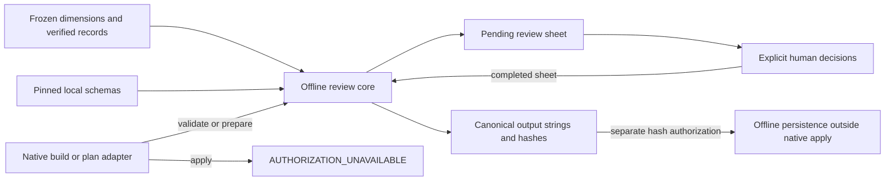

# Author Review

## Purpose

Author review is the human-curated step between [consolidated candidates](./author-consolidation.md) and downstream author-model composition. It preserves the original evidence while recording explicit decisions about correctness, applicability, and adoption. It does not perform extraction, reclustering, authorship testing, personality inference, or voice-prompt generation.

The current artifacts document **52 completed human decisions, 29 approved author-pattern entries, and three retained semantic entries**. These are existing artifact facts documented in `docs/author-extraction.md`, not a newly executed review or recomputation. The reviewed outputs were generated separately offline under explicit authorization of the canonical completed-review hash; their existence does not mean native apply is enabled.

## Key Files

| File | Role |
| --- | --- |
| `_scripts/author-extraction/review.mjs` | Offline verification, pending-sheet preparation, completed-decision checks, and pure transformations. |
| `_scripts/author-extraction/review-native.mjs` | Host identity/input guards, bounded responses, cancellation, and unconditional native apply denial. |
| `_scripts/author-extraction/author-review.schema.json` | Closed Draft 2020-12 contracts for bindings, decisions, merges, reports, and outputs. |
| `docs/author-extraction.md` | Workflow, historical preparation state, current completion status, and authorization limitations. |
| `docs/author-pattern-results/v1.3/author-pattern-review.json` | Completed source-bound sheet, immutable context, decisions, and merge specifications. |
| `docs/author-pattern-results/v1.3/reviewed-author-patterns.json` | Reviewed non-semantic entries plus full audit and evidence context. |
| `docs/author-pattern-results/v1.3/reviewed-semantic-model.json` | Reviewed corpus concepts/relations, semantic audit, and merge lineage. |

## Public API

### Offline core

All three exports in `review.mjs` are asynchronous and read repository-bound inputs without writing or publishing files.

| Function | Result |
| --- | --- |
| `validateAuthorPatterns(repoRoot)` | `author-pattern-validation/1` report with binding, per-dimension group/observation/evidence/unclustered counts, and totals. It verifies sources, not human correctness. |
| `prepareAuthorReview(repoRoot)` | Complete pending sheet as pretty-printed JSON text with a final newline. Every decision field starts as `null`; `semantic_merges` starts empty. |
| `applyAuthorReview(repoRoot, completedReviewJson)` | `author-review-transformation/1` object containing canonical reviewed-output JSON strings, their SHA-256 values, and source/completed-review hashes. This is a pure transformation, not release authorization. |

### Native adapter

`createReviewAdapter(coreApi, repoRoot)` exposes `validate`, `prepare`, `apply`, and `dispose`. [Native tools](../api/native-author-tools.md) are `author_patterns_validate({})`, `author_review_prepare({})`, and `author_review_apply({})`. Arguments must be an empty plain object: callers cannot select a root, identity, source path, or review file.

Only the **actual host identities `build` and `plan`** are allowlisted for native validation/preparation. Merely describing an agent as a planner or orchestrator does not grant access. With otherwise valid context, unauthorized callers receive `AGENT_DENIED` before core work. Context requires a host session ID; cancellation and disposal invalidate operations, with checks before and after asynchronous core execution.

## Dependencies



The core uses Node.js crypto/filesystem/path APIs and local Ajv 2020 validation. `verifyConsolidationInputs` re-verifies the accepted dimensions and extraction records; `prepareArticle` restores cited passage context from matching source articles. No model/provider request participates in these mechanical operations.

## Immutable Inputs and Hashes

### Frozen source binding

`loadReviewInputs` pins the four v1.3 dimension files, raw pattern schema, review schema, twenty-record corpus, and original consolidation method. It checks exact source-file bytes, each dimension's `input_hash`, common method, verified accepted content, matching source-article hashes, and cited passage availability. File reads reject symlinks, cross-device paths, non-files, paths escaping the trusted root, and oversized inputs. UTF-8 decoding is fatal; review JSON rejects duplicate keys and excessive nesting. Schema compilation permits only local references and does not coerce values, fill defaults, or remove extra properties.

The binding includes the consolidation corpus hash, four ordered source descriptors, method, review contract version, and raw/review schema hashes. Its `review_source_hash` is SHA-256 of the canonical binding **before** that hash field is added. The retained value is:

```text
d8b3cf7c11e9328e37fbad296741e069b0c15a7ca0f12b1ad59be5cefa9223e6
```

Equal dimension input hashes alone do not prove equal groupings: exact source-file hashes also bind the accepted grouping. Stale or edited source-bound fields are rejected, not repaired.

### Input hash versus completed-review hash

| Identifier | What it identifies |
| --- | --- |
| `binding.review_source_hash` / output `review_source_hash` | Frozen review inputs and contract, not completed decisions or human release consent. |
| `completed_review_hash` | SHA-256 of the entire canonical completed sheet, including decisions, notes, applicability, revisions, and merges. Both reviewed outputs carry it in provenance. |
| Downstream `source_review_hash` | The canonical completed-review identity used for downstream composition; it must not be confused with the frozen-input `review_source_hash`. The review transformation itself calls this identity `completed_review_hash`. |

Canonical serialization recursively sorts object keys, preserves array order, and emits compact JSON. Formatting-only changes do not change the completed-review identity; changing review content does. [Separate offline release authorization](../concepts/governance-and-verification.md) must refer to the **exact canonical completed-review hash**, not the input-binding hash or the pretty-printed file's raw-byte hash.

## Human Decision Contracts

### Coverage and read-only context

The sheet reviews every original group, including local/single-article groups: 13 rhetorical, 16 epistemic, nine semantic, and 14 decisional. The documented snapshot includes 16 single-article groups, 217 observations, 246 evidence references, 229 cited passage contexts, and 86 raw unclustered observations. These are coverage facts, not measures of independence, correctness, or author distinctiveness.

Application rebuilds the pending sheet and compares `schema_version`, `binding`, `candidates`, `observation_index`, `passage_context_index`, and `unclustered_coverage` canonically. Only review decisions and explicit semantic merge specifications are editable. Exactly one completed decision is required for each original `(dimension, source_pattern_id)` pair; missing, duplicate, unknown, or null decisions fail. Observation and passage indexes supply context, not additional review rows. Original observations retain their `unreviewed` status rather than being rewritten by group approval.

### Rhetorical, epistemic, and decisional groups

Every completed row records `correctness: yes | partial | no`, independently of its adoption decision. `notes` may be nonblank text or `null`.

| Decision | Contract and output effect |
| --- | --- |
| `accept` | Keep the candidate formulation; `revision` must be `null`. Require nonblank applicability and explicit relevance, utility, and risk assessments. Emit a reviewed author entry. |
| `revise` | Require a dimension-specific revision making at least one effective change, plus the same applicability and assessments. Emit revised fields with unchanged source ID and support. |
| `reject` | Emit no reviewed entry. Applicability, revision, relevance, utility, and risk must be `null`; retain the decision in the audit. |
| `defer` | Also emit no reviewed entry, preserving the distinct human decision in the audit with the same null-field requirements as rejection. |

Human assessments use `author_relevance: high | contextual | none`, `generative_utility: usable | descriptive_only | none`, and `overuse_risk: low | medium | high`. They are explicit qualitative judgments, not hidden approval thresholds. The rhetorical candidate's original `author_relevance` remains immutable and distinct from the review-row assessment and `pattern_scope`.

Revisions supply label and description and may change the permitted abstraction/type field: rhetorical `pattern_scope`, epistemic/decisional `classification`, or `abstraction_kind`. Null optional type/abstraction values retain the original. A no-op revision is invalid. A decisional entry whose effective classification remains `thematic` cannot be approved: it needs a supported non-thematic revision or rejection/deferral. Other dimensions are not silently filtered by classification or article count.

### Semantic groups and merges

Semantic review records correctness, applicability, and notes, without the author-pattern relevance/utility/risk assessments.

| Decision | Contract and output effect |
| --- | --- |
| `retain` | Require applicability; revision and merge key are null. Emit the original formulation. |
| `revise` | Require applicability and an effective revision of label, description, abstraction, or semantic kind. Preserve original support and source lineage. |
| `discard` | Emit no semantic entry; applicability, revision, and merge key are null. Preserve the audit record. |
| `merge` | Each participant supplies the same explicit `merge_key`; its applicability and revision are null. One merge specification supplies the resulting formulation and applicability. |

A merge specification names at least two distinct **original semantic groups**, all consenting through matching `merge` decisions. Keys must be unique, participants cannot overlap, and every consenting participant must appear exactly once in its specification. Support is the union of whole, disjoint source groups: partial membership, unclustered additions, duplicate observations, merge chains, and invented permanent semantic IDs are not permitted. Cross-kind merges are allowed when the specification explicitly supplies the final `semantic_kind`. Results retain sorted original `source_pattern_ids` as lineage.

The current sheet has no merges. It retains `SPC::C0001` (invariance), `SPC::C0002` (state-space representations), and `SPC::R0001` (system/object distinction); other semantic groups are discarded. Retention supplies corpus conceptual context, not a general author trait or scientific truth certification.

## Transformations and Evidence Preservation

The core returns two separate, schema-validated transformations:

- **Reviewed author patterns:** only accepted/revised non-semantic groups enter `reviewed_entries`. Its audit preserves every original candidate snapshot and completed decision, including semantic and rejected groups.
- **Reviewed semantic model:** retained/revised/merged groups become `corpus_concept` or `corpus_relation` entries according to their effective semantic kind. Its audit covers semantic decisions and preserves merge specifications.

Both outputs retain the full observation and passage-context indexes and source/completed-review provenance. Candidate rationales and variation notes remain accessible in audit snapshots; raw unclustered coverage remains in the immutable completed sheet. Effective revisions do not manufacture observations or broaden documentary support. The core sorts support by observation ID and derives `observation_count`, distinct `article_count`, and per-article `local_incidence` from that support, including after merges.

Single-article approval is permitted but is not evidence of recurrence. For example, the broader author-declared revisions of `EPC:T0009`, `EPC:T0014`, and `DPC:T0009` retain their original local support. The declaration of wider practice belongs to human review notes; it is not a newly verified cross-article finding. Series relationships, shared topics, and common editorial conventions can also confound apparent recurrence.

Rejected groups stay excluded from approved entries even when correctness is `yes` or notes contain separate author statements. In particular, the rejected `DPC:T0010` does not become an adopted human-control policy, and the additional tutorial-verification statement in rejected `EPC:T0013` does not reverse that rejection. Evidence preservation is not permission to promote rejected material into downstream rules.

## Authorization and Failure Boundaries

For an allowed, active host caller with valid empty input, **native apply always throws `AUTHORIZATION_UNAVAILABLE`**. It does not call `coreApi.applyAuthorReview`, create a preview, write a file, or publish anything. Unauthorized callers instead fail the earlier `AGENT_DENIED` guard. An ordinary permission grant, identity string, boolean, token, or supplied hash is not hash-bound human consent.

The implementation in `review-native.mjs` is explicit:

```javascript
async apply(input, context) {
  checkContext(context, disposed);
  checkInput(input);
  ensureActive();
  throw failure("AUTHORIZATION_UNAVAILABLE", AUTHORIZATION_MESSAGE);
},
```

The existing reviewed JSON files were produced through separately authorized offline processing after the human decisions were completed. That historical release neither enables native auto-apply nor authorizes regeneration. `docs/author-extraction.md` preserves the earlier pending-phase instructions alongside the later completion statement; the former must not be read as the current artifact state.

Core failures distinguish invalid bindings/immutable inputs, malformed JSON, incomplete review, schema errors, ineffective decisions, and invalid merges. Inputs, core results, and transformations are bounded to 8 MiB; native tool envelopes are bounded to 16 MiB and declare `metadata.truncated: false`. Safe errors expose bounded messages and at most five JSON pointers rather than evidence excerpts. These checks do not certify semantic entailment or actual native transfer. The documented runtime has no claimed successful allowed native prepare/authorization-UI path; observed denied calls establish guard reachability only.
