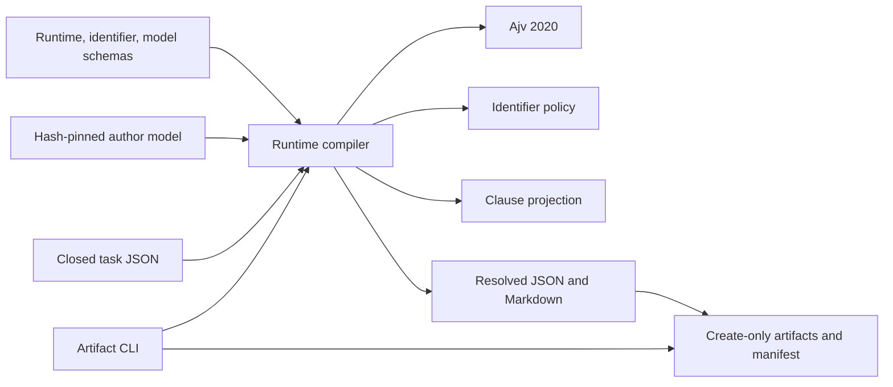

# Author Runtime

## Purpose

The author runtime compiler turns the [governed author model](./author-model.md) and an explicit task brief into a compact, standalone operational profile. It selects existing instructions and lineage rather than extracting, consolidating, or reviewing patterns again. Its structured JSON and rendered Markdown can accompany writing or revision material without requiring the consumer to load the complete model.

The core API is read-only; a separate CLI materializes bounded artifacts. Compilation does not generate posts, select a provider, publish content, or prove that an LLM follows the resulting instructions. The current payload is `author-runtime-profile/1`, produced by `author-runtime-compiler/1.1`.

Sources: `docs/author-runtime.md`; `_scripts/author-extraction/runtime.mjs`.

## Key Files

| File | Role |
| --- | --- |
| `_scripts/author-extraction/runtime.mjs` | Safe input reading, validation, deterministic selection, rendering, hashing, and recompilation-based verification. |
| `_scripts/author-extraction/runtime-guardrails.mjs` | Version-local applicability rules and operative-clause projection for linked guardrails. |
| `_scripts/author-extraction/compile-author-runtime.mjs` | Create-only artifact writer and CLI argument handling. |
| `_scripts/author-extraction/author-runtime-profile.schema.json` | Closed task/profile contracts, device statuses, lineage, and compiler-version requirements. |
| `_scripts/author-extraction/identifiers.mjs` | Canonical formatting, retained-contract compatibility, and alias-collision checks. |
| `_scripts/author-extraction/identifiers.schema.json` | Canonical identifier syntax; not migration or source-eligibility authorization. |
| `docs/author-runtime.md` | Runtime usage, governance, compatibility, and documented test scope. |
| `docs/author-identifiers.md` | Identifier retention and future migration boundaries. |

## Public API

| Export | Behavior |
| --- | --- |
| `readAuthorRuntimeInput(repoRoot, relative, limit)` | Reads bounded, valid UTF-8 from a repository-relative regular file; rejects traversal, symlinks, and unsafe paths. Default limit: 16 KiB. |
| `compileAuthorRuntimeProfile(repoRoot, taskJson)` | Validates source and task, resolves the profile, and returns JSON, Markdown, their SHA-256 hashes, component counts, runtime ID, and guardrail resolution. Writes nothing. |
| `verifyAuthorRuntimeProfile(repoRoot, profileJson)` | Recompiles the supplied task context under the current policy and compares the complete canonical profile. |
| `projectRuntimeGuardrails(model, task, linkedIds, principleIds, deviceIds)` | Returns projected mandatory guards, candidate-resolution records, and the planning prohibition. |
| `materializeAuthorRuntime(repoRoot, taskRelative, { checkOnly })` | Creates or verifies the profile, instructions, and manifest at the derived runtime directory. |
| `main(args)` | Accepts exactly one `--task <repository-relative.json>` and an optional single `--check`. |

Sources: the three runtime `.mjs` files listed above.

## Dependencies



Internal dependencies are the identifier and guardrail policies plus the fixed model at `docs/author-pattern-results/v1.3/author-model.json`. [External dependencies](../dependencies/dependency-map.md) are Ajv's draft-2020 validator and Node.js filesystem, path, URL, and cryptographic APIs. The runtime restricts schema references to local definitions and the registered identifier schema; it does not fetch remote schemas.

Sources: imports and `validators()` in `runtime.mjs`; imports in `compile-author-runtime.mjs`.

## Task Contract and Deterministic Routing

### Closed task context

`TaskContext` rejects additional properties. It requires `mode`, `content_type`, `language`, and a nonblank `objective`; optional fields cover audience, topic, constraints, series context, explicit features, local topics, semantic topics, and device requests. Supported modes are `generate`, `rewrite`, `expand`, and `review`.

- `mixed` requires two or three distinct `mixed_content_types` chosen from `scientific_explainer`, `project_article`, and `tutorial`. This list is forbidden for other types; mixed does not activate every profile automatically.
- Although `other` is a schema enum value, normalization fails with `RUNTIME_CONTEXT_UNSUPPORTED`: there is no approved routing for it.
- A planned continuation requires `continuation_topic`. Series membership alone does not imply a plan, and a standalone article may explicitly plan a follow-up.
- A nonempty `semantic_topics` array requires a nonblank `topic`. Device IDs may appear only once in `device_requests`.

Strict JSON parsing rejects duplicate keys, excessive nesting, malformed input, and tasks larger than 16 KiB. Normalization sorts selection arrays, supplies empty optional arrays, and defaults series flags to false; validation runs before and after normalization. Free text in the objective, topic, or constraints is not keyword-classified into routing signals.

Sources: `author-runtime-profile.schema.json`; `strictJson()`, `normalizeTask()`, and `compileAuthorRuntimeProfile()` in `runtime.mjs`.

### Profiles and principles

`buildProfile()` derives routing from declared content types, feature enums, local topics, and series flags:

| Profile | Activation |
| --- | --- |
| `C01` | The declared types include `scientific_explainer`. |
| `C02` | The declared types include `project_article` or `tutorial`. |
| `C03` | Series membership, an explicitly planned continuation, or scientific writing with `scope_delimitation`. |
| `C04` | At least one explicit local topic. Only the corresponding local rules are selected. |

Principle selection starts with fixed source-pattern activations, adds patterns for explicit task conditions, and includes principles referenced by selected devices. It then intersects those principle IDs with the principles permitted by active profiles. Contextual rules have their own explicit condition checks; activating a profile does not copy every rule it contains.

There are no top-k scores or rhetorical quotas. Conditional principle clauses retain their scope, and mentioning a device inside a principle does not activate that device.

Sources: `buildProfile()` in `runtime.mjs`; `docs/author-runtime.md`.

### Device eligibility and status

A device must both belong to an active profile and satisfy its activation condition. Examples of routing offers include `D01` as an available question device, `D05` as preferred for practical writing, `D02` for a declared hypothetical scenario or numerical calculation, and `D06` for a planned continuation or scientific scope delimitation. `D03` depends on mathematical/historical connections or the relevant local analogy/contrast; `D04` requires scientific writing with a familiar reference.

| Status | Meaning | Recorded basis |
| --- | --- | --- |
| `available` | May be used; not an instruction to include it. | `context_available` |
| `preferred` | Favor when useful, but still conditional. | `context_preference` or explicit `task_preference` |
| `required` | An explicit requirement of this task. | `task_requirement` only |

Context never creates `required` automatically. An explicit `device_requests` entry can change an already eligible device's status; it cannot bypass eligibility. An ineligible request fails with `RUNTIME_DEVICE_INELIGIBLE` instead of inventing a calculation, connection, or sequel.

Source: device planning in `buildProfile()`; device definitions in `author-runtime-profile.schema.json`.

## Mandatory Guardrail Projection

Selection first forms the candidate guardrail closure from active profile links, selected device links, and guards sharing source-pattern lineage with selected principles or devices. `projectRuntimeGuardrails()` then resolves applicable clauses; linkage identifies candidates, not permission to copy every clause regardless of context.

All projected clauses are mandatory and take precedence over devices. Guardrails have no status or optional field. Compiler revision 1.1 requires `source_clause_ids`, such as `G04:C03`, and restricts each projection's lineage to its selected clauses. Unknown guardrails, missing clause policies, or newly introduced source lineage fail closed.

The manifest accounts for every linked candidate using `projected`, `covered_by_prohibition`, or `not_applicable`, with clause IDs and runtime targets. In particular:

- The planning prohibition appears once in `runtime_instructions.prohibitions`. Without a plan it forbids announcing a continuation; with a plan it forbids inventing undeclared dates, destinations, or details. Covered `G06` clauses point there rather than duplicating the same instruction.
- `G04` projects only applicable analogical, historical, numerical, practical-relevance, or quantum-contrast cautions.
- `G05` preserves essential-step and non-exhaustive-limits cautions, adding omission or lighting-model clauses only when applicable.
- `G10` has no operative row without an active local topic; when projected, it mentions only the selected domains.

Resolved principle reminders and the `D03` instruction also avoid reintroducing inactive local examples. This is contextual applicability, not brevity-based removal: excessive output size causes failure rather than dropping mandatory constraints.

Sources: guardrail selection and text resolution in `runtime.mjs`; `runtime-guardrails.mjs`; `docs/author-runtime.md`.

## Optional Conceptual Context

Explicit `semantic_topics` map `invariance`, `state_space`, and `system_object_distinction` to retained contexts `S01`–`S03`. Each selected item has `optional: true` and `usage: "conceptual_context_only_not_style"`. These are conceptual aids, not style, metaphor inventories, or obligations to discuss a topic.

Changing only semantic selection does not change profiles, principles, devices, guardrails, or style directives. Without a declaration the semantic array is empty. The compiler validates the declaration's shape but cannot establish its truth from the free-text brief. Semantic `SPC` lineage is kept separate from operative author-pattern lineage.

Sources: semantic selection in `runtime.mjs`; `author-runtime-profile.schema.json`; `docs/author-runtime.md`.

## Governance, Identifiers, and Artifact Lifecycle

### Exact source binding and retained lineage

Routing is pinned to the governed model's exact SHA-256:

```text
88d622c01aee9e0dafa44a2966ebbbe63ff8249336eb0e861da13c157051f8b5
```

The compiler also validates the model against its schema and verifies that schema's fingerprint against model provenance. A changed model fails with `RUNTIME_SOURCE_UNSUPPORTED`; future promotion requires explicit routing-policy review rather than assuming that component IDs retain their meanings.

New runtime references use canonical single-colon IDs. `canonicalIdentifier()` converts only whole recognized identifiers; `canonicalIdentifierMap()` rejects definitions that would collapse onto one canonical identity. `provenance.source_pattern_bindings` maps every used canonical ID to an exact JSON pointer in the hash-bound model.

Legacy extraction contracts 1.1–1.3 and pattern dimension/preparation contracts 0.1–0.6 retain their declared formatting. Their source artifacts keep original IDs, bytes, and hashes. Canonical pointers preserve lineage without rewriting those artifacts; the helpers do not authorize migration or global separator replacement.

Sources: `runtime.mjs`; `identifiers.mjs`; `identifiers.schema.json`; `docs/author-identifiers.md`.

### Create-only outputs and hashes

The runtime ID binds the model/review source, normalized task hash, compiler implementation fingerprint, and schema fingerprints. The implementation fingerprint includes `runtime.mjs`, `identifiers.mjs`, and `runtime-guardrails.mjs`. It is an input binding, not a self-hash of the generated payload.

The CLI derives `docs/author-pattern-results/v1.3/author-runtimes/arp-<lowercase-id>/` and manages exactly:

- `author-runtime-profile.json`: canonical structured profile with resolved text and provenance;
- `author-runtime-instructions.md`: escaped, quoted brief summary plus operative instructions;
- `manifest.json`: exact profile/instructions hashes, paths, versions, counts, and guardrail resolution.

Payload hashes live in the manifest, not inside the files they hash. Identical reruns are idempotent. Existing different bytes cause `RUNTIME_COLLISION`; new files use exclusive creation, and persisted bytes are checked afterward. Symlink destinations are rejected. `--check` writes nothing and fails if expected artifacts are missing. There is no force/replacement or arbitrary-output-path option.

Sources: hashing and rendering in `runtime.mjs`; `materializeAuthorRuntime()` in `compile-author-runtime.mjs`.

## Usage Example

The minimal task documented in `docs/author-runtime.md` is:

```json
{
  "mode": "generate",
  "content_type": "tutorial",
  "language": "it",
  "objective": "Spiegare una configurazione riutilizzabile senza introdurre complessità non necessaria."
}
```

The same document provides these commands for an existing explicit scientific task:

```sh
npm --prefix _scripts/author-extraction run compile:author-runtime -- --task _scripts/author-extraction/fixtures/runtime-tasks/A08-scientific-units.json
npm --prefix _scripts/author-extraction run check:author-runtime -- --task _scripts/author-extraction/fixtures/runtime-tasks/A08-scientific-units.json
```

## Verification and Evidence Boundaries

`verifyAuthorRuntimeProfile()` recompiles the embedded task and compares the entire canonical result, not merely schema validity. Edited selections, device requirements, applicable clauses, planning prohibitions, or provenance are rejected with `RUNTIME_PROFILE_CHANGED`. JSON and Markdown must each remain within 48 KiB, and JSON must be smaller than the governed model.

The payload schema still recognizes retained compiler revision 1 alongside 1.1. However, current semantic verification recompiles an old profile under the **current** compiler and projection policy; it does not replay the historical implementation. Changed fingerprints produce a new runtime ID/directory. Old promoted profiles, instructions, hashes, and manifests remain untouched; a current check expects current artifacts rather than overwriting historical ones.

`docs/author-runtime.md` describes seven source-backed fixture cases for approved articles A02, A07, A08, A09, A10, A13, and A20. Their documented checks cover source-byte hashes, selection, statuses, guardrail resolution, semantics, standalone text, size, lineage, determinism, tampering, and create-only materialization. They are [selection and prompt-materialization tests](../concepts/governance-and-verification.md), not a generated-prose benchmark, new pattern review, proof of scientific truth, human authorship, or independent LLM adherence.

Sources: `compileAuthorRuntimeProfile()` and `verifyAuthorRuntimeProfile()` in `runtime.mjs`; `compile-author-runtime.mjs`; `author-runtime-profile.schema.json`; `docs/author-runtime.md`.
