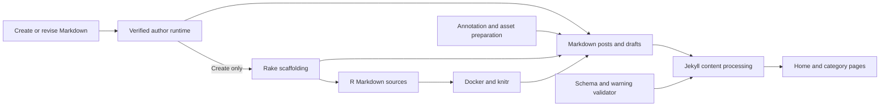

# Blog Content

## Purpose

This module organizes the blog's technical tutorials, project articles, and scientific explainers. Markdown posts are Jekyll inputs; [R Markdown sources](./r-publishing.md) support executable analysis and generate Markdown counterparts. The authoring commands normally produce Italian content, independently of this English documentation.

Scaffolding a post, promoting a local draft, deploying the site, and [broadcasting to social channels](./social-broadcast.md) are separate operations. Neither creating a file under `_posts/` nor running Rake `publish` performs a Git commit, push, deployment, or social broadcast. Sources: `Rakefile`, `.opencode/commands/create-post.md`, and `docs/post-authoring.md`.

## Key Files

| File | Role |
|------|------|
| `Rakefile` | Creates Markdown/R Markdown skeletons, promotes Markdown drafts, and invokes knitting. |
| `_config.yml` | Defines Jekyll processing, permalinks, pagination, exclusions, and content defaults. |
| `frontmatter-schema.yml` | Documents metadata fields and their intended types and semantics. |
| `_plugins/validate.rb` | Performs warning-oriented metadata checks after Jekyll reads posts. |
| `index.html` | Renders paginated post previews and unpublished-status styling. |
| `_pages/fisica.html` | Declares a category landing page for `Fisica`. |
| `.opencode/commands/create-post.md` | Governs new Markdown authoring through verified runtime preparation. |
| `.opencode/commands/revise-post.md` | Prepares an existing Markdown article for revision and a current editorial comparison; does not run Rake. |
| `.opencode/commands/annotate-post.md` | Stages semantic/link/image annotations, screenshot capture, optional hero selection, and reviewable social copy. |
| `_layouts/post.html`, `_includes/image_credit.html` | Render optional hero attribution after article content. |
| `_drafts/batterie-home-assistant-ricarica-stimata.md` | Authored example of hero credit, channel copy, and a result screenshot; not validation evidence. |
| `.opencode/commands/create-rmd.md` | Describes separate R Markdown authoring and subsequent knitting. |
| `R/includes/template.Rmd` | Supplies R Markdown frontmatter and shared setup. |
| `R/build_one.R` | Generates Markdown, SVG figures, Liquid image tags, and computation metadata. |

## Content Organization and Naming

The categories accepted by `/create-post` map to directories through lowercase conversion, whitespace trimming, and replacement of spaces with hyphens:

| Category | Post directory |
|----------|----------------|
| `3D Printing` | `_posts/3d-printing/` |
| `DevOps` | `_posts/devops/` |
| `Fisica` | `_posts/fisica/` |
| `Home Assistant` | `_posts/home-assistant/` |
| `Meccanica` | `_posts/meccanica/` |
| `Reti Sociali` | `_posts/reti-sociali/` |

Published-source filenames follow `YYYY-MM-DD-<slug>.md`; drafts use `_drafts/<slug>.md` without a category subdirectory or date prefix. R Markdown scaffolds use the corresponding `.Rmd` extension. The command derives kebab-case slugs using lowercase ASCII letters, digits, and hyphens, with keyword/stopword guidance and a `-parte-N` suffix for series parts. Rake itself requires an explicit slug argument: it does not implement that derivation or validate the command's category allowlist. Sources: `Rakefile` and `.opencode/commands/create-post.md`.

Jekyll uses `/:slugified_categories/:title/` permalinks, ten posts per pagination page, and the `Europe/Rome` timezone. Future-dated posts are disabled by default. Post defaults supply the `post` layout, author profile, reading time, sharing, related content, and a sticky table of contents; `_pages` defaults instead use the `page` layout unless overridden. `_pages/fisica.html` explicitly selects `layout: category`, identifies `category: Fisica`, and exposes `/fisica`.

The [home page](../components/site-presentation.md) iterates over `paginator.posts`, displays titles and excerpts, selects card imagery from `master` or `header.overlay_image`, and includes post status and pagination. It marks draft/future previews when such entries are present in the paginator; that presentation logic does not itself enable their inclusion. Sources: `_config.yml` and `index.html`.

## Public API

### Rake Tasks

| Task | Arguments | Result |
|------|-----------|--------|
| `post` | `title, category, slug` | New `_posts/<category>/YYYY-MM-DD-<slug>.md`. |
| `draft` | `title, category, slug` | New `_drafts/<slug>.md`. |
| `publish` | `draft` path | Copies draft content to a dated category post, then deletes the draft. |
| `new_rmd` | `title, category, slug` | New dated `.Rmd` under `_posts/<category>/`, copied from the R template. |
| `new_rmd_draft` | `title, category, slug` | New `_drafts/<slug>.Rmd` from the same template. |
| `knit` | `.Rmd` path | Uses Docker to generate a `.md` alongside the input. |

Creation tasks reject an existing target. `post` and `draft` use exclusive file creation. `post` and `new_rmd` accept `ENV["date"]` as a date override; `publish` always uses the current date. Unlike `draft`, `new_rmd_draft` does not create the `_drafts` directory, so that directory must already exist. Source: `Rakefile`.

### Governed Markdown Authoring

[`/create-post`](./governed-post-authoring.md) must call `author_post_prepare` before creating a file or writing its body. Preparation verifies a task-specific author runtime, invokes Rake `post` or `draft`, and activates instruction injection for that session. The agent writes only the newly returned `target_path`, then calls `author_post_finish` with `written` or `cancelled`. Finishing ends injection; it neither publishes nor removes files.

- An unspecified destination means **draft**. A non-draft post requires an explicit request; the command also routes series parts numbered above one to drafts.
- This integration covers **new `.md` files only**, not overwriting or promoting existing drafts.
- Failed or unavailable preparation stops the command; direct Rake execution is not an authorized fallback within `/create-post`.
- Injection does not transfer to subagents. `/create-rmd`, revisions of existing articles, and draft publication do not automatically inherit this integration.
- Runtime receipts and hook application establish preparation/context handling, not factual accuracy, editorial approval, or prose compliance.

These boundaries come from `.opencode/commands/create-post.md` and `docs/post-authoring.md`; standalone Rake tasks remain a separate interface.

### Explicit Revision of Existing Articles

`/revise-post` requires its own `author_post_revision_prepare` call **before editing one existing Markdown article** under `_drafts/` or a supported `_posts/` category. It supplies the unchanged target path, a `rewrite` or `expand` task, and 2–4 comparable approved articles from `docs/corpus.yaml` with literal body excerpts. Preparation snapshots the original and activates this session's runtime; it neither edits the article nor runs Rake. It does not rename, promote, or recreate the target. Failed or unavailable preparation means stop, not reuse an earlier creation receipt.

After preparation, revise only the target and preserve existing user changes. Voice-only revisions preserve code, formulas, IDs, images, links, and verified facts unless explicitly asked otherwise; they do not authorize changes to Home Assistant or other live systems. Before finishing:

1. Call `author_post_editorial_prepare` for the current article hash and comparison schema.
2. Submit a reasoned, quote-grounded comparison with `author_post_editorial_submit`; correct remaining issues and repeat after any further article edit.
3. Keep the runtime active throughout writing and comparison, then call `author_post_finish` with `written`, or `cancelled` if abandoned. Accepted comparisons remain candidate editorial judgments, not voice certification or human approval.

*[Context injection]* (see [Glossary](../glossary.md)) ends on successful `written` completion. Corrections after creation or revision finishes require **new revision preparation**, regardless of profile text remaining in the chat; activation is not inherited by subagents. Neither command automatically annotates, commits, publishes, deploys, or broadcasts. Sources: `.opencode/commands/create-post.md:61–67`, `.opencode/commands/revise-post.md`.

## Frontmatter

Both Markdown scaffolds write YAML between `---` delimiters with the following initial values:

| Field | Scaffold value or purpose |
|-------|---------------------------|
| `category`, `title` | Supplied arguments; the title is serialized with `to_json`. |
| `excerpt` | Empty string to complete during authoring. |
| `master` | `/assets/images/posts/<slug>.png`; scaffolding does not create the image. |
| `image_meta` | `role: illustration`, `context: ambient`, empty caption. |
| `header.overlay_filter` | `0.5`. |
| `broadcast.channels` | `[linkedin,mastodon]`. |
| `broadcast.sent` | `false`; configuration, not an instruction to send immediately. |
| `intended_audience` | `practitioner`. |
| `proficiency_level` | `intermediate`. |

The command subsequently fills the excerpt, tags, and [declared conceptual, technical, and mathematical difficulty](../components/semantic-metadata.md). `frontmatter-schema.yml` additionally describes prerequisites, imagery, canonical URLs, broadcast overrides, series metadata, and associated 3D assets. These documented fields are not all emitted by the initial scaffold. Sources: `Rakefile`, `frontmatter-schema.yml`, and `.opencode/commands/create-post.md`.

### Hero Credit and Channel Copy

The *[Frontmatter]* (see [Glossary](../glossary.md)) reference also defines metadata added after scaffolding:

| Field | Purpose |
|-------|---------|
| `image_credit.author`, `author_url` | Optional photographer/creator name and profile/page URL. |
| `image_credit.source`, `source_url` | Optional source name and URL; generic, not restricted to Unsplash. |
| `broadcast.<channel>.text` | Authored channel copy excluding the article URL, stored as a literal paragraph block. LinkedIn and Mastodon are documented mappings. |
| `broadcast.<channel>.hashtags` | Optional array appended with the URL by the broadcast pipeline. |

`_layouts/post.html` includes `_includes/image_credit.html` after the body. The include emits a credit line when `author` or `source` is Liquid-truthy, with optional links from their corresponding URLs; this is not nonblank-field or image validation. Attribution is separate from hero alternative text. See [Site Presentation](../components/site-presentation.md#hero-credits-and-alternative-text) for rendering details; annotation should not duplicate the credit in the body.

Authored text allows review before pushing; it does not send a post or set `broadcast.sent`. Channels without usable text retain pipeline generation, and final URL/hashtag assembly or length trimming can change the outgoing text. See [Social Broadcast](./social-broadcast.md#copy-selection-and-social-voice). Sources: `frontmatter-schema.yml:48–61,124–131`, `_layouts/post.html:40–48`, `_includes/image_credit.html`, `.opencode/commands/annotate-post.md:173–267`.

### Series Membership Is Not a Continuation Plan

`series.id`, `title`, `part`, and optional `total_parts` describe membership and navigation among posts. The schema documents build-time grouping by series ID and date ordering. Include only known metadata: neither membership nor a part number authorizes inventing a total, announcing a sequel, or creating additional parts automatically. Runtime `series_context.is_series` is distinct from `planned_continuation`; an explicitly planned continuation requires a `continuation_topic`. Sources: `frontmatter-schema.yml`, `.opencode/commands/create-post.md`, and `docs/author-runtime.md`.

### Validation Limits

`_plugins/validate.rb` reads recognizable declarations from the reference schema and checks loaded posts at the `post_read` hook. It logs warnings for selected required fields, enums, numeric types/ranges, local image existence, broadcast channels, and a series part exceeding its total. It skips children of missing parents and does not comprehensively validate array items, every type, or conditional requirements. Its warning path does not deliberately fail the build. Treat it as **warning-oriented checking, not full schema enforcement**; a lack of warnings is not proof that all documented requirements hold.

## Annotation and Asset Preparation

`/annotate-post` is a separate, explicitly requested pass after article review, not automatic continuation of creation or revision. Its command stages changes in memory, preserves code fences and existing Liquid annotations, and uses the [Wikidata oracle](../api/wikidata-oracle.md) for bounded semantic retrieval and proposal checks. Sources: `.opencode/commands/create-post.md:280–281`, `.opencode/commands/revise-post.md:91–94`, `.opencode/commands/annotate-post.md`.

### Staging and Final Article Write

The command reads the original bytes, freezes a concept registry, and opens a snapshot-bound oracle run. It requires accepted validation of a draft changing only `difficulty_computed.semantic` and `knowledge_prerequisites`, then carries those two fields unchanged through the remaining annotations. Acceptance covers that semantic draft, not the later transformed document or semantic truth.

Before writing, close/reap the run, confirm closure, and reread the article against the opened snapshot. A change requires stopping and starting a fresh run. Otherwise write the fully composed article exactly once, immediately after the final check. **This single final article write is not a transaction with earlier asset writes or external service actions**: captured/downloaded images or service side effects may already exist if the article is not written. Sources: `.opencode/commands/annotate-post.md:47–112,269–274`.

### Screenshots and Optional Hero

- **Screenshot placeholders:** inline `<!-- screenshot: <url> | <what to show> -->` markers, including newly suggested live-page visuals, are capture instructions. Use the URL from the article/request; ask for an unknown base URL rather than guessing.
- **Authentication handoff:** before the first screenshot, use Chrome DevTools MCP on the origin to check sign-in. Continue if authenticated; otherwise stop and let the user sign in, asking at most once per run.
- **Targeted capture and review:** locate the requested element and save the next free `assets/images/<slug>-<n>.png`. If no element matches, ask instead of taking a whole-page image. The loose-text fallback uses a temporary viewport image outside the repository, crops to the target, and deletes the raw capture. Inspect/crop the result, replace the placeholder with an annotated `cloudinary` tag, and list saved paths for the user's privacy review before committing.
- **Best-effort Unsplash hero:** search only when **both `master` and `header.overlay_image` are absent**, not when an existing path points to a missing file. Skip and report after two unsuccessful queries. A selected landscape photo is saved as `assets/images/posts/<slug>.jpg`, centre-cropped to 16:9, resized to at most 2400 pixels wide, and stripped of metadata. The command instructs a `track_download` call, sets `master`, and adds `image_meta` plus generic `image_credit`; the caption includes the returned attribution text for hero alt text. An existing `master` without `image_meta` instead receives descriptive metadata.

Rake still scaffolds a `.png` `master` path **without generating an image**. That populated field does not itself trigger the absent-hero branch, even if the file is missing; resolve missing scaffold imagery separately. These instructions do not certify screenshot privacy, licensing, or successful download tracking. Sources: `Rakefile:36–40,74–78`, `.opencode/commands/annotate-post.md:139–214,307–316`.

### Offline Social Copy

Annotation drafts reviewable copy only when `broadcast` is a mapping and `broadcast.sent` is not `true`. Use configured channels, defaulting to LinkedIn and Mastodon if absent, and handle only channels described by `SOCIAL_COPY_PROMPT` in `_scripts/broadcast.py`. That prompt—not article voice or the author runtime—governs social tone. **Keep existing `broadcast.<channel>.text` untouched**, including manual edits; leave `channels`, `sent`, and `*_image` settings unchanged.

New text uses YAML `|-` paragraph blocks, excludes the article URL, and avoids repeating appended hashtags already used inline. Respect `text_budget(channel, url)` for the eventual URL and hashtags as well as the body, since pipeline overflow can shorten reviewed wording. Report each channel as written, kept, or skipped; preparing copy does not invoke a broadcast. See [Social Broadcast](./social-broadcast.md#authoring-time-copy). Source: `.opencode/commands/annotate-post.md:224–267`.

## R Markdown Counterparts

`/create-rmd` creates only an `.Rmd`, through `new_rmd` or `new_rmd_draft`; knitting follows review rather than happening automatically. The command file still uses legacy underscore spellings such as `/create_rmd` and `/create_post`, but it is separate from the governed `/create-post` runtime flow. Source: `.opencode/commands/create-rmd.md` and `docs/post-authoring.md`.

Rake copies `R/includes/template.Rmd` and substitutes the title and category; the draft task also resets tags. The template contains this frontmatter verbatim:

```yaml
title: ""
excerpt: ""
category: ""
tags: []
header:
  overlay_filter: 0.5
  overlay_image: /assets/images/
  teaser: /assets/images/
editor_options:
  chunk_output_type: inline
```

Its setup loads `pacman`, `tidyverse`, and `rprojroot`, sets SVG output with a transparent background, hides code/messages/warnings by default, enables caching, and optionally sources the shared blog theme. Unlike Markdown scaffolding, it does not initially contain broadcast or audience defaults. Source: `R/includes/template.Rmd`.

`rake knit` calls `R/build_one.R` in `gabrielebaldassarre/knitr:latest` with the input and same-stem Markdown output. The script emits Cloudinary Liquid image tags and injects `_computation` metadata, including R version, detected packages/data sources, render timestamp, and graphics device. Its figure directory is `assets/figures/<derived-slug>/`, where the derived slug removes the content-root prefix and extension and replaces remaining slashes with hyphens. This differs from the older `assets/images/<slug>-<name>.svg` convention stated in the command file. `_config.yml` excludes `*.Rmd`, so the generated `.md`, rather than the executable source, is the Jekyll content input.

## Local Draft Promotion

Rake `publish` reads a draft, extracts a `category:` line with a regular expression, derives its basename by removing `.md`, and writes unchanged content to `_posts/<normalized-category>/<today>-<basename>.md`. It refuses a missing input, absent category, or existing destination, then deletes the original draft after writing. This is a local copy-and-delete operation, not a Git move or deployment. Source: `Rakefile`.

The task is designed for Markdown drafts and does not coordinate an `.Rmd`/`.md` pair or its generated figures. Its category extraction is not a YAML parser and retains quotes in the matched value; review quoted metadata before relying on the resulting directory name. Do not treat `publish` as an R Markdown publication workflow or a broadcast trigger.

## Dependencies



Markdown creation and explicit revision prepare their own verified runtimes; only creation invokes Rake. The separate R Markdown command invokes its Rake scaffolds directly. Annotation prepares metadata, assets, and social copy separately. Internal dependencies include frontmatter conventions, the R template/build script, and Jekyll views. External dependencies include Ruby/Rake for scaffolding, Jekyll/Kramdown for content processing, and Docker/R/knitr/svglite for executable content; annotation may also use Chrome DevTools and Unsplash MCP tools. Sources: `Rakefile`, `_config.yml`, `R/build_one.R`, and the authoring command files.

## Usage Example

These examples are recorded in the `Rakefile` comments; they illustrate separate operations, not a single end-to-end sequence:

```sh
rake post["My Title","DevOps","my-slug"]
rake draft["My Draft","DevOps","my-draft-slug"]
rake publish["_drafts/my-draft.md"]
rake new_rmd["Reti Smallworld - Analisi Quantitativa","Reti Sociali","reti-smallworld-analisi-quantitativa"]
rake knit["_posts/reti-sociali/2018-08-17-reti-smallworld.Rmd"]
```

For governed `/create-post` authoring, use the command's preparation lifecycle instead of running these creation tasks as a fallback. Review content and assets separately before any deployment or broadcast.

### Authored Metadata Example

`_drafts/batterie-home-assistant-ricarica-stimata.md` records a `.jpg` hero at `/assets/images/posts/batterie-home-assistant-ricarica-stimata.jpg`, photographer/source credit, and LinkedIn/Mastodon `text` and `hashtags` while retaining `sent: false`. Its result-image tag references `/assets/images/batterie-home-assistant-ricarica-stimata-1.png` with screenshot role, result context, alt text, and caption. These are authored inputs, not evidence that the annotation workflow, external tracking, or live rendering succeeded.

The draft also retains publication/review TODOs alongside its technical claims. This page does not verify its Home Assistant implementation or reported tests, inspect image privacy, or certify licensing. No tests, builds, or service actions were performed for this documentation update. Source: `_drafts/batterie-home-assistant-ricarica-stimata.md`.
