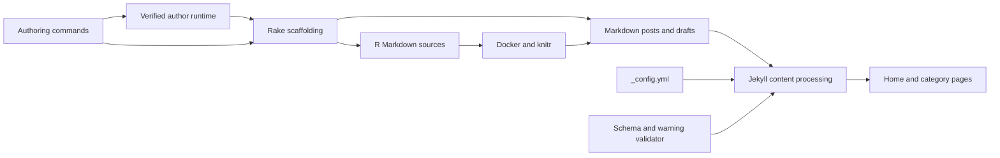

# Blog Content

## Purpose

This module organizes the blog's technical tutorials, project articles, and scientific explainers. Markdown posts are Jekyll inputs; [R Markdown sources](./r-publishing.md) support executable analysis and generate Markdown counterparts. The authoring commands normally produce Italian content, independently of this English documentation.

Scaffolding a post, promoting a local draft, deploying the site, and [broadcasting to social channels](./social-broadcast.md) are separate operations. Neither creating a file under `_posts/` nor running Rake `publish` performs a Git commit, push, deployment, or social broadcast. Sources: `Rakefile`, `.opencode/commands/create-post.md`, and `docs/post-authoring.md`.

## Key Files

| File | Role |
|------|------|
| `Rakefile` | Creates Markdown/R Markdown skeletons, promotes Markdown drafts, and invokes knitting. |
| `_config.yml` | Defines Jekyll processing, permalinks, pagination, exclusions, and content defaults. |
| `frontmatter-schema.yml` | Documents metadata fields and their intended types and semantics. |
| `_plugins/validate.rb` | Performs warning-oriented metadata checks after Jekyll reads posts. |
| `index.html` | Renders paginated post previews and unpublished-status styling. |
| `_pages/fisica.html` | Declares a category landing page for `Fisica`. |
| `.opencode/commands/create-post.md` | Governs new Markdown authoring through verified runtime preparation. |
| `.opencode/commands/create-rmd.md` | Describes separate R Markdown authoring and subsequent knitting. |
| `R/includes/template.Rmd` | Supplies R Markdown frontmatter and shared setup. |
| `R/build_one.R` | Generates Markdown, SVG figures, Liquid image tags, and computation metadata. |

## Content Organization and Naming

The categories accepted by `/create-post` map to directories through lowercase conversion, whitespace trimming, and replacement of spaces with hyphens:

| Category | Post directory |
|----------|----------------|
| `3D Printing` | `_posts/3d-printing/` |
| `DevOps` | `_posts/devops/` |
| `Fisica` | `_posts/fisica/` |
| `Home Assistant` | `_posts/home-assistant/` |
| `Meccanica` | `_posts/meccanica/` |
| `Reti Sociali` | `_posts/reti-sociali/` |

Published-source filenames follow `YYYY-MM-DD-<slug>.md`; drafts use `_drafts/<slug>.md` without a category subdirectory or date prefix. R Markdown scaffolds use the corresponding `.Rmd` extension. The command derives kebab-case slugs using lowercase ASCII letters, digits, and hyphens, with keyword/stopword guidance and a `-parte-N` suffix for series parts. Rake itself requires an explicit slug argument: it does not implement that derivation or validate the command's category allowlist. Sources: `Rakefile` and `.opencode/commands/create-post.md`.

Jekyll uses `/:slugified_categories/:title/` permalinks, ten posts per pagination page, and the `Europe/Rome` timezone. Future-dated posts are disabled by default. Post defaults supply the `post` layout, author profile, reading time, sharing, related content, and a sticky table of contents; `_pages` defaults instead use the `page` layout unless overridden. `_pages/fisica.html` explicitly selects `layout: category`, identifies `category: Fisica`, and exposes `/fisica`.

The [home page](../components/site-presentation.md) iterates over `paginator.posts`, displays titles and excerpts, selects card imagery from `master` or `header.overlay_image`, and includes post status and pagination. It marks draft/future previews when such entries are present in the paginator; that presentation logic does not itself enable their inclusion. Sources: `_config.yml` and `index.html`.

## Public API

### Rake Tasks

| Task | Arguments | Result |
|------|-----------|--------|
| `post` | `title, category, slug` | New `_posts/<category>/YYYY-MM-DD-<slug>.md`. |
| `draft` | `title, category, slug` | New `_drafts/<slug>.md`. |
| `publish` | `draft` path | Copies draft content to a dated category post, then deletes the draft. |
| `new_rmd` | `title, category, slug` | New dated `.Rmd` under `_posts/<category>/`, copied from the R template. |
| `new_rmd_draft` | `title, category, slug` | New `_drafts/<slug>.Rmd` from the same template. |
| `knit` | `.Rmd` path | Uses Docker to generate a `.md` alongside the input. |

Creation tasks reject an existing target. `post` and `draft` use exclusive file creation. `post` and `new_rmd` accept `ENV["date"]` as a date override; `publish` always uses the current date. Unlike `draft`, `new_rmd_draft` does not create the `_drafts` directory, so that directory must already exist. Source: `Rakefile`.

### Governed Markdown Authoring

[`/create-post`](./governed-post-authoring.md) must call `author_post_prepare` before creating a file or writing its body. Preparation verifies a task-specific author runtime, invokes Rake `post` or `draft`, and activates instruction injection for that session. The agent writes only the newly returned `target_path`, then calls `author_post_finish` with `written` or `cancelled`. Finishing ends injection; it neither publishes nor removes files.

- An unspecified destination means **draft**. A non-draft post requires an explicit request; the command also routes series parts numbered above one to drafts.
- This integration covers **new `.md` files only**, not overwriting or promoting existing drafts.
- Failed or unavailable preparation stops the command; direct Rake execution is not an authorized fallback within `/create-post`.
- Injection does not transfer to subagents. `/create-rmd`, revisions of existing articles, and draft publication do not automatically inherit this integration.
- Runtime receipts and hook application establish preparation/context handling, not factual accuracy, editorial approval, or prose compliance.

These boundaries come from `.opencode/commands/create-post.md` and `docs/post-authoring.md`; standalone Rake tasks remain a separate interface.

## Frontmatter

Both Markdown scaffolds write YAML between `---` delimiters with the following initial values:

| Field | Scaffold value or purpose |
|-------|---------------------------|
| `category`, `title` | Supplied arguments; the title is serialized with `to_json`. |
| `excerpt` | Empty string to complete during authoring. |
| `master` | `/assets/images/posts/<slug>.png`; scaffolding does not create the image. |
| `image_meta` | `role: illustration`, `context: ambient`, empty caption. |
| `header.overlay_filter` | `0.5`. |
| `broadcast.channels` | `[linkedin,mastodon]`. |
| `broadcast.sent` | `false`; configuration, not an instruction to send immediately. |
| `intended_audience` | `practitioner`. |
| `proficiency_level` | `intermediate`. |

The command subsequently fills the excerpt, tags, and [declared conceptual, technical, and mathematical difficulty](../components/semantic-metadata.md). `frontmatter-schema.yml` additionally describes prerequisites, imagery, canonical URLs, broadcast overrides, series metadata, and associated 3D assets. These documented fields are not all emitted by the initial scaffold. Sources: `Rakefile`, `frontmatter-schema.yml`, and `.opencode/commands/create-post.md`.

### Series Membership Is Not a Continuation Plan

`series.id`, `title`, `part`, and optional `total_parts` describe membership and navigation among posts. The schema documents build-time grouping by series ID and date ordering. Include only known metadata: neither membership nor a part number authorizes inventing a total, announcing a sequel, or creating additional parts automatically. Runtime `series_context.is_series` is distinct from `planned_continuation`; an explicitly planned continuation requires a `continuation_topic`. Sources: `frontmatter-schema.yml`, `.opencode/commands/create-post.md`, and `docs/author-runtime.md`.

### Validation Limits

`_plugins/validate.rb` reads recognizable declarations from the reference schema and checks loaded posts at the `post_read` hook. It logs warnings for selected required fields, enums, numeric types/ranges, local image existence, broadcast channels, and a series part exceeding its total. It skips children of missing parents and does not comprehensively validate array items, every type, or conditional requirements. Its warning path does not deliberately fail the build. Treat it as **warning-oriented checking, not full schema enforcement**; a lack of warnings is not proof that all documented requirements hold.

## R Markdown Counterparts

`/create-rmd` creates only an `.Rmd`, through `new_rmd` or `new_rmd_draft`; knitting follows review rather than happening automatically. The command file still uses legacy underscore spellings such as `/create_rmd` and `/create_post`, but it is separate from the governed `/create-post` runtime flow. Source: `.opencode/commands/create-rmd.md` and `docs/post-authoring.md`.

Rake copies `R/includes/template.Rmd` and substitutes the title and category; the draft task also resets tags. The template contains this frontmatter verbatim:

```yaml
title: ""
excerpt: ""
category: ""
tags: []
header:
  overlay_filter: 0.5
  overlay_image: /assets/images/
  teaser: /assets/images/
editor_options:
  chunk_output_type: inline
```

Its setup loads `pacman`, `tidyverse`, and `rprojroot`, sets SVG output with a transparent background, hides code/messages/warnings by default, enables caching, and optionally sources the shared blog theme. Unlike Markdown scaffolding, it does not initially contain broadcast or audience defaults. Source: `R/includes/template.Rmd`.

`rake knit` calls `R/build_one.R` in `gabrielebaldassarre/knitr:latest` with the input and same-stem Markdown output. The script emits Cloudinary Liquid image tags and injects `_computation` metadata, including R version, detected packages/data sources, render timestamp, and graphics device. Its figure directory is `assets/figures/<derived-slug>/`, where the derived slug removes the content-root prefix and extension and replaces remaining slashes with hyphens. This differs from the older `assets/images/<slug>-<name>.svg` convention stated in the command file. `_config.yml` excludes `*.Rmd`, so the generated `.md`, rather than the executable source, is the Jekyll content input.

## Local Draft Promotion

Rake `publish` reads a draft, extracts a `category:` line with a regular expression, derives its basename by removing `.md`, and writes unchanged content to `_posts/<normalized-category>/<today>-<basename>.md`. It refuses a missing input, absent category, or existing destination, then deletes the original draft after writing. This is a local copy-and-delete operation, not a Git move or deployment. Source: `Rakefile`.

The task is designed for Markdown drafts and does not coordinate an `.Rmd`/`.md` pair or its generated figures. Its category extraction is not a YAML parser and retains quotes in the matched value; review quoted metadata before relying on the resulting directory name. Do not treat `publish` as an R Markdown publication workflow or a broadcast trigger.

## Dependencies



Only the new Markdown command takes the verified runtime route; the separate R Markdown command invokes its Rake scaffolds directly. Internal dependencies include frontmatter conventions, the R template/build script, and Jekyll views. External dependencies include Ruby/Rake for scaffolding, Jekyll/Kramdown for content processing, and Docker/R/knitr/svglite for executable content. Sources: `Rakefile`, `_config.yml`, `R/build_one.R`, and the authoring command files.

## Usage Example

These examples are recorded in the `Rakefile` comments; they illustrate separate operations, not a single end-to-end sequence:

```sh
rake post["My Title","DevOps","my-slug"]
rake draft["My Draft","DevOps","my-draft-slug"]
rake publish["_drafts/my-draft.md"]
rake new_rmd["Reti Smallworld - Analisi Quantitativa","Reti Sociali","reti-smallworld-analisi-quantitativa"]
rake knit["_posts/reti-sociali/2018-08-17-reti-smallworld.Rmd"]
```

For governed `/create-post` authoring, use the command's preparation lifecycle instead of running these creation tasks as a fallback. Review content and assets separately before any deployment or broadcast.
