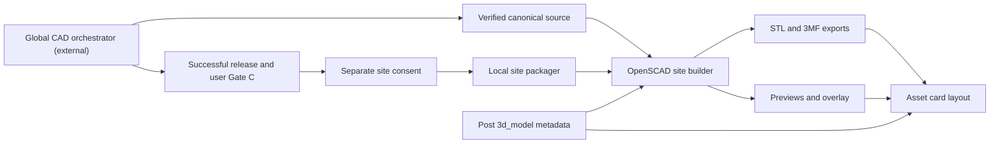

# CAD Assets

## Purpose

The CAD asset workflow separates editable parametric designs, CAD release evidence, and generated blog deliverables. The local blog coordinator delegates design, validation, exports, and release to the **external global `cad-orchestrator`**; the repository instructions are a handoff contract, not a local implementation of that orchestrator. Only after a successful CAD release and user Gate C can separately authorized site packaging begin. (`.opencode/commands/create-cad.md:8–42`; `.opencode/agents/cad-author.md:18–34`.)

The canonical source preserves parameters and modeling logic. STL/3MF files are derived print exports; PNGs are presentation previews, not dimensioned drawings or independent geometric acceptance evidence. A generated site bundle does not establish equivalence to the artifacts inspected during CAD release. (`.opencode/agents/cad-site-packager.md:29–31,85–89`; `_scripts/cad/build.py:199–291`.)

## Key Files

| File | Role |
|------|------|
| `.opencode/commands/create-cad.md` | Request brief, global delegation, Gate C, optional packaging, and result reporting. |
| `.opencode/agents/cad-author.md` | Blog-facing coordination and separate draft/publication boundaries. |
| `.opencode/agents/cad-site-packager.md` | Consent, release-identity preflight, bounded builder approval, and per-artifact verification. |
| `_cad/design.yaml.example` | Design-contract fields for requirements, parameters, features, manufacturing, and validator results. |
| `_cad/customizable-cable-grommet/customizable-cable-grommet.scad` | Concrete parametric model with physical-piece modules, fit checks, assembly, and print layout. |
| `_scripts/cad/build.py` | Local OpenSCAD site exporter and preview composer. |
| `_scripts/cad/preview.py` | Camera presets, OpenSCAD preview invocation, and ImageMagick processing. |
| `_scripts/cad/customizer_compat_check.sh` | Static proxy for older Thingiverse Customizer parser compatibility. |
| `_layouts/asset-3d.html` | Metadata-driven asset card, download actions, and canonical source link. |
| `docs/assisted-cad-modeling-method.md` | Assisted sketch-based modeling notes, including Fusion-specific orientation and unit rules. |

## Dependencies



- **Local integration:** command and agent instructions govern delegation; the builder imports the preview renderer, reads post/draft YAML, and writes site assets. The Liquid layout consumes publication metadata. (`.opencode/commands/create-cad.md`; `_scripts/cad/build.py:25–38,73–105`; `_layouts/asset-3d.html:7–115`.)
- **Packaging dependencies:** [Python with PyYAML, the `openscad` executable, and ImageMagick](../dependencies/dependency-map.md) (`magick`, falling back to `convert`). The compatibility proxy separately uses Bash, awk, and grep. These local utilities are not a substitute for the global release workflow. (`_scripts/cad/build.py:17–30,110–118,203–218`; `_scripts/cad/preview.py:41–80`; `_scripts/cad/customizer_compat_check.sh:35–84`.)

## Source and Design Contracts

### Canonical source versus publication metadata

For the local OpenSCAD builder, the expected source is `_cad/<slug>/<slug>.scad`. Discovery recursively considers `.scad` files only when their basename matches their parent directory name; `build_one` then constructs the fixed canonical path under `_cad/<slug>/`. Auxiliary includes and differently named library files are not build targets. The builder does **not** resolve its source from `3d_model.sources.scad`. (`_scripts/cad/build.py:92–105,176–188`.)

Post frontmatter `3d_model` is the publication metadata source, not a CAD-directory README. The coordinator preserves verified source paths, slug, attribution, and licensing; reader-facing text is Italian unless requested otherwise. New requests derive a unique kebab-case slug and Italian project title; updates preserve existing slug and metadata unless a change is requested. (`.opencode/commands/create-cad.md:15–28`; `.opencode/agents/cad-author.md:40–51`.)

### Design contract

`_cad/design.yaml.example` describes a contract copied to `_cad/<slug>/design.yaml`, separate from publication metadata:

| Section | Contents |
|---------|----------|
| `slug` | Stable identifier matching asset directory and publication slug. |
| `requirements` | Functional requirements, critical dimensions, constraints, assumptions, unknowns, and acceptance criteria. |
| `parameters` | Explicit public names/types/defaults and optional unit/range/Customizer fields; derived values, invariants, and constants. |
| `feature_plan` | Physical-piece modules, coordinate system, ordered operations, and module-to-parameter mapping. |
| `manufacturing` | `fdm` or `woodworking` profile, build/stock limits, and inventory reference. |
| `validation_results` | Validator-owned results, left empty by the planner. |

The template says the CAD pipeline roster consumes this contract. The local site builder does not read it and therefore does not establish that its requirements or validation results passed. (`_cad/design.yaml.example:1–59`; `_scripts/cad/build.py:176–188`.)

### Concrete parametric model

The cable-grommet source defines a top sleeve, bayonet-lock bottom ring, and snap-in cap with a parabolic cable opening. Public Customizer groups expose hole/desk dimensions, clearances, locking geometry, optional connector profiles, and view controls; derived dimensions follow under `[Hidden]`. `top_part()`, `bottom_part()`, and `cap_part()` define the pieces, while `assembly(gap)` handles assembled/exploded placement. The layout supports `assembly`, `exploded`, individual-part modes, and `print`. (`_cad/customizable-cable-grommet/customizable-cable-grommet.scad:22–35,43–290,823–1068`.)

Optional connector checks validate active profiles and layout constraints, including bore fit, flange seating, cutout keepout, and pair separation. Diagnostics describe limits without automatically repositioning geometry. USB-A/USB-C defaults are explicitly editable estimates, not standards or measured dimensions; RJ45 values distinguish user measurements from the assumed nominal screw diameter. These are model-specific facts, not blanket fit guarantees. (`_cad/customizable-cable-grommet/customizable-cable-grommet.scad:185–220,519–570,617–816,1026–1027`.)

### Sketch-based method is not an OpenSCAD rulebook

`docs/assisted-cad-modeling-method.md` records bookcase-oriented assisted modeling: functional-face sketch preflight, explicit driving dimensions, robust closure, reusable profiles, deterministic orientation, and final bounding-box checks. Its Fusion YZ sketch-axis mapping and centimeter API units are backend-specific. The document explicitly says not to apply the sketch advisor blindly to non-sketch CAD such as OpenSCAD; these notes do not select a backend or impose Fusion sketch operations on `.scad` authoring. (`docs/assisted-cad-modeling-method.md:5–35`; `.opencode/commands/create-cad.md:20–22`.)

## Public API

### Local builder and renderer

| Interface | Behavior |
|-----------|----------|
| `discover_slugs(select=None)` | Returns sorted matching source identifiers, optionally filtered by exact slug equality. |
| `find_post_frontmatter(slug)` | Walks `_posts` before `_drafts`; returns the first nonempty parsed frontmatter from a `.md` filename containing the slug. |
| `build_one(slug, skip_png=False, png_only=False)` | Exports print meshes and/or creates previews; returns paths and an error list for recorded failures. |
| Builder CLI | Supports `--slug`, `--skip-png`, and `--png-only`; these capabilities do not expand the packager's allowed command. |
| `render_png(...)` | Renders an auto-fitted camera view, then applies `blueprint`, `monochrome`, or raw-image processing. |
| `render_solid(...)` | Renders with Solarized preview colors and removes the background for a transparent overlay. |

Sources: `_scripts/cad/build.py:73–105,176–331`; `_scripts/cad/preview.py:26–34,59–173`.

### Generated bundle

The packager's permitted builder invocation has only `--slug`; it attempts the entire set below, regardless of which deliverables the user selects. Writes target existing paths directly, so a rerun can replace a previous bundle; there is no selection-based write isolation. (`.opencode/agents/cad-site-packager.md:48–71`; `_scripts/cad/build.py:190–291`.)

| Destination | Derivation |
|-------------|------------|
| `assets/3d/<slug>/<slug>.stl` | OpenSCAD export with `mode="print"`. |
| `assets/3d/<slug>/<slug>.3mf` | OpenSCAD 3MF export with `mode="print"`. |
| `assets/images/3d/<slug>-isometric.png` | Exploded isometric preview composited over the blueprint background. |
| `assets/images/3d/<slug>-ortho.png` | 1920×1080 sheet: top/side above front/isometric. |
| `assets/overlays/<slug>.png` | Exploded solid isometric preview, transparent and tightly cropped with a 2% border. |

The builder reads `color_scheme` and `explode_distance` from `3d_model`, silently defaulting to `blueprint` and `25`. Preview rendering forwards `mode` and `explode_distance` via OpenSCAD `-D`; cameras use `--autocenter --viewall`, not a dimensioned drawing scale. (`_scripts/cad/build.py:121–171,184–188,228–291`; `_scripts/cad/preview.py:59–80`.)

## Release and Packaging Workflow

1. **Delegate CAD work.** `/create_cad` forwards the brief to the global orchestrator. The blog coordinator must not design, validate, export, build, or call CAD specialists directly. Wait for complete pipeline evidence, successful release, and user Gate C. A tutorial code snippet alone is not authorization to create or package an asset. (`.opencode/commands/create-cad.md:8–22`; `.opencode/agents/cad-author.md:18–34`.)
2. **Obtain separate packaging consent.** Pass the exact verified canonical source, slug, and release evidence to `cad-site-packager`. Additional final renders and dimensioned drawings are out of scope. Post-draft changes require another separate approval; publishing, uploading, and committing remain prohibited. (`.opencode/commands/create-cad.md:30–45`; `.opencode/agents/cad-author.md:53–57`.)
3. **Recheck identity and metadata.** The packager rereads the source and uses a recorded hash or equivalent release identity to establish it is unchanged. Require exactly one matching post/draft filename, matching canonical source/slug metadata, and explicit `color_scheme` and `explode_distance`. Missing, changed, or ambiguous evidence means `hold`; the builder's substring/first-match lookup is not sufficient validation. (`.opencode/agents/cad-site-packager.md:33–47`.)
4. **Approve all writes and replacements.** Record selected deliverables, inspect every destination, obtain consent for the full set of writes, and obtain replacement consent for every existing target. The only permitted invocation is `python3 _scripts/cad/build.py --slug <canonical-slug>`, with an exact bounded approval and independent slug check. Permission-glob matching is not strict slug isolation; inability to bound approval means stop, not broaden permissions. (`.opencode/agents/cad-site-packager.md:48–71`.)
5. **Verify artifacts individually.** For each selected output, verify exact path, slug correspondence, freshness from this run, readability, and nonempty content as appropriate. Report warnings and partial/noncritical failures. Only an authorized build with every selected output verified can be `complete`; otherwise retain `hold`. Do not claim unselected outputs were produced without verification. (`.opencode/agents/cad-site-packager.md:73–83`.)

Keep CAD release/Gate C results separate from site status: `not requested`, `awaiting consent`, `complete`, or `hold`. The site STL is a separate export from `_cad/<slug>/stl`; earlier geometric inspection does not cover it. Independent geometric comparison is not required for site-package completion, but completion must not be described as geometric equivalence or a new CAD release verdict. (`.opencode/agents/cad-author.md:59–65`; `.opencode/agents/cad-site-packager.md:85–97`.)

## Validation and Failure Caveats

- **Zero exit can mean no work.** If discovery finds no projects, `main()` prints `No .scad projects found under _cad/` and returns normally. An unmatched slug can therefore exit successfully without producing anything. (`_scripts/cad/build.py:300–310`.)
- **3MF failure is noncritical to the builder, not proof of a complete selected bundle.** STL and caught preview failures populate `errors`; 3MF failure only prints a warning. The CLI exits based on `errors`, so it can report success without a new 3MF. (`_scripts/cad/build.py:207–223,244–327`.)
- **Customizer checking is a static proxy.** The script strips comments, then flags known older-parser constructs such as `let`, `assert`, hex color strings, and newer syntax. It returns 0 for no findings, 1 for findings, and 2 for input errors. Its comment stripper is string-unaware and its conditional check is heuristic; passing is not a live Thingiverse validation. The inspected grommet source contains `let` and `assert`, so compatibility must not be assumed from its Customizer annotations or a modern OpenSCAD build. (`_scripts/cad/customizer_compat_check.sh:3–33,96–144`; `_cad/customizable-cable-grommet/customizable-cable-grommet.scad:617–698`.)

## Site Presentation

[`_layouts/asset-3d.html`](../components/site-presentation.md) extends the post layout and adds a card only when `page["3d_model"]` exists. It conditionally displays the isometric preview, purpose, material, dimensions, print settings, license, and source repository link. Thingiverse and Printables buttons take precedence: local STL/3MF download buttons appear only when neither external URL exists. These are metadata-driven links, not file-existence or release checks. (`_layouts/asset-3d.html:1–120`.)

## Usage Example

The source's public view controls illustrate the interface consumed by packaging:

```scad
// Which part(s) to display
mode = "exploded"; // [assembly:Assembly, exploded:Exploded, top:Top part, bottom:Bottom part, cap:Cap only, print:Print layout]

// Distance between parts in exploded view — also consumed by the build pipeline via post frontmatter `3d_model.explode_distance` (mm)
explode_distance = 25; // [5:5:80]
```

Excerpt: `_cad/customizable-cable-grommet/customizable-cable-grommet.scad:224–228`. The builder overrides these controls for print exports and exploded previews; this example documents the source interface, not permission to run the workflow.
