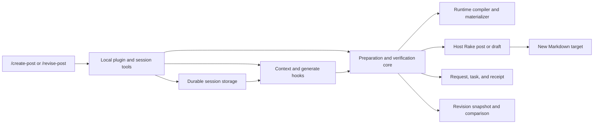

# Governed Post Authoring

## Purpose

The `/create-post` command turns a natural-language brief into one new Markdown draft or post, prepared against a [task-specific author runtime](./author-runtime.md). It hides the operational complexity of Step 5, profile names such as C01/C02, scripts, and hashes: the command supplies the workflow instructions even in a fresh session without prior chat history. The plugin prepares and injects instructions; the current session's agent writes the article. It does not select another provider or model or delegate generation.

The separate `/revise-post` command prepares one **existing `.md` article** for `rewrite` or `expand`, keeping runtime injection active through editing and a quote-grounded editorial comparison. It does not run Rake or write the article during preparation. `/create-post` remains **create-only** and does not automatically acquire the revision comparison gate. R Markdown creation and draft publication remain separate workflows. Neither authoring flow commits, pushes, builds, deploys, or broadcasts. Sources: `docs/post-authoring.md`, `.opencode/commands/create-post.md`, `.opencode/commands/revise-post.md`.

## Key Files

| File | Role |
|------|------|
| `.opencode/commands/create-post.md` | Natural-language interface, metadata interpretation, editorial instructions, and required prepare/write/finish sequence; sets `subagent: false`. |
| `.opencode/commands/revise-post.md` | Existing-article brief, approved-reference selection, and prepare/edit/compare/finish sequence; sets `subagent: false`. |
| `.opencode/plugins/post-authoring.js` | Defines the `post-authoring` plugin and binds its root to this checkout using the entrypoint location. |
| `_scripts/author-extraction/post-authoring-plugin.mjs` | Registers tools, permission checks, session hooks, durable activation, and `/cancel-post`. |
| `_scripts/author-extraction/post-authoring.mjs` | Validates and plans requests, prepares runtime evidence and Rake scaffolds, and verifies context and written-body prerequisites. |
| `_scripts/author-extraction/post-revision.mjs` | Plans revisions, saves immutable source snapshots, binds approved reference excerpts, and validates current-byte editorial candidates and completion. |
| `Rakefile` | Implements create-only `post` and `draft` scaffolds; also contains separate publishing and R Markdown tasks. |
| `docs/post-authoring.md` | Operator guidance, guarantees, recovery limits, and verification boundaries. |

## Public API

### Session-facing tools and command

| Interface | Contract |
|-----------|----------|
| [`author_post_prepare`](../api/native-author-tools.md) | Requires `request`, `title`, `category`, `slug`, `destination`, and `task`; optionally accepts `date`. On success returns `status: ready`, target and receipt paths, runtime identifiers and hashes, full instruction Markdown, and session-injection status. |
| `author_post_revision_prepare` | Code Mode tool requiring `request`, `target_path`, a `rewrite`/`expand` task, and 2–4 approved references. Saves a snapshot and activates runtime plus comparison context without editing the article. |
| `author_post_editorial_prepare` | Read-only Code Mode tool returning the current target hash and comparison candidate schema for the active revision. |
| `author_post_editorial_submit` | Code Mode tool accepting `candidate_json`; checks literal evidence and current bytes, saves an immutable candidate report, and leaves injection active. |
| `author_post_finish` | Accepts only `outcome: written` or `outcome: cancelled`. Ends activation without publishing or removing files. `written` performs additional checks. |
| `/cancel-post` | Plugin-registered command that removes activation directly, without a model call or runtime-integrity check. Leaves all files intact. |

Preparation inputs are closed against unknown properties. Creation planning accepts only `task.mode: generate`; revision planning accepts only `rewrite` or `expand`. Creation categories are `3D Printing`, `DevOps`, `Fisica`, `Home Assistant`, `Meccanica`, and `Reti Sociali`; slugs must be lowercase kebab-case, at most 100 characters. Creation dates must be real calendar dates in `YYYY-MM-DD` form. Revision targets must already contain YAML frontmatter and a nonempty body under `_drafts/` or a supported category directory in `_posts/`. Sources: `preparePostInputSchema` and `planAuthorPost` in `post-authoring.mjs`; `revisionInputSchema` and `planAuthorRevision` in `post-revision.mjs`; tool registration in `post-authoring-plugin.mjs`.

### Core exports

| Export | Responsibility |
|--------|----------------|
| `planAuthorPost(root, input)` | Validate, compile the runtime profile, normalize the request, derive its hash and destination, and reject existing targets without creating output directories. |
| `authorPostRakeInvocation(input)` | Produce the `post[...]` or `draft[...]` task argument with Rake-specific escaping. |
| `prepareAuthorPost(root, input, { signal })` | Save evidence, materialize and check the runtime, invoke Rake, and return the preparation receipt and instructions. |
| `verifyAuthorPostContext(root, prepared)` | Recheck saved evidence, runtime identity and hashes, exact instruction text, and target-file safety. |
| `verifyAuthorPostWritten(root, prepared)` | Reject an unchanged scaffold or an empty body after YAML frontmatter. |
| `planAuthorRevision(root, input)` / `prepareAuthorRevision(root, input, { signal, plan })` | Validate the existing target and references, recheck inputs after permission, snapshot the original, and materialize the revision runtime and receipt. |
| `verifyAuthorRevisionContext(root, prepared)` | Recheck the snapshot, request, task, approved sources/corpus, runtime, instructions, comparison context, and editable-target safety. |
| `prepareAuthorEditorialReview(root, prepared)` / `submitAuthorEditorialReview(root, prepared, candidateJson)` | Return the current hash/schema or validate and persist a literal-evidence-bound candidate comparison. |
| `verifyAuthorRevisionWritten(root, prepared, review)` | Require changed, nonempty article content and a current report with verdict `ready_for_human_review`. |
| `setupPostAuthoring(ctx, repoRoot)` | Install tools, hooks, cancellation command, and lifecycle cleanup; return an unload callback. |

## Dependencies



The core imports runtime compilation and input-reading helpers from `runtime.mjs`, materialization from `compile-author-runtime.mjs`, the runtime schema, Ajv 2020, and Node filesystem, crypto, path, and child-process APIs. Revision additionally uses `prepareArticle` from `core.mjs` to verify approved references and `yaml` to reject duplicate report keys. The entrypoint loads the plugin SDK through `native.mjs`. Creation requires host Rake and its Ruby dependencies; revision does not execute Rake. The plugin installs neither. Sources: imports in the implementation files; `docs/post-authoring.md`.

## Authoring Flow

### Interpret the request

The command derives editorial metadata and a structured task brief rather than asking users for JSON or hashes. **Draft is the command's default** when the destination is unspecified; the tool itself requires an explicit `destination`. An explicitly requested non-draft article may use `post`, while later series parts are directed to drafts by the command instructions.

The task language defaults to Italian unless requested otherwise. Content type is inferred independently of category, using `tutorial`, `project_article`, `scientific_explainer`, or explicitly declared mixed types. The agent must not invent experience, measurements, dependencies, or series plans. Runtime features should reflect the actual brief, not genre-based obligations. Source: `.opencode/commands/create-post.md`.

### Prepare before creating the scaffold

The plugin requires the session's resolved directory to equal the repository root and allows only one active authoring task per session, shared between creation and revision. For creation it first plans the request, then explicitly asserts **both host edit and shell permissions**. Edit resources cover the target, authoring-run evidence, and runtime outputs; the shell permission covers the intended Rake task. Native filesystem and process work therefore does not silently bypass host permission rules.

Preparation then proceeds in this order:

1. Save the normalized request and task as immutable evidence.
2. Materialize the task runtime, run a check-only materialization, and compare profile and instruction hashes with the planned compilation.
3. Read the instructions and Rakefile, validate destination directories, and recheck that the target is absent.
4. Execute Rake through Node `execFile`, with an argument array and no shell. Backslashes, commas, and brackets are separately escaped for Rake's own argument parser; shell quoting alone would not solve that parser boundary.
5. Read the scaffold, persist the immutable preparation receipt, and only then activate injection in session storage.

The process invocation in `post-authoring.mjs` is:

```javascript
await run("rake", ["--rakefile", "Rakefile", invocation], {
  cwd: root, env: { ...process.env, date: plan.request.date }, signal, timeout: 30_000, maxBuffer: 64 * 1024,
});
```

Targets are `_drafts/<slug>.md` or `_posts/<normalized-category>/<date>-<slug>.md`. Core checks reject existing targets and unsafe destination ancestors; Rake additionally creates both types with `File.open(filename, "wx")`. The scaffold contains YAML metadata, an empty excerpt, image defaults, audience and proficiency defaults, and `broadcast.sent: false`, but no article body. Sources: `post-authoring.mjs`, `post-authoring-plugin.mjs`, `Rakefile`.

### Prepare an existing article for revision

The revision command reads the target and 2–4 distinct approved articles from `docs/corpus.yaml`. Each reference supplies a comparability reason and 1–4 literal body excerpts tagged `opening`, `decision`, `technical_transition`, or `limitation`. The target cannot reference itself; excerpts are bounded to 6,000 characters in total. Source selection and comparability remain editorial judgments, not substring-validation results.

`author_post_revision_prepare` plans the snapshot and runtime, asserts host **edit permission only** for the target, revision evidence, and runtime tree, then replans to detect changes during permission handling. It saves the original bytes and normalized request/task, materializes and checks the runtime, and rechecks the target before saving the receipt and activating injection. It neither requests shell permission nor executes Rake nor writes the article. Each attempt has a new UUID directory, even for an identical brief; interrupted attempts can leave evidence without activating a revision. This is not a global lock against other editors. Sources: `planAuthorRevision`, `selectReferences`, and `prepareAuthorRevision` in `post-revision.mjs`; `post-authoring-plugin.mjs:98–110`; `.opencode/commands/revise-post.md`.

### Inject and write in the same session

Activation is stored under a hash of the session ID. Both V2 `context` and `generate` hooks retrieve that activation, check the session location, and reverify the receipt, request, task, runtime, and exact instruction Markdown before appending the complete Markdown as a system-context text block. For revision they also verify the immutable snapshot, approved sources/corpus, and exact comparison context, then inject that context alongside the runtime. An additional instruction identifies the target, prohibits delegating the writing, and requires finishing before changing topic.

Storage preserves activation across reloads, and subsequent hook applications do not depend on earlier conversation content surviving compaction. Activation is **not inherited by child sessions**, shared with unrelated sessions, or valid from a different checkout directory. Both commands require writing only to their returned target. Hooks do not switch provider/model or generation parameters; recording `last_model` is observation, not selection. Sources: `post-authoring-plugin.mjs`, `.opencode/commands/create-post.md`, `.opencode/commands/revise-post.md`, `docs/post-authoring.md`.

### Compare the revision before finishing

After editing, `author_post_editorial_prepare` returns the current file hash and report schema without writing files or assessing prose. The agent supplies exactly one comparison for each of the four aspects, using `coherent`, `needs_revision`, or `not_applicable` and a rationale. Applicable aspects require a literal quote from the current article body and an exact prepared reference excerpt for that aspect. Non-applicable aspects require null quotes/references and an explicit reason; an entirely non-applicable report is rejected.

`author_post_editorial_submit` asserts edit permission for the report directory, verifies the current-byte hash and literal evidence, and saves an immutable candidate. Injection stays active through comparison and corrections. Further article edits make the report stale and require another submission before finishing. The saved report remains `status: candidate_pending_human` and `human_approval: false`, including when its derived verdict is `ready_for_human_review`. These checks do not validate the semantic judgment or certify the author's voice. No model, corpus, or pattern promotion occurs. Sources: `prepareAuthorEditorialReview`, `submitAuthorEditorialReview`, and `verifyAuthorRevisionWritten` in `post-revision.mjs`; `post-authoring-plugin.mjs:111–172`; `.opencode/commands/revise-post.md`.

## Saved Evidence

| Location | Contents |
|----------|----------|
| `docs/authoring-runs/<request-sha256>/request.json` | Original natural-language request plus normalized metadata, resolved date, and compiled task context. |
| Same directory, `task.json` | The task used for runtime materialization and subsequent checks. |
| Same directory, `preparation.json` | Request and target references; Rake task; Rakefile and initial-scaffold hashes; runtime, manifest, profile, instruction, and source-author-model bindings. |
| `.opencode/authoring-revisions/<request-sha256>/<UUID>/` | Revision `request.json`, `task.json`, original-byte `source.md`, and `preparation.json` binding the snapshot, target, runtime, and editorial context. Kept outside `docs/` so draft snapshots do not become Jekyll pages. |
| Same revision directory, `editorial/<report-sha256>.json` | Immutable current-byte-bound editorial candidate reports, not human approvals. |
| `docs/author-pattern-results/v1.3/author-runtimes/` | Existing hash-addressed runtime artifacts used by both flows. |

Evidence writes are create-only; an existing identical file can be reused, but differing content produces a collision error rather than an overwrite. The article remains editable, while context verification requires it to remain a safe regular file inside the repository. Hook-application counts and the latest revision report reference live in session storage, not in the preparation receipt. The receipt binds preparation, not the final prose or human approval. Sources: `immutable`, `prepareAuthorPost`, and `verifyAuthorPostContext` in `post-authoring.mjs`; `post-revision.mjs`; `post-authoring-plugin.mjs`; `docs/post-authoring.md`.

## Completion, Cancellation, and Failures

- **Written:** `author_post_finish` revalidates context and requires at least one observed hook application. Creation rejects an unchanged scaffold or empty body. Revision rejects unchanged/empty article content and requires the saved comparison to match the latest bytes and have verdict `ready_for_human_review` (no remaining `needs_revision`). Only successful completion clears activation; revision completion also returns the candidate report reference and `editorial_status: candidate_pending_human`. Creation does not automatically require this report. Neither completion establishes factual correctness, voice quality, human approval, or prose compliance.
- **Cancelled:** `author_post_finish` with `cancelled` clears activation without requiring written-body or runtime checks. The registered `/cancel-post` also works without a model call, including when invalid runtime evidence prevents further model requests. Neither mechanism deletes or publishes anything.
- **Operation in progress:** finish and cancellation reject a busy session, including while an editorial submission is running. Stop preparation through normal host controls before cancelling. Unloading the plugin aborts running preparation and disposes registrations, but deliberately retains durable activation.
- **Interrupted or failed preparation:** evidence, directories, or a newly created scaffold may remain. There is no automatic rollback, cleanup, overwrite, or fallback. Retrying creation for an existing target fails, even if the target is only a scaffold from an interrupted attempt. A revision retry uses a fresh UUID evidence directory and does not overwrite a prior snapshot.
- **Unavailable or failing tool:** the command instructs the agent to stop and report the problem, not bypass preparation through direct shell/Rake or generic-style generation. Merely changing topic does not clear activation.

Sources: `post-authoring-plugin.mjs`, `post-authoring.mjs`, `post-revision.mjs`, `.opencode/commands/create-post.md`, `.opencode/commands/revise-post.md`, `docs/post-authoring.md`.

## Usage Example

The operator guide supplies this natural-language request for a fresh session at the repository root:

```text
/create-post una bozza tutorial su come modellare una matita parametrica in OpenSCAD, per principianti, con corpo esagonale, punta in legno e mina. Includi il codice completo e spiega i parametri.
```

The command requires preparation before writing, then a finish call after filling the returned target. Its final summary includes the runtime ID, receipt path, instruction hash, and an explicit distinction between completed checks and remaining TODOs. Review, annotation, image generation, publication, commits, and deployment are not automatically performed. Sources: `docs/post-authoring.md`, `.opencode/commands/create-post.md`.

## Assurance Boundaries

This is a permission-aware preparation gate and session-context integration, **not a global editorial sandbox**. Generic edit or shell tools can technically bypass the procedural command; the plugin does not revoke them or govern unrelated edits. The no-fallback and no-delegation rules are command instructions, not proof that every possible agent action is confined.

[Successful hooks](../concepts/governance-and-verification.md) establish that verified instructions were inserted into the host-assembled context. They do not prove byte-for-byte provider delivery, model attention, or prose compliance; another plugin may also alter context afterward. Hashes and `written` completion are not content certification.

The operator guide separates offline verification from live generation. Creation tests use temporary-directory Rake execution and plugin lifecycle checks; revision tests use temporary fixtures without a Rakefile to check snapshots, references, permissions, cancellation/reload, stale reports, and candidate-versus-human-approval boundaries. They do not call providers, generate repository articles, or measure voice quality. Neither those tests nor a successful individual revision certify generation generally. Sources: `docs/post-authoring.md:199–221`; the finish result explicitly reports `runtime_integrity_and_context_hook_application_not_prose_compliance_or_provider_delivery` in `post-authoring-plugin.mjs`.
