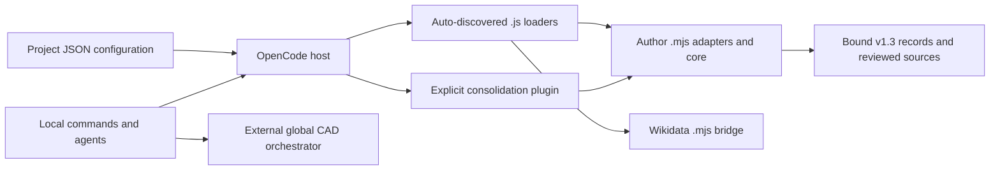

# OpenCode Integration

## Purpose

The repository connects OpenCode commands and narrowly scoped agents to local authoring, evidence-extraction, consolidation, model-compilation, and [Wikidata tools](../api/wikidata-oracle.md). [CAD commands](./cad-assets.md) hand off to an external global orchestrator rather than implementing the CAD pipeline here. This page describes the checked-in integration, not the complete configuration of the operator's OpenCode installation.

## Key Files

| File or directory | Role |
|---|---|
| `opencode.json` | Sets `subagent_depth: 3` and explicitly registers the consolidation plugin with v1.3 records. |
| `.opencode/opencode.json` | Supplies a `cad-orchestrator` mode override and three child-agent permission rules for `copilot-pipeline-orchestrator`. |
| `.opencode/commands/` | Prompt workflows for Markdown posts, R Markdown, annotation, and CAD coordination. |
| `.opencode/agents/` | Local extractor, consolidator, model compiler, CAD coordinator, and site-packager definitions. |
| `.opencode/plugins/*.js` | Auto-discovered JavaScript entrypoints wrapping implementations under `_scripts/`. |
| `plugins/author-pattern-consolidator/index.js` | Explicit plugin entrypoint registering consolidation, review, and model tools. |
| `_scripts/author-extraction/*-native.mjs` | Host-context checks, closed tool inputs, session protocols, and result validation. |
| `_scripts/author-extraction/INTEGRATION.md` | Versioned workflow contract, operational limits, and recorded verification caveats. |

## Command and Agent Routing

### Local commands

| Command file | Route and boundary |
|---|---|
| [`create-post.md`](./governed-post-authoring.md) | Uses `subagent: false`; requires `author_post_prepare` before creating or writing the article. Writing stays in the current session and ends with `author_post_finish`. Unclear destinations default to drafts. |
| [`create-rmd.md`](./blog-content.md) | Instructs creation through Rake `new_rmd` or `new_rmd_draft`; knitting is a separate reviewed step. It does not specify the native post-runtime preparation used by `create-post.md`. |
| `annotate-post.md` | Requires read-only `wikidata_oracle` retrieval and semantic-draft validation before a final snapshot check and one document write. Oracle acceptance does not certify later transformations or semantic truth. |
| `create-cad.md` | Selects local `cad-author`, which delegates CAD execution to global `cad-orchestrator`. A site bundle requires successful release, user Gate C, and separate packaging consent. |

The R Markdown and CAD command bodies use legacy underscore spellings such as `/create_rmd` and `/create_cad`, while their filenames are hyphenated. These body headings are not evidence that additional command aliases are registered. Extraction and consolidation are agent workflows, not `/author-extractor` or `/consolidate-author` commands (`INTEGRATION.md`).

### Local agents and external roles

- [`author-extractor`](./author-extraction.md) declares `mode: all`, six steps, and only the extraction prepare/submit tools; it handles one approved article per session.
- [`author-pattern-consolidator`](./author-consolidation.md) declares `mode: subagent`, five steps, and only consolidation prepare/submit; it handles one dimension per session.
- [`author-model-compiler`](./author-model.md) declares `mode: subagent`, six steps, and V2 `permissions` denying everything except model prepare/submit. It composes reviewed sources, not new observations or review decisions.
- `cad-author` is a primary blog-facing coordinator, not a CAD executor. `cad-site-packager` is a subagent with read access and a narrow approval-gated builder command, not general editing or delegation authority.

These declarations are in the respective `.opencode/agents/*.md` files. The local config references `copilot-pipeline-orchestrator` and permits its delegation to the three author agents; it does not define that orchestrator's complete behavior. Likewise, `cad-orchestrator` is explicitly described as global by the CAD workflow, and the local config only overrides its mode to `all`. External global agent definitions are not repository-owned implementations.

Neither checked-in JSON configuration selects a provider or model. The model compiler inherits its parent's model according to `INTEGRATION.md`; example model selections there are run-specific, not plugin defaults. Author workflows prohibit implicit provider/model fallback: an unavailable route or requested model is a reason to stop, not to substitute another provider or shell-based generation.

## Dependencies



The extraction loader imports `native.mjs?contract=1.3` and dynamically imports `core.mjs?contract=1.3`. The post loader delegates to `setupPostAuthoring`; the Wikidata loader delegates to `createWikidataOraclePlugin`. Their `.js` entrypoints are separate from the underlying `.mjs` implementations.

The root config explicitly loads the **directory** `./plugins/author-pattern-consolidator`, whose physical entrypoint is `index.js`. Its consolidation adapter/core imports carry `?contract=0.6`; the same entrypoint imports review and model adapters. Do not also register an auto-discovered consolidator copy. The fixed contract tags prevent reuse of an older cached contract during the documented watched-reload workflow; they are not tool inputs (`INTEGRATION.md`).

Both [integration packages](../dependencies/dependency-map.md) pin `@opencode/plugin` to **2.0.24**. The author-extraction package also pins Ajv 8.20.0 and YAML 2.8.1. Directory resolution to `index.js` without a package manifest is recorded behavior of the installed OpenCode 2.0.24 in `INTEGRATION.md`, not a guarantee for every current OpenCode build.

## Public API and Trust Boundaries

### Host-bound inputs and effective callers

The extraction and consolidation entrypoints derive the repository root from their own module URL. They pass the effective `toolContext.sessionID`, `toolContext.agent`, and cancellation signal separately from model-supplied input. Adapter identity checks therefore use the actual host caller, not an `agent` field supplied by a model. Closed schemas do not provide an identity-switching argument.

The consolidation adapter receives `recordsDirectory` through `ctx.options`, validated against an approved directory allowlist. The actual project selects `docs/author-extraction-results/v1.3`; the adapter's omitted-option default remains v1.1. A model cannot choose another corpus by passing a path. The documented active contract covers twenty approved articles, A01–A20, extraction v1.3, and consolidation v0.6. All twenty records must pass processing eligibility before consolidation (`consolidator-native.mjs`, `INTEGRATION.md`).

| [Tools](../api/native-author-tools.md) | Effective caller and protocol | Output or side effect |
|---|---|---|
| `author_extraction_prepare`, `author_extraction_submit` | Only `author-extractor`; one article and input hash per session; at most two submissions. | Accepted canonical JSON with a host-tracked whole-article receipt; no automatic record-file persistence. |
| `author_pattern_consolidation_prepare`, `author_pattern_consolidation_submit` | Only `author-pattern-consolidator`; one dimension with corpus/input hashes; one submission. | Accepted canonical dimension JSON; blocked preparation cannot submit. No native cross-dimension finalizer. |
| `author_model_prepare`, `author_model_submit` | Only `author-model-compiler`; prepared source-review/input hashes; at most two received submissions. | Read-only preparation, then a separately saved immutable model candidate. |
| `author_patterns_validate`, `author_review_prepare` | Only actual host `build` or `plan`; input is `{}`. | Read-only source validation or the complete pending review sheet. |
| `author_review_apply` | Same caller and empty-input gate. | Always fails closed; no review application or publication. |

The adapters enforce budgets and binding; agent instructions can impose stricter run-specific limits. Extraction/consolidation acceptance requires the native `status: "accepted"` envelope, whose `canonical_json` bytes are authoritative. Assistant prose or a completed session is not acceptance, and technical acceptance is not human author approval. The parent must obtain separate saving/finalization authorization (`INTEGRATION.md`).

### Model candidates are not promotion

`author_model_prepare` projects effective approved patterns, applicability, review notes, qualitative judgments, the composition schema, and optional semantic context. Preparation is read-only and binds the source bytes, schema, compiler, instructions, and preparation implementation. Semantic context remains optional conceptual context, never mandatory style.

Submit revalidates that binding and compiles into `docs/author-pattern-results/v1.3/author-model-candidates/<input-hash>/<model-hash>/`. The documented candidate contains preparation, composition, compiled model, and manifest; identical reruns are idempotent and conflicting existing bytes fail closed. Only `status: "compiled_candidate"` establishes a saved candidate. Neither tool replaces the current `author-model.json` or checked-in composition, grants new human approval, deploys a runtime, or promotes a candidate (`model-native.mjs`, `author-model-compiler.md`, `INTEGRATION.md`).

### Native review apply stays closed

[`review-native.mjs`](./author-review.md) checks caller identity before input validation. Unauthorized callers receive `AGENT_DENIED`; allowed callers invoking apply receive `AUTHORIZATION_UNAVAILABLE`. This wrapper never invokes core `applyAuthorReview`, writes outputs, or produces an apply preview.

The integration guide records that the pinned host lacks the documented hash-bound human release-authorization mechanism required here. Ordinary permission approval, a model-supplied token, or “Allow Always” is not review consent. Later separately authorized offline reviewed artifacts do not enable this native apply route. The guide's earlier pending-review section is historical preparation context; its Step 4 section records completion of human review through a separate authorized action.

## Session-Scoped Post Authoring

`post-authoring-plugin.mjs` registers `author_post_prepare`, `author_post_finish`, `/cancel-post`, and both `context` and `generate` session hooks.

1. Prepare verifies that the calling session is at the repository root and has no active article. It requests host edit and shell permissions before native filesystem/Rake work.
2. It prepares a verified runtime, creates one new post/draft through Rake without overwriting an existing article, and stores activation under a hash of that session ID.
3. The hooks verify the stored context and append instructions only for that active session's outgoing calls. The activation is not inherited by child sessions or shared globally; the command explicitly forbids delegating the writing.
4. Finish with `written` checks runtime integrity, an observed hook application, and written-target verification before clearing activation. `cancelled` or `/cancel-post` clears activation without publishing or deleting files.

Cleanup aborts in-flight preparations and disposes registrations, but intentionally retains durable activation across plugin reloads. Hook-application counts and the recorded last model are observations, not proof of provider delivery, model attention, or prose compliance. The plugin performs no provider selection or text generation itself.

The Wikidata integration uses a different session boundary: `index.mjs` verifies host session/project/location data and maintains a per-session bridge to the Ruby oracle. The tool accepts only `operation`, `input`, and optional `run_id`; trusted root, endpoints, and launcher settings are not model-selected arguments. Its operations are `open`, `discover`, `expand`, `validate`, and `close`.

## Usage Example

The actual root configuration supplies the records source at plugin registration time:

```json
{
  "$schema": "https://opencode.ai/config.json",
  "subagent_depth": 3,
  "plugins": [
    {
      "package": "./plugins/author-pattern-consolidator",
      "options": {
        "recordsDirectory": "docs/author-extraction-results/v1.3"
      }
    }
  ]
}
```

## Verification Limits

`INTEGRATION.md` distinguishes adapter/core tests, controlled SDK integration tests, and live-host evidence. Tests do not establish watched reload, active tool catalogs, lossless provider transfer, or release authorization. It records a successful read-only compiler-child preparation smoke probe, not a successful live model submission or candidate promotion. Missing registration is not permission to restart global services, widen permissions, impersonate another agent, or fall back to shell/provider calls.
