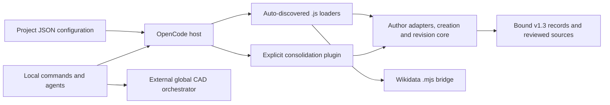

# OpenCode Integration

## Purpose

The repository connects OpenCode commands and narrowly scoped agents to local authoring, evidence-extraction, consolidation, model-compilation, and [Wikidata tools](../api/wikidata-oracle.md). [CAD commands](./cad-assets.md) hand off to an external global orchestrator rather than implementing the CAD pipeline here. This page describes the checked-in integration, not the complete configuration of the operator's OpenCode installation.

## Key Files

| File or directory | Role |
|---|---|
| `opencode.json` | Sets `subagent_depth: 3` and explicitly registers the consolidation plugin with v1.3 records. |
| `.opencode/opencode.json` | Supplies a `cad-orchestrator` mode override and three child-agent permission rules for `copilot-pipeline-orchestrator`. |
| `.opencode/commands/` | Prompt workflows for Markdown creation/revision, R Markdown, annotation, and CAD coordination. |
| `.opencode/agents/` | Local extractor, consolidator, model compiler, CAD coordinator, and site-packager definitions. |
| `.opencode/plugins/*.js` | Auto-discovered JavaScript entrypoints wrapping implementations under `_scripts/`. |
| `plugins/author-pattern-consolidator/index.js` | Explicit plugin entrypoint registering consolidation, review, and model tools. |
| `_scripts/author-extraction/*-native.mjs` | Host-context checks, closed tool inputs, session protocols, and result validation. |
| `_scripts/author-extraction/post-authoring-plugin.mjs` | Creation/revision tools, host permission assertions, shared session activation, hooks, and cancellation. |
| `_scripts/author-extraction/post-authoring.mjs` | *[Create-only]* (see [Glossary](../glossary.md)) runtime/Rake preparation and creation receipts. |
| `_scripts/author-extraction/post-revision.mjs` | Existing-article snapshots, approved reference excerpts, and current-byte editorial comparisons. |
| `_scripts/author-extraction/INTEGRATION.md` | Versioned workflow contract, operational limits, and recorded verification caveats. |
| `docs/post-authoring.md` | Creation/revision operator guide, host capability requirements, and assurance limits. |

## Command and Agent Routing

### Local commands

| Command file | Route and boundary |
|---|---|
| [`create-post.md`](./governed-post-authoring.md) | Uses `subagent: false`; requires `author_post_prepare` before creating or writing the article. Writing stays in the current session and ends with `author_post_finish`. Unclear destinations default to drafts. |
| `revise-post.md` | `/revise-post` uses `subagent: false`: `author_post_revision_prepare` → edit the existing target → `author_post_editorial_prepare`/`author_post_editorial_submit` → `author_post_finish`. Injection stays active through comparison and corrections; no Rake, rename, publication, or delegated writing. |
| [`create-rmd.md`](./blog-content.md) | Instructs creation through Rake `new_rmd` or `new_rmd_draft`; *[Knitting]* (see [Glossary](../glossary.md)) is a separate reviewed step. It does not specify the native post-runtime preparation used by `create-post.md`. |
| `annotate-post.md` | Requires read-only `wikidata_oracle` retrieval and semantic-draft validation before staging link/image annotations, screenshots, optional hero metadata, and prewritten social copy. After confirmed run closure and a final snapshot check, writes the document once. *[Oracle]* (see [Glossary](../glossary.md)) acceptance does not certify later transformations or semantic truth. |
| `create-cad.md` | Selects local `cad-author`, which delegates CAD execution to global `cad-orchestrator`. A site bundle requires successful release, user *[Gate C]* (see [Glossary](../glossary.md)), and separate packaging consent. |

The R Markdown and CAD command bodies use legacy underscore spellings such as `/create_rmd` and `/create_cad`, while their filenames are hyphenated. These body headings are not evidence that additional command aliases are registered. Extraction and consolidation are agent workflows, not `/author-extractor` or `/consolidate-author` commands (`INTEGRATION.md`).

### Annotation assets and offline social copy

These are instructions in `.opencode/commands/annotate-post.md`, not additional native author tools. Asset and copy work follows accepted semantic-draft validation; the two approved semantic fields must remain unchanged through the later transformations.

- **Screenshots:** capture each `<!-- screenshot: <url> | <what to show> -->` placeholder, including newly suggested placements. Before the first capture, use `chrome-devtools` on the site's origin to check sign-in. Continue if authenticated; otherwise hand the ready browser to the user and wait for sign-in, asking at most once per run. Prefer an element screenshot by snapshot `uid`. For loose text, measure its bounding box, account for `devicePixelRatio`, capture a temporary viewport outside the repository, crop with ImageMagick, strip metadata, and delete the raw capture. Ask if no matching element exists rather than saving a whole page. Inspect/crop the PNG, replace the placeholder with a `cloudinary` screenshot tag, and list `assets/images/<slug>-<n>.png` paths for privacy review before committing.
- **Best-effort hero and generic credit:** search Unsplash only when neither `master` nor `header.overlay_image` is set; skip and report failure after two unsuitable queries. Choose a relevant landscape image, download to `assets/images/posts/<slug>.jpg`, crop to 16:9, resize to at most 2,400 pixels wide, and call `track_download`. Set `master`, `image_meta`, and `image_credit`; the caption/alt includes the returned photographer attribution. Credit fields are source-independent (`author`, `author_url`, `source`, `source_url`), with at least `author` or `source` required when credit is supplied. The template renders the credit line, so do not duplicate it in the body. An existing `master` without `image_meta` receives descriptive metadata rather than a replacement hero.
- **Offline social-copy preparation:** prewrite reviewable copy in *[Frontmatter]* (see [Glossary](../glossary.md)) only when `broadcast` is a mapping and *[broadcast.sent]* is not `true`. Use configured channels or LinkedIn/Mastodon defaults, handling only channels described by `_scripts/broadcast.py`'s `SOCIAL_COPY_PROMPT`. Keep existing per-channel `text` untouched; otherwise follow that separate Italian social prompt, not the article runtime, and use YAML `|-` paragraphs plus hashtags. Preserve channels, sent state, and image settings. Keep text within `text_budget(channel, url)` so the final URL/hashtags fit, without embedding the URL in `text`. Report copy as written, kept, or skipped; annotation does not send it to Buffer. The later pipeline uses nonempty prewritten text without a GitHub Models request for that channel; missing copy retains model generation. Over-budget copy can still be shortened by that pipeline, so prewriting is not a byte-preservation guarantee.

Sources: `.opencode/commands/annotate-post.md:109–274,307–316`; `_scripts/broadcast.py:69–78,202–221,839–891`. Screenshot/Unsplash retrieval is not offline; “offline” here distinguishes social-copy preparation from broadcast execution.

### Local agents and external roles

- [`author-extractor`](./author-extraction.md) declares `mode: all`, six steps, and only the extraction prepare/submit tools; it handles one approved article per session.
- [`author-pattern-consolidator`](./author-consolidation.md) declares `mode: subagent`, five steps, and only consolidation prepare/submit; it handles one dimension per session.
- [`author-model-compiler`](./author-model.md) declares `mode: subagent`, six steps, and V2 `permissions` denying everything except model prepare/submit. It composes reviewed sources, not new *[observations]* (see [Glossary](../glossary.md)) or review decisions.
- `cad-author` is a primary blog-facing coordinator, not a CAD executor. `cad-site-packager` is a subagent with read access and a narrow approval-gated builder command, not general editing or delegation authority.

These declarations are in the respective `.opencode/agents/*.md` files. The local config references `copilot-pipeline-orchestrator` and permits its delegation to the three author agents; it does not define that orchestrator's complete behavior. Likewise, `cad-orchestrator` is explicitly described as global by the CAD workflow, and the local config only overrides its mode to `all`. External global agent definitions are not repository-owned implementations.

Neither checked-in JSON configuration selects a provider or model. The model compiler inherits its parent's model according to `INTEGRATION.md`; example model selections there are run-specific, not plugin defaults. Author workflows prohibit implicit provider/model fallback: an unavailable route or requested model is a reason to stop, not to substitute another provider or shell-based generation.

## Dependencies



The extraction loader imports `native.mjs?contract=1.3` and dynamically imports `core.mjs?contract=1.3`. The post loader delegates to `setupPostAuthoring`; the Wikidata loader delegates to `createWikidataOraclePlugin`. Their `.js` entrypoints are separate from the underlying `.mjs` implementations.

The root config explicitly loads the **directory** `./plugins/author-pattern-consolidator`, whose physical entrypoint is `index.js`. Its consolidation adapter/core imports carry `?contract=0.6`; the same entrypoint imports review and model adapters. Do not also register an auto-discovered consolidator copy. The fixed contract tags prevent reuse of an older cached contract during the documented watched-reload workflow; they are not tool inputs (`INTEGRATION.md`).

The [integration packages](../dependencies/dependency-map.md) pin different versions of the `@opencode/plugin` *[SDK]* (see [Glossary](../glossary.md)): **2.0.31** for author extraction/authoring and **2.0.24** for Wikidata. The author-extraction package also pins Ajv 8.20.0 and YAML 2.8.1. These package pins do not identify the running host version. Directory resolution to `index.js` without a package manifest is an explicitly **historical OpenCode 2.0.24 observation** in `INTEGRATION.md`, not evidence of the current installation or a guarantee for other builds.

## Public API and Trust Boundaries

### Host-bound inputs and effective callers

The extraction and consolidation entrypoints derive the repository root from their own module URL. They pass the effective `toolContext.sessionID`, `toolContext.agent`, and cancellation signal separately from model-supplied input. Adapter identity checks therefore use the actual host caller, not an `agent` field supplied by a model. Closed schemas do not provide an identity-switching argument.

The consolidation adapter receives `recordsDirectory` through `ctx.options`, validated against an approved directory allowlist. The actual project selects `docs/author-extraction-results/v1.3`; the adapter's omitted-option default remains v1.1. A model cannot choose another corpus by passing a path. The documented active contract covers twenty approved articles, *[A01–A20]* (see [Glossary](../glossary.md)), extraction v1.3, and consolidation v0.6. All twenty records must be *[Processing-eligible]* before consolidation (`consolidator-native.mjs`, `INTEGRATION.md`).

| [Tools](../api/native-author-tools.md) | Effective caller and protocol | Output or side effect |
|---|---|---|
| `author_extraction_prepare`, `author_extraction_submit` | Only `author-extractor`; one article and *[Input hash]* per session; at most two submissions. | Accepted *[Canonical JSON]* with a host-tracked *[Whole-article receipt]* (see [Glossary](../glossary.md)); no automatic record-file persistence. |
| `author_pattern_consolidation_prepare`, `author_pattern_consolidation_submit` | Only `author-pattern-consolidator`; one dimension with corpus/input hashes; one submission. | Accepted canonical dimension JSON; blocked preparation cannot submit. No native cross-dimension finalizer. |
| `author_model_prepare`, `author_model_submit` | Only `author-model-compiler`; prepared source-review/input hashes; at most two received submissions. | Read-only preparation, then a separately saved immutable model candidate. |
| `author_patterns_validate`, `author_review_prepare` | Only actual host `build` or `plan`; input is `{}`. | Read-only source validation or the complete pending review sheet. |
| `author_review_apply` | Same caller and empty-input gate. | Always fails closed; no review application or publication. |

The adapters enforce budgets and binding; agent instructions can impose stricter run-specific limits. Extraction/consolidation acceptance requires the native `status: "accepted"` envelope, whose `canonical_json` bytes are authoritative. Assistant prose or a completed session is not acceptance, and technical acceptance is not human author approval. The parent must obtain separate saving/finalization authorization (`INTEGRATION.md`).

### Model candidates are not promotion

`author_model_prepare` projects effective approved patterns, applicability, review notes, qualitative judgments, the composition schema, and optional semantic context. Preparation is read-only and binds the source bytes, schema, compiler, instructions, and preparation implementation. Semantic context remains optional conceptual context, never mandatory style.

Submit revalidates that binding and compiles into `docs/author-pattern-results/v1.3/author-model-candidates/<input-hash>/<model-hash>/`. The documented candidate contains preparation, composition, compiled model, and manifest; identical reruns are idempotent and conflicting existing bytes fail closed. Only `status: "compiled_candidate"` establishes a saved candidate. Neither tool replaces the current `author-model.json` or checked-in composition, grants new human approval, deploys a runtime, or promotes a candidate (`model-native.mjs`, `author-model-compiler.md`, `INTEGRATION.md`).

### Native review apply stays closed

[`review-native.mjs`](./author-review.md) checks caller identity before input validation. Unauthorized callers receive `AGENT_DENIED`; allowed callers invoking apply receive `AUTHORIZATION_UNAVAILABLE`. This wrapper never invokes core `applyAuthorReview`, writes outputs, or produces an apply preview.

The integration guide records the earlier 2.0.24 SDK limitation motivating the closed release route; the current wrapper still unconditionally rejects apply. Ordinary permission approval, a model-supplied token, or “Allow Always” is not review consent. Later separately authorized offline reviewed artifacts do not enable this native apply route. The guide's earlier pending-review section is historical preparation context; its Step 4 section records completion of human review through a separate authorized action.

## Session-Scoped Post Authoring

See [Governed Post Authoring](./governed-post-authoring.md#authoring-flow) for the writing workflow and [Native Author Tools](../api/native-author-tools.md#revision-preparation-and-editorial-comparison) for revision/comparison input contracts. `post-authoring-plugin.mjs` registers the following interfaces, plus both `context` and `generate` session hooks:

| Interface | Exposure and permission boundary |
|---|---|
| `author_post_prepare` | Direct tool (`codemode: false`); asserts host edit permission for the target/evidence/runtime and shell permission for the intended Rake invocation. Creates a scaffold, not prose. |
| `author_post_revision_prepare` | Code Mode (`codemode: true`); asserts edit permission only, snapshots one existing article, and activates its runtime/comparison context. No Rake or article write. |
| `author_post_editorial_prepare` | Code Mode (`codemode: true`); read-only current article hash and comparison schema for an active revision. |
| `author_post_editorial_submit` | Code Mode (`codemode: true`); asserts edit permission for `editorial/**` beneath the active revision directory before saving a candidate comparison. |
| `author_post_finish`, `/cancel-post` | Finish is a direct tool (`codemode: false`); cancellation is also available as a plugin command without a model call. Neither publishes nor removes files. |

`docs/post-authoring.md` documents **OpenCode 2.0.29 or newer** as the host minimum for `permission.assert`. The executable feature gate checks the **actual host** with `typeof ctx.permission?.assert === "function"`, not an SDK version comparison. Missing or noncallable support causes `AUTHOR_POST_HOST_UNSUPPORTED` in either preparation route before runtime compilation or evidence/article writes. Upgrading only the SDK cannot add this capability to an older running host; the guide calls for updating OpenCode and restarting its server, not merely reloading the plugin. Neither the minimum nor the package pins establish which host version is installed. Host permission assertions carry the actual calling agent and tool provenance; they are not model-supplied authorizations.

1. **Shared activation:** both preparation routes require the calling session at the repository root and share **one active-article slot per session**. Creation cannot start during a revision or vice versa. Preparation and editorial submission use a shared busy guard; finish/cancel rejects an operation in progress.
2. **Prepare before editing:** creation verifies/materializes the runtime and creates one new post/draft through Rake without overwriting an existing article. Revision instead binds 2–4 distinct approved reference articles and literal excerpts, saves an immutable original snapshot under `.opencode/authoring-revisions/<request-sha256>/<run-id>/`, and leaves the target untouched. References and target are rechecked around permission/preparation; this is not a global editor lock.
3. **Session-local injection:** activation is stored under a *[Hash]* of the session ID. The hooks reverify the stored context and append runtime instructions only for that active session's outgoing calls; revision also verifies/injects its comparison context. This *[Context injection]* (see [Glossary](../glossary.md)) is not inherited by child sessions or shared globally. Both commands forbid delegating the writing.
4. **Compare while active:** after editing a revision, prepare and submit a comparison covering `opening`, `decision`, `technical_transition`, and `limitation`. Applicable aspects need literal current-body and prepared-reference quotes; non-applicable aspects need an explicit rationale. The core checks current bytes and literal evidence, not voice quality or editorial truth. Saved reports remain `candidate_pending_human` with `human_approval: false`; injection continues during comparison and corrections. Further edits make the report stale.
5. **Finish or cancel:** `written` checks runtime integrity, an observed hook application, and written-target verification before clearing activation. Revision additionally requires changed, nonempty article content and a current saved report with verdict `ready_for_human_review`, with no remaining `needs_revision`; an entirely `not_applicable` report is insufficient. Creation completion does not perform this editorial gate. `cancelled` or `/cancel-post` clears activation without deleting article edits, snapshots, or reports. Later corrections after closure require a fresh `/revise-post` preparation, not reuse of a creation receipt or old chat context.

Sources: `post-authoring-plugin.mjs:24–172`, `post-revision.mjs:70–213`, `.opencode/commands/create-post.md:61–67`, `.opencode/commands/revise-post.md`, and `docs/post-authoring.md:111–197`.

Cleanup aborts in-flight preparations and disposes registrations, but intentionally retains durable activation across plugin reloads. Hook-application counts and the recorded last model are observations, not proof of provider delivery, model attention, or prose compliance. The plugin performs no provider selection or text generation itself.

The Wikidata integration uses a different session boundary: `index.mjs` verifies host session/project/location data and maintains a per-session bridge to the Ruby oracle. The tool accepts only `operation`, `input`, and optional `run_id`; trusted root, endpoints, and launcher settings are not model-selected arguments. Its operations are `open`, `discover`, `expand`, `validate`, and `close`.

## Usage Example

The actual root configuration supplies the records source at plugin registration time:

```json
{
  "$schema": "https://opencode.ai/config.json",
  "subagent_depth": 3,
  "plugins": [
    {
      "package": "./plugins/author-pattern-consolidator",
      "options": {
        "recordsDirectory": "docs/author-extraction-results/v1.3"
      }
    }
  ]
}
```

## Verification Limits

`INTEGRATION.md` distinguishes adapter/core tests, controlled SDK integration tests, and live-host evidence. Tests do not establish watched reload, active tool catalogs, lossless provider transfer, or release authorization. It records a successful read-only compiler-child preparation smoke probe, not a successful live model submission or candidate promotion. Missing registration is not permission to restart global services, widen permissions, impersonate another agent, or fall back to shell/provider calls.
