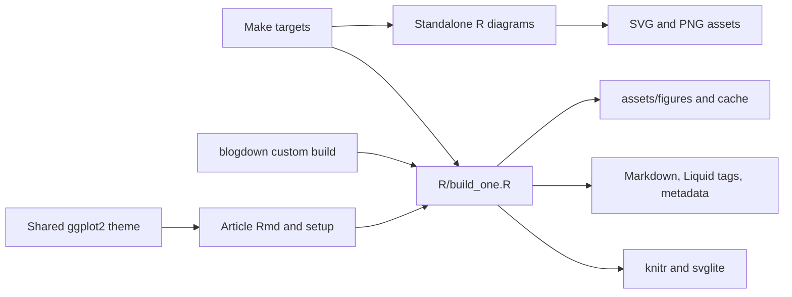

# R Publishing

## Purpose

The R publishing module converts computational articles from R Markdown into Markdown for Jekyll. Its current single-file worker produces SVG figures, [Cloudinary Liquid tags](../components/site-presentation.md), and `_computation` frontmatter. Standalone R diagram scripts generate separate illustration assets without knitting articles. This page describes source behavior; no knitting, diagram generation, container build, or site build was run to validate it.

## Key Files

| File | Role |
|------|------|
| `.Rprofile` | Configures blogdown, conditionally activates renv, locates the repository root, and loads the shared theme when available. |
| `renv.lock` | Records the interactive environment's R and package versions. |
| `R/build_one.R` | Current single-file knitting worker, figure hook, and metadata injector. |
| `R/build.R` | Custom blogdown coordinator that discovers articles and delegates to the worker. |
| `R/build_blog.R` | Loads build packages and invokes blogdown without Hugo. |
| `R/manual_build.R` | Older manual knitting helper using Jekyll hooks and shared output paths. |
| `R/includes/template.Rmd` | Article frontmatter and setup-chunk template. |
| `R/includes/theme_gabriob.R` | Shared ggplot2 theme and discrete color/fill scales. |
| `R/diagrams/thread-vs-bayonet-comparison.R` | Standalone base-R illustration with SVG output and external PNG conversion. |
| `containers/knitr/Dockerfile` | Separately managed batch R image and system dependencies. |
| `Makefile`, `Makefile.common` | Native/container selection, article targets, diagram targets, and site-build dependencies. |

## Public API

These are script entry points and sourced helpers, not an exported R package API.

| Interface | Behavior |
|-----------|----------|
| `Rscript R/build_one.R <input.Rmd> <output.md>` | Requires two arguments; knits one input to the requested output and then inserts computation metadata when frontmatter delimiters are found. |
| `build_one(io)` in `R/build.R` | Accepts an input/output pair, skips it when blogdown considers the output current, and launches the worker through blogdown's internal Rscript helper. On a nonzero result, removes the output and stops. |
| `R/build_blog.R` | Uses pacman to load build dependencies, changes to the Git root, and calls `blogdown::build_site(run_hugo = FALSE)`. |
| `manual_build(source)` | Knits one source with `knitr::render_jekyll()` hooks and a same-basename `.md` output. |
| `theme_gabriob(base_size = 11, base_family = "")` | Returns the site's ggplot2 theme. Sourcing the file also sets it as the global default. |
| `scale_color_gabriob(...)`, `scale_fill_gabriob(...)` | Apply the shared six-color palette through manual scales. |

## Dependencies



The worker explicitly loads [`svglite`, `knitr`, and `rprojroot`](../dependencies/dependency-map.md). The blogdown coordinator additionally relies on blogdown internals and `xfun`. Article setup can introduce further packages: the template loads `tidyverse` and `rprojroot` through pacman. Standalone diagram drawing uses base R, but PNG conversion requires the external `rsvg-convert` executable.

## Usage Example

The worker documents this invocation signature in `R/build_one.R`; the two placeholders represent an article source and its Markdown destination:

```text
Rscript R/build_one.R <input.Rmd> <output.md>
```

The Make rule runs the worker from the repository root. The blogdown alternative is the actual call in `R/build_blog.R`:

```r
blogdown::build_site(run_hugo = FALSE)
```

## Current and Legacy Rendering

### Single-file worker and coordinators

`R/build_one.R` uses `knitr::knit()` directly. It configures chunk defaults and a custom plot hook before evaluating the article. It does not invoke a full `rmarkdown::render()` pipeline.

`R/build.R` recursively discovers `.Rmd` files beneath `_posts/` and `_drafts/`, pairs each with a same-directory `.md`, and delegates changed pairs to the worker. `.Rprofile` selects blogdown's custom build method and Jekyll generator; `R/build_blog.R` is the blogdown-facing entry script.

Make provides a separate [`%.md: %.Rmd` rule](../config/build-and-automation.md) that invokes the same worker, selecting native R when `HAS_KNITR=1` and Docker otherwise. Its `knitr` aggregate uses the explicit `_drafts/*.Rmd` and `_posts/**/*.Rmd` wildcard expressions; unlike `R/build.R`, it does not implement an unrestricted recursive directory walk. The rule declares the article source as its prerequisite, not every sourced helper, package, or data input. Dependency-driven rebuilding therefore does not establish complete computational freshness. Sources: `R/build_one.R`, `R/build.R`, `Makefile.common`.

### Older manual helper

`R/manual_build.R` obtains blogdown's `baseurl`, calls `knitr::render_jekyll()` to install output hooks, and uses shared `assets/figures/` and `cache/` paths. It lacks the current worker's per-post directories, custom Cloudinary plot hook, and `_computation` injection. The current Make rule and blogdown coordinator call `R/build_one.R`, not this manual helper.

## Figures and Article Setup

The worker derives a slug by removing the leading `_posts/` or `_drafts/` and the R Markdown extension, then replacing directory separators with hyphens. It creates `assets/figures/<slug>/` and configures a corresponding `cache/<slug>/` path. Figures default to `svglite`, transparent device backgrounds, and `fig.retina = 2`; code, warnings, and messages are hidden, and chunk caching is enabled.

The plot hook emits one Liquid tag per plot using this source format string:

```r
'{%% cloudinary /%s alt="%s" caption="%s" role="%s" context="%s" %%}'
```

The doubled percent signs are `sprintf()` escapes. Figure metadata comes from chunk options: `fig.role` defaults to `chart`, `fig.context` to `result`, alt text falls back from `fig.alt` to `fig.cap` to an empty string, and the caption defaults to empty. The worker emits a tag; it does not itself upload an image. Source: `R/build_one.R`.

`R/includes/template.Rmd` supplies an uncached, hidden setup chunk with matching SVG defaults, base-graphics parameters, package loading, and theme sourcing. It documents figure roles and contexts for authors. `theme_gabriob.R` defines light backgrounds, teal/amber accents, grid styling, and bottom-positioned legends. `.Rprofile` deliberately avoids configuring knitr chunk options because early knitr loading can interfere with the worker's hook overrides; interactive chunk options belong in article setup.

## Computation Metadata and Lineage Limits

After knitting, `R/build_one.R` inserts an `_computation` block before the second line exactly equal to `---`, when at least two such lines exist. The block contains:

| Field | Recorded value |
|-------|----------------|
| `r_version` | The running R version, not a value copied from the lockfile. |
| `packages` | Unique package names extracted by a source-text scan, or an empty list. |
| `data_sources` | Matching source lines for selected data-reading patterns; omitted when none match. |
| `rendered_at` | `Sys.time()` at metadata injection. |
| `knitr_device` | The literal value `svglite`. |

This is heuristic lineage, not exhaustive proof of dependencies or reproducibility. The scanner filters delimiter lines and lines starting with `#`; despite its comment, it does not parse and remove a complete YAML block or restrict analysis to executable chunks. Regular expressions look for `library`, `require`, `requireNamespace`, and `p_load`, plus selected read/load patterns. Dynamic package names, multiple packages in one call, namespace-only usage, sourced scripts, and other data-loading methods can escape detection; prose or inactive code can also match.

The metadata records neither package versions nor data checksums, and the timestamp does not prove every cached chunk was re-executed. Injection appends a block rather than merging an existing `_computation` key. Sources: the scan, cache defaults, and injection logic in `R/build_one.R`.

## Environment and Reproducibility Boundaries

`.Rprofile` activates renv only when `interactive()` is true and `renv/activate.R` exists. The lockfile records R `4.5.3` and explicit package versions, including blogdown `1.23`, knitr `1.51`, and svglite `2.2.2`; these are recorded versions, not evidence of the environment currently installed.

Batch Docker uses its own library. `containers/knitr/Dockerfile` starts from `rocker/verse:latest`, installs unversioned operating-system packages, and calls `install2.r` for named CRAN packages without version pins. It does not restore `renv.lock`. The template and blogdown wrapper can also install missing packages through pacman. Consequently, the lockfile and metadata support reproducibility goals, but do not make fresh Docker builds immutable or guarantee parity with interactive R.

## Standalone Diagrams and Site Builds

`R/diagrams/thread-vs-bayonet-comparison.R` draws a two-panel comparison with base graphics. Its executable code writes `thread-vs-bayonet-comparison.svg` under `assets/images/diagrams/`, then invokes `rsvg-convert` for a 1600-pixel-wide PNG in that same directory. The header's shorter script name and `assets/images/3d/` output comment are stale; the assignments and conversion call define the current paths. The script does not explicitly stop on a nonzero PNG-conversion status.

`Makefile.common` discovers `R/diagrams/*.R` and maps them to SVG targets. It runs each changed target natively when configured, otherwise through the knitr image. If that command fails, the fallback accepts an existing SVG file; it checks existence, not freshness, validity, or PNG success. Unlike the article container rule, the diagram rule does not first build the knitr image.

`make site` reaches `_site`, whose prerequisites are the Jekyll image build and `diagrams`; `dev` also depends on `diagrams`. Neither declares `knitr` as a prerequisite. Native or fallback diagram handling therefore does **not** automatically knit all R Markdown posts during a site build. Article knitting remains a separate Make target or blogdown operation.
