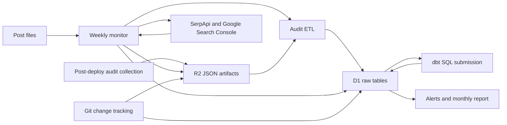

# SEO Monitoring

## Purpose

The `_scripts/seo` package combines post metadata, archived performance audits, Google Trends, and Google Search Console (GSC) metrics in Cloudflare D1. R2 holds JSON artifacts; Python normalizes audit data, invokes dbt compilation, checks thresholds, and writes report artifacts. This is a batch pipeline consuming external APIs, not an owned REST server.

The [weekly workflow](../config/build-and-automation.md) runs Monday at 08:00 UTC or on manual dispatch. A separate post-deploy workflow collects audits and records post changes after a successful deployment, or when manually dispatched. These are configured behaviors, not evidence that a particular run succeeded. Sources: `.github/workflows/seo-monitor.yml`, `.github/workflows/seo-pipeline.yml`, `_scripts/seo/monitor.py`.

## Key Files

| File | Role |
|------|------|
| `_scripts/seo/monitor.py` | Weekly orchestration and embedded D1 schema initialization |
| `_scripts/seo/posts.py` | Post parsing, URN construction, and D1 dimension synchronization |
| `_scripts/seo/keywords.py` | Category/tag seed extraction and a separate post-URL helper |
| `_scripts/seo/trends.py` | SerpApi Google Trends retrieval |
| `_scripts/seo/search_console.py` | Read-only Google Search Console client |
| `_scripts/seo/etl.py` | R2 audit extraction, URL-to-post resolution, and processed-key tracking |
| `_scripts/seo/post_history.py` | Git diff metadata and raw diff archival |
| `_scripts/seo/d1.py`, `_scripts/seo/r2.py` | HTTP SQL and S3-compatible object-storage clients |
| `_scripts/seo/dbt_runner.py` | dbt compile/test subprocesses and compiled-SQL submission to D1 |
| `_scripts/seo/alerts.py`, `_scripts/seo/report.py` | Threshold checks and monthly Markdown generation |
| `seo-schema.sql`, `_seo-monitor.yml` | Raw-table DDL, uniqueness indexes, thresholds, and GSC tuning |
| `_dbt/models/staging/`, `_dbt/models/analytics/` | Staging SQL, analytical SQL, and declared tests/contracts |

## Public API

These are Python entry points and helpers, not HTTP endpoints.

| Interface | Behavior |
|-----------|----------|
| `monitor.main()` | Handles `--dry-run` and `--force-report`; sequences schema, posts, retrieval, ETL, dbt, alerts, and reporting |
| `posts.post_urn(category, slug)` / `sync_posts(dry_run=False)` | Constructs `urn:post:<normalized-category>/<slug>` and synchronizes posts |
| `keywords.get_seed_keywords()` | Returns sorted, deduplicated category/tag seeds, capped at 35 |
| `trends.fetch_keyword(keyword, geo="IT", date="today 3-m")` | Returns timeline data, fetch metadata, and up to five rising/top queries each |
| `search_console.fetch_query_metrics(days=14, limit=500)` | Returns daily query/device/country rows with `page=None` |
| `search_console.fetch_page_metrics(paths, days=14)` | Optional per-page retrieval with `query=None`; not called by the weekly monitor |
| `etl.run_etl(batch_size=200)` | Processes up to the last 200 sorted keys per audit prefix and returns inserted-row counts |
| `dbt_compile(select=None)`, `dbt_test(select=None)`, `apply_to_d1(sql_files, dry_run=False)` | Compile, optionally test, and submit compiled SQL |
| `alerts.check_and_alert()` / `report.generate()` | Write `alerts.json` / `seo-monthly-report.md` and return new alerts / report path |
| `d1.execute()`, `execute_batch()`, `ensure_schema()` | Submit SQL via consumed Cloudflare APIs |
| `r2.upload_json()`, `put_json()`, `list_keys()`, `download_json()` | Timestamped uploads, explicit-key overwrites, listing, and downloads |

Signatures and behavior come from the corresponding `_scripts/seo/*.py` files. `post_history.py` provides a separate CLI `main()` that returns a nonzero status when individual post processing records errors.

## Dependencies



- **Local inputs:** Jekyll post files, Git history, `_seo-monitor.yml`, and dbt models.
- **Libraries:** [PyYAML](../dependencies/dependency-map.md) for metadata/configuration, `serpapi.google_search.GoogleSearch`, Google service-account credentials and API discovery, `boto3` for R2, and `httpx` for D1. The dbt runner invokes the `dbt` executable through `subprocess`.
- **Credentials:** R2 endpoint/access-key/secret-key environment variables; Cloudflare account/database identifiers and D1 API token; `SERPAPI_API_KEY`; and either `GSC_SERVICE_ACCOUNT_JSON` or `GSC_SERVICE_ACCOUNT_B64`. GSC uses the `webmasters.readonly` scope. No credential values belong in documentation.

Sources: imports and client setup in `_scripts/seo/{monitor,trends,search_console,r2,d1,dbt_runner}.py`.

## Retrieval and Raw Storage

### Audits and post changes

`.github/workflows/seo-pipeline.yml` derives changed-post URLs from `HEAD~1` to `HEAD`, unless manual URL inputs are supplied. It calls PageSpeed Insights for mobile and desktop, saves full JSON responses, and uploads them beneath `seo/pagespeed/<timestamp>/`. Its Lighthouse CI job collects deployed URLs and uploads JSON reports/assertions beneath `seo/lighthouse/<timestamp>/`; assertion failures are informational and the job allows failure. The Hermes audit job is disabled with `if: false`.

The same workflow invokes `_scripts/seo/post_history.py`. That script first synchronizes posts, then archives each changed post's diff and commit metadata through `r2.upload_json("seo/history", ...)`, and inserts structured history into D1. The `created`/`deleted`/`modified` label is inferred from added/removed line counts, not Git file-status metadata.

### Keywords and search metrics

`keywords.py` scans `.md` and `.Rmd` frontmatter with a title, combines distinct categories with the ten most-used tags, sorts/deduplicates them, and takes the first 35. It intentionally excludes the site glossary. `trends.py` makes two SerpApi calls per seed: timeline and related queries. The weekly caller uses the function's Italy/three-month defaults; it does not load the `trends` configuration block from `_seo-monitor.yml`.

`search_console.py` requests query/date/device/country dimensions in one request, with a default 14-day lookback and row limit of 500; it does not paginate. It preserves the GSC day as `data_date`, separately records `fetched_at`, normalizes device/country to lowercase, and rounds CTR/position. The optional page fetcher uses page/date/device/country dimensions and a 1,000-row limit per supplied path. `monitor.py` calls only the query fetcher and skips GSC when neither credential variable is present.

### R2 object layout

| Prefix/key | Writer and replacement policy |
|------------|-------------------------------|
| `seo/pagespeed/<timestamp>/<name>.json` | Post-deploy workflow; timestamped audit artifacts |
| `seo/lighthouse/<timestamp>/<name>.json` | Post-deploy workflow; timestamped Lighthouse JSON |
| `seo/history/<timestamp>/<name>.json` | Post-history script via `upload_json()` |
| `seo/trends/<ISO-year>-W<week>.json` | Monitor via `put_json()`; same-week replacement |
| `seo/search-console/<YYYY-MM-DD>.json` | Monitor groups returned rows by `data_date`; replacement of each returned day |

`r2.py` fixes the Python client's bucket to `gabrielebaldassarre-seo`. Workflow audit uploads may override their bucket through `CLOUDFLARE_R2_SEO_BUCKET`; ingestion requires those artifacts to reach the bucket the Python client reads. GSC/Trends payloads are written directly to both R2 and D1 by `monitor.py`; `etl.py` does not replay those prefixes.

## Normalization and Idempotency

`posts.py` derives category and slug from the file path, removes the leading publication date, and normalizes the category in the URN to lowercase with spaces replaced by hyphens. New posts receive first-seen and modification timestamps. Existing rows update title, tags, and `last_modified_at` on every non-dry synchronization, not only when content changes.

`etl.py` caches public URL-to-URN mappings from D1 posts. Resolution tries an exact match, then removes query/fragment and ensures a trailing slash. Unmatched URLs retain a null `post_urn`.

- **PageSpeed:** category scores become 0–100 values. Numeric LCP, TBT, CLS, FCP, interactive/TTI, and speed-index audits become metric rows. Device comes from `formFactor`, with an ID-based fallback; audit fetch time is retained when available.
- **Lighthouse:** only list payloads with numeric `actual` values yield assertion rows. Category is the assertion-name prefix, device is fixed to mobile, and `checked_at` is ingestion time. Dictionary report payloads yield no rows even when a URL can be extracted.

| Data | Deduplication identity | Important limit |
|------|------------------------|-----------------|
| Posts | `urn` primary key | Path/category changes can change identity |
| Audit ingestion | `(source, r2_key)` in `etl_processed_keys` | Marker follows row inserts; no enclosing transaction is implemented, so partial failures before marking can duplicate rows on retry |
| Trends in D1 | `(keyword, fetched_at)` unique index plus `INSERT OR IGNORE` | A new fetch timestamp creates another row, even within a week whose R2 object was overwritten |
| GSC in D1 | `(COALESCE(query,''), COALESCE(page,''), data_date, device, country)` unique index | `INSERT OR IGNORE` preserves earlier values rather than updating revised data for the same key |
| Post history | `(post_urn, commit_hash)` unique index and pre-insert lookup | A retry after R2 upload but before D1 insert can leave another timestamped archive |

Audit ETL considers only the last `batch_size` sorted keys for each prefix, skips known keys, and catches errors per object. An older backlog outside that slice is not automatically drained. Even an object producing no rows is marked processed. Sources: `_scripts/seo/etl.py`, `monitor.py`, `post_history.py`, and uniqueness definitions in `seo-schema.sql` and `monitor.SCHEMA_SQL`.

## dbt Compilation and Analytical Models

`dbt_runner.py` runs `dbt compile` using `_dbt` for project/profiles, then discovers SQL under `_dbt/target/compiled/gabriele_seo/models`. It handles staging paths before analytics paths, using sorted file order within each group rather than explicitly traversing dbt's dependency graph. Its adapter splits statements and rewrites explicit `CREATE VIEW ... AS` into a drop/create-table pair. Each model's resulting statements are submitted together through `d1.execute_batch()` to the configured `/batch` URL.

This is not `dbt run`: the runner submits compiled file contents and does not otherwise wrap bare model SELECTs in materialization DDL. Successful submission therefore does not, by itself, establish that analytical tables were created or refreshed. Comments asserting D1 view restrictions, batch atomicity, and rollback are implementation assumptions, not live-verified API or transaction guarantees. `apply_to_d1()` catches a model error and continues to later models, despite the module header's stop-early wording.

| Model | SQL behavior |
|-------|--------------|
| `stg_seo_snapshots` | Keeps the highest-ID row per URL/source/category/metric/device/timestamp and casts values to real |
| `stg_post_history` | Coalesces line counts and derives `change_magnitude` as additions plus removals |
| `stg_keyword_trends` | Filters null keywords and carries JSON trend fields |
| `fct_seo_metrics` | Excludes unresolved post URNs; pivots daily metrics with `MAX`, grouped by post, URL, source, and device; flags performance below 50, accessibility below 80, and LCP above 4,000 ms |
| `fct_keyword_performance` | Counts JSON timeline points and flags presence of trend/rising/top-query data; does not calculate search rankings |
| `fct_post_activity` | Computes rolling seven-day change counts and cumulative change magnitude per post |
| `dim_posts` | Joins current post metadata to non-deletion change dates and derives validity intervals/current-row flags; not historical copies of old titles/tags |

The staging schema declares uniqueness/nullability and accepted-value tests. The analytics schema declares enforced contracts for `dim_posts` and `fct_seo_metrics`, plus selected tests elsewhere. In particular, the declared unique/primary-key `dim_posts.urn` conflicts with the SQL's potential multiple change-timeline rows per URN. These declarations are not evidence of passing tests or enforced D1 output constraints.

The standalone runner attempts `dbt test` unless `--skip-tests` is supplied, but explicitly continues after test failures. Its CLI exits nonzero for no compiled models or counted application errors. The weekly monitor calls `dbt_compile()` and `apply_to_d1()` directly, bypassing that CLI test step; it logs missing dbt, compilation absence, and application errors without making dbt a hard gate before alerts/reporting. Sources: `_scripts/seo/dbt_runner.py`, `_scripts/seo/monitor.py`, and the listed model/schema files.

## Alerts and Monthly Reports

`alerts.py` reads `_seo-monitor.yml` thresholds as `(metric, value, comparison)` tuples, querying at most 50 matching snapshots from the last seven days for each configuration key. It compares `lt`/`gt`, suppresses repeat URL-plus-category/metric alerts for seven days, inserts breaches into D1, and writes the latest 100 alert rows to root-level `alerts.json`. It does not select only one latest observation per URL or filter by device.

**Configuration mismatch:** threshold keys are used literally as snapshot categories. Current keys `performance_score`, `accessibility_score`, `seo_score`, and `lcp_mobile` differ from the ETL's `performance`, `accessibility`, `seo`, and `lcp` categories, so those entries will not match ETL rows. `cls` does match. This differs from the separate hard-coded flags in `fct_seo_metrics.sql`. Sources: `_scripts/seo/alerts.py`, `_scripts/seo/etl.py`, `_seo-monitor.yml`.

`monitor.py` generates the report on the first Monday of the month, or with `--force-report`. `report.py` queries raw D1 tables, not the analytical models: PageSpeed averages and alerts use a trailing 30-day window, while GSC top queries are filtered by `fetched_at`, not `data_date`. It includes up to 20 alerts and ten query groups. The weekly workflow uploads the report and alert files with 90-day retention; no notification delivery is implemented in these Python modules.

**Report aggregation issue:** the PageSpeed query names its average column `avg_value`, but `_avg()` reads `metric_value` by default. Both site-health and vitals summaries call that default, so they currently render zero despite populated average rows. This is source-observed behavior, not an observed production report result. Source: `_scripts/seo/report.py`.

## Usage Example and Execution Boundaries

The weekly monitor's dbt integration is the following source excerpt from `_scripts/seo/monitor.py`:

```python
from _scripts.seo.dbt_runner import dbt_compile, apply_to_d1
sql_files = dbt_compile()
if sql_files:
    stats_dbt = apply_to_d1(sql_files)
```

**Dry-run is not offline.** In `monitor.py`, `d1.ensure_schema(SCHEMA_SQL)` executes before any dry-run guard. `posts.sync_posts(dry_run=True)` still performs D1 SELECTs. Trends retrieval still calls SerpApi, and configured GSC retrieval still calls Google. The flag suppresses subsequent post updates, Trends/GSC storage, ETL, dbt, alerts, and report generation, but does not prevent schema changes or retrieval/query effects.

Similarly, the dbt runner's `--dry-run` suppresses D1 application only: compilation and, unless skipped, tests still execute first. This page is based on static source inspection; no SEO job, network retrieval, dbt command, build, or test was executed, and no live D1 behavior or CI-validated output is asserted.
