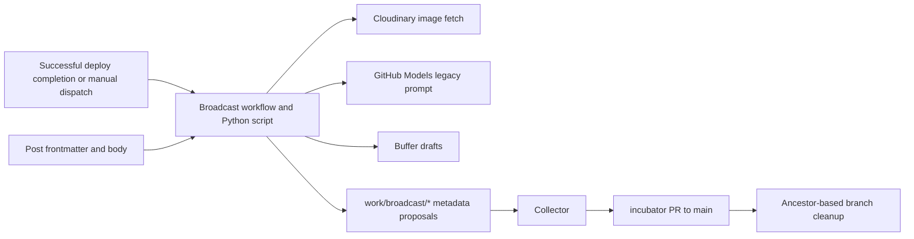

# Social Broadcast

## Purpose

The social broadcast pipeline reads eligible blog posts, prepares channel-specific Cloudinary images, generates Italian social copy through GitHub Models, and creates **Buffer drafts**. It proposes the resulting `broadcast.sent` frontmatter changes through `work/broadcast/*` branches collected into an `incubator` pull request; it does not directly commit these changes to `main`.

This is a **separate legacy social-copy path**. `_scripts/broadcast.py` uses its own literal `SOCIAL_COPY_PROMPT` and model requests, not the [governed author runtime](./author-runtime.md). Its model fallback is local to this script, not an implicit fallback of the native authoring plugin. Creating a Buffer draft is also distinct from public social publication: `broadcast.sent: true` records successfully processed draft targets, not confirmed publication.

Sources: `_scripts/broadcast.py:68–103,231–345,593–655,812–826`; `.github/workflows/broadcast-social.yml:131–182`.

## Key Files

| File | Role |
|------|------|
| `_scripts/broadcast.py` | Frontmatter parsing, eligibility, image URLs, model copy, Buffer channel discovery and draft creation, local sent-marker updates. |
| `.github/workflows/broadcast-social.yml` | Post selection after deployment or manual dispatch; script execution; per-post work branches and collector dispatch. |
| `.github/workflows/collect-incubator-pr.yml` | Collects `work/*` contributions into `incubator` and creates or updates a PR targeting `main`. |
| `.github/workflows/cleanup-work-branches.yml` | Deletes work branches whose heads are ancestors of `main`; removes `incubator` after its merged PR. |
| `frontmatter-schema.yml` | Reference notation for broadcast configuration and per-channel image fields; some documented image options differ from script behavior. |

## Public API

The executable interface accepts one or more post paths, optionally with `--posts`, plus `--dry-run`. Missing files or any explicit `False` post result produce exit status 1; disabled/already-sent posts return `None` and do not by themselves fail the run. A dry run parses the post and reports its settings without calling the model, Buffer, or image warmup, and does not write frontmatter.

| Function | Responsibility |
|----------|----------------|
| `get_broadcast_config(fm)` | Normalizes boolean, list, or mapping broadcast settings. |
| `get_post_info(fm, body, filepath)` | Builds model context and the article URL from the filename and parent directory. |
| `cloudinary_social_url(master_path, social_config, post_title, channel_type)` | Builds transformed image URLs with optional caption and logo composition. |
| `call_github_models(post_info, active_channels)` | Tries the primary model and then the script's fallback model. |
| `get_buffer_channels()` | Resolves service names to channel IDs in the first Buffer organization returned. |
| `create_buffer_draft(channel_id, text, photo_url=None, retries=3, label="")` | Creates a draft, with retry and image-free fallback behavior. |
| `broadcast_post(filepath, dry_run=False)` | Runs the per-post pipeline and conditionally updates its sent marker. |

Sources: `_scripts/broadcast.py:154–258,364–477,516–566,593–655,672–867`.

## Dependencies



The broadcast workflow installs PyYAML and selects Python 3.14. The script otherwise uses Python standard-library modules, loads `site_logo` from `_config.yml`, and receives `CLOUDINARY_CLOUD_NAME`, `BUFFER_API_TOKEN`, and `GITHUB_TOKEN` from its environment. These are configuration/credential names, not embedded values. Broadcast, collection, and cleanup share the `work-pipelines` concurrency group with cancellation disabled.

Sources: `_scripts/broadcast.py:9–35`; `.github/workflows/broadcast-social.yml:15–42,106–119`; `.github/workflows/collect-incubator-pr.yml:12–14`; `.github/workflows/cleanup-work-branches.yml:12–14`.

## Eligibility and Channel Filtering

### Workflow selection

`Broadcast to Social` listens for completion of [`Deploy blog on Cloudflare Pages`](../config/build-and-automation.md) on `main` or `master`; the job proceeds only on a successful conclusion, unless manually dispatched. It checks out the triggering commit. A manual `post_path` is prefixed with `_posts/` and checked for existence; the script still applies its own broadcast eligibility rules.

Without an explicit path, the workflow scans `.md` and `.Rmd` posts, excluding files matching `broadcast: false` or `sent: true`. It also checks the corresponding remote `work/broadcast/{category-directory}-{slug}` branch for a sent marker before including files containing `broadcast:`. These are text searches, not YAML-aware checks: a matching string elsewhere in a file can affect selection.

Source: `.github/workflows/broadcast-social.yml:3–7,25–34,44–104`.

### Script configuration

| `broadcast` value | Script behavior |
|-------------------|-----------------|
| Missing, `null`, or `false` | Disabled. |
| `true` | Enabled with default channels. |
| List | Enabled with that list; an empty list uses defaults. |
| Mapping | Reads `channels` and `sent`; enabled unless `sent` is truthy. A string `channels` value becomes a one-item list. |

Defaults are `linkedin` and `mastodon`. A mapping's `enabled` field is not consulted. Channel names are matched as supplied against Buffer's lowercased service names; the script does not normalize requested names. Buffer discovery uses the first organization and stores one ID per service, so later channels for the same service overwrite earlier entries.

Requested channels absent from Buffer, or absent from `SOCIAL_CROPS`, are skipped rather than counted as failed draft targets. All requested names are nevertheless passed to the copy-generation request. Configured crop sizes and final text limits are:

| Channel | Image size | Final text limit |
|---------|------------|------------------|
| LinkedIn | 1200 × 627 | 800 characters |
| Mastodon | 1200 × 675 | 390 characters |
| Bluesky | 1200 × 675 | 300 characters |
| YouTube | 1280 × 720 | 5000 characters |

Sources: `_scripts/broadcast.py:37–66,154–177,516–566,684–698,722–726,757–795`.

## Social Images

The base image is `master`, falling back to `header.overlay_image`; otherwise drafts can be text-only. A nonempty `broadcast.{channel}_image` mapping can override the image with `overlay_image`. Without such a mapping, the script uses a basic Cloudinary fetch crop. With one, it constructs the social composition:

- Optional `keystone` or `cinematic` distortion, with `low`, `medium`, or `high` intensity and a safe crop afterward; otherwise a fill crop using `gravity` (default `auto`).
- Caption defaults to the post title when omitted or `true`; a false/empty caption disables it, and another truthy value supplies custom text. `color` defaults to white.
- A caption or logo adds a semi-transparent bottom bar. `logo: true` selects the site logo; a string can select a custom logo path/name. The script uses an 88-pixel circular logo.
- A colon splits the caption into a smaller first line and uppercase second line; otherwise the caption is uppercase on one line.

Only channels both available in Buffer and present in the crop table receive image preparation. Initial Cloudinary warmup makes up to five attempts; failure of any prepared image aborts that post **before** spending model tokens. During draft creation, images are warmed again, but that warmup result is not itself a gate on the Buffer call.

The reference schema documents a per-channel `overlay` foreground image, but this script never consumes it. Its logo/font implementation also differs from the schema's descriptive sizing comments; the executable code is authoritative for this path. The decorated URL builder returns no image when the cloud name is empty, whereas the basic URL builder has no equivalent guard.

Sources: `_scripts/broadcast.py:180–192,348–477,574–602,718–755`; `frontmatter-schema.yml:46–88`.

## Legacy Copy Prompt and Fallback

`SOCIAL_COPY_PROMPT` asks for conversational Italian in the voice of an engineer, with honest approximation caveats and occasional self-irony rather than marketing copy. It gives detailed formats for LinkedIn (Unicode-bold opening/closing questions, short paragraphs, inline hashtags) and Mastodon (concrete first-person opening, concise sentences, trailing hashtags). Although the crop table also supports Bluesky and YouTube, the literal system prompt only specifies LinkedIn and Mastodon output examples.

The user prompt includes title, category, constructed article URL, excerpt, audience, proficiency, and up to 1,500 characters of body text after stripping LaTeX and some Markdown. The URL uses the parent directory as the category path and the date-stripped filename as the slug; it is not read from `canonical_url`.

Requests go to GitHub Models with temperature `0.7`, first using `openai/gpt-4o`, then `openai/gpt-4o-mini` if the first attempt returns no truthy result. Missing `GITHUB_TOKEN` fails generation. Response handling strips Markdown code fences, parses JSON, and retries parsing after escaping literal newlines inside JSON strings. Failure of both models stops the post; there is no deterministic substitute copy.

The parsed JSON is not validated against a channel-copy schema. String copy receives the article URL; dictionary copy receives the URL and any separate hashtag list. An absent channel key defaults to `{}`, which still produces URL-only text rather than a skip. A value of another type is skipped. Character limits apply **after** appending the URL and hashtags, despite the prompt saying its limits exclude the URL; truncation can therefore remove links or hashtags.

Sources: `_scripts/broadcast.py:68–103,195–345,667–669,757–795`.

## Buffer Drafts and Success Semantics

### Draft creation

Buffer calls use GraphQL `createPost` with `schedulingType: automatic`, `mode: addToQueue`, and, critically, **`saveToDraft: true`**. A returned post ID is treated as draft success; the script does not verify public publication.

The helper normally allows three attempts. Missing API results retry; errors containing `Not Found` or `image dimensions` retry; other mutation errors stop the image-bearing attempt loop. If image-bearing creation fails, it makes a final one-attempt text-only call. A successful text-only draft counts as success even though the requested image was not attached.

Source: `_scripts/broadcast.py:593–655`.

### Sent markers and partial success

`target_count` increases only immediately before an actual draft attempt, after channel/copy filtering. If no draft succeeds, the post fails. If at least one succeeds and all counted targets succeed, the script writes `broadcast.sent: true`; consequently, skipped requested channels do not prevent that marker. If some attempted targets fail, it returns `False` without setting the marker, but already-created Buffer drafts remain. No per-channel success state or rollback is recorded, so rerunning can duplicate those successful drafts.

Frontmatter updates deep-merge mappings, then serialize the complete YAML block with PyYAML; original formatting is not preserved exactly. When the old `broadcast` value was a boolean or list, replacing it with the sent mapping also loses that original shorthand channel configuration.

There is an additional workflow-level consequence: one explicit post failure makes the script exit nonzero, and the change-detection step runs only on `success()`. Thus drafts and local sent updates for other successful posts in the same invocation can exist without reaching work branches or the collector. The remote sent-marker check only helps when such metadata was actually persisted.

Sources: `_scripts/broadcast.py:123–151,768–826,844–863`; `.github/workflows/broadcast-social.yml:68–75,106–132,178–182`.

## Frontmatter Proposals and Review

When the broadcast step succeeds and post changes exist, the workflow saves each post, checks out or creates `work/broadcast/{category-directory}-{slug}` from `main`, refreshes an existing branch by merging `main`, and recreates it from `main` on a merge conflict. It copies the saved post back, commits, and pushes the work branch, then explicitly dispatches the collector.

The collector also listens for pushes to `work/**`. It starts from existing `incubator` when present, attempts a rebase onto `main`, and otherwise starts from `main`. It merges sorted work branches, reports and skips merge conflicts, and force-pushes `incubator` when its tree differs from `main`. It creates or updates an open `incubator` → `main` PR with branch lists, per-post changes, history, and a post diff. It does not auto-merge the PR or encode human approval as a release authorization.

Reviewers should distinguish the proposed repository marker from side effects already made in Buffer: rejecting a frontmatter proposal does not retract drafts. The collector's generated rejection guidance also overstates automation: its actual triggers do not include branch deletion, and retaining an existing `incubator` means deleting a work branch does not itself remove contributions already incorporated there. Any rejection needs inspection of the resulting PR diff, not reliance on that guidance alone.

Cleanup runs after a merged `incubator` PR targeting `main`/`master`, or by manual dispatch. It deletes only work branches whose current head is an ancestor of `origin/main`, retaining others; this is commit reachability, not patch equivalence. On the PR-triggered path it also deletes `incubator`. These workflow definitions describe mechanics, not evidence that deployment, merge, or publication has been approved.

Sources: `.github/workflows/broadcast-social.yml:131–182`; `.github/workflows/collect-incubator-pr.yml:3–6,26–168`; `.github/workflows/cleanup-work-branches.yml:3–20,29–77`.

## Usage Example

The draft configuration below is taken directly from `create_buffer_draft`; it shows why queue-related fields must not be mistaken for immediate publication:

```python
parts = [
    f'text: "{escaped_text}"',
    f'channelId: "{channel_id}"',
    'schedulingType: automatic',
    'mode: addToQueue',
    'saveToDraft: true'
]
```

Source: `_scripts/broadcast.py:604–611`.
