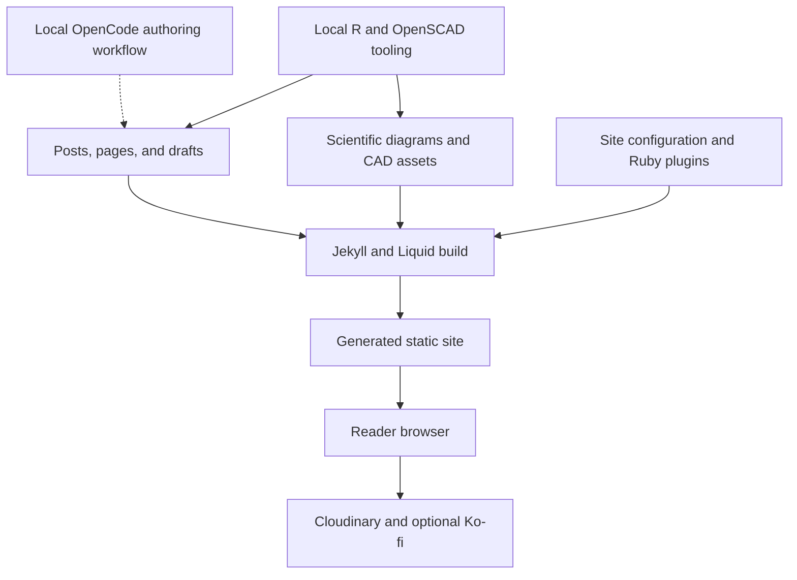

# gabrielebaldassarre.com

Gabriele Baldassarre's personal blog publishes Italian technical and scientific content, reflecting interests in science communication, home automation, physics, social networks, and 3D printing. The public site is generated with Jekyll; the repository also contains supporting scientific-content tooling and a governed author-modeling workflow used through OpenCode. These authoring and operational tools are adjacent to the [static site](./architecture.md), not a REST application server. Sources: `README.md`, `_config.yml`, `index.html`, `Gemfile`, `Makefile.common`, `docs/README.md`.

## Key Features

- **Italian publishing:** Italian locale, Europe/Rome timestamps, category-based permalinks, and ten posts per archive page. Future-dated posts are disabled in the site configuration. Source: `_config.yml`.
- **Post discovery and presentation:** the homepage combines an author introduction with [paginated post previews](./components/site-presentation.md), optional Cloudinary images, excerpts, and publication-status indicators. Source: `index.html`.
- **Scientific formatting:** GitHub-flavored Markdown, Rouge syntax highlighting, KaTeX mathematics, and configurable tables of contents support technical articles. Sources: `_config.yml`, `Gemfile`.
- **Reproducible content assets:** Make rules convert R Markdown to Markdown, R diagram scripts to SVG, and OpenSCAD models to printable STL/3MF assets and PNG previews. Native tools or container alternatives support these workflows. Source: `Makefile.common`.
- **Publishing integrations:** configured plugins provide feeds, sitemaps, redirects, and other content features. The homepage supports author profile links and an optional Ko-fi widget. Sources: `_config.yml`, `Gemfile`, `index.html`.
- **Governed assisted writing:** article-grounded extraction, dimension-specific consolidation, human review, model composition, and task-specific runtime instructions form a separate authoring pipeline. Source: `docs/README.md`.

## Tech Stack

| Layer | Technology and role |
|-------|---------------------|
| Static generator | Ruby and Jekyll `~> 4.4`; the shared Makefile selects the Jekyll 4.4.1 container image. |
| Templates and text | Liquid, Kramdown with the GFM parser, Rouge, and KaTeX integration. |
| Styling | Sass/SCSS with compressed output configured in Jekyll. |
| Scientific content | R/knitr for R Markdown and R-generated diagrams. |
| CAD assets | OpenSCAD exports and a Python-driven blueprint-preview workflow. |
| Local orchestration | GNU Make rules, optional native tool detection, and Docker containers. |
| Assisted authoring | OpenCode, specialized subagents, JSON artifacts, and npm-based compiler/check commands documented for `_scripts/author-extraction`. |
| External integrations | Cloudinary image delivery and an optional Ko-fi browser widget. |
| Operational tooling | A separate SEO-monitor container receives environment configuration and optional arguments. |

Sources: `Gemfile`, `_config.yml`, `Makefile.common`, `docs/README.md`, `index.html`. These files do not define a request-serving application database or REST API.

## System Overview

[Local workflows](./getting-started.md) prepare content and assets; Jekyll generates the public static site; browsers consume the resulting pages and referenced external services. The dashed authoring edge represents assisted preparation, not automatic publication. Sources: `Makefile.common`, `_config.yml`, `index.html`, `docs/README.md`.

### Public Site and Local Tooling Boundaries

The production site target runs a Jekyll build with `JEKYLL_ENV=production`. The development target instead runs Jekyll's preview server with drafts and future posts enabled; that preview is distinct from the public publishing configuration. Both targets depend on diagram preparation, while knitr and CAD have their own aggregate targets. Source: `Makefile.common`.

Jekyll explicitly excludes `_scripts`, `_dbt`, monitoring configuration and result files, several container/build inputs, `renv`, and `vendor`. The configuration describes the SEO-monitoring pipeline as outside Jekyll's scope. These exclusions establish specific boundaries, not a blanket guarantee that every documentation or authoring artifact is private. Source: `_config.yml`.

Cloudinary and Ko-fi are external integrations, not locally hosted application components. Likewise, the SEO container is separate operational tooling, not part of page request handling. Sources: `_config.yml`, `index.html`, `Makefile.common`.

## Project Structure

| Path | Purpose evidenced by the reviewed sources |
|------|------------------------------------------|
| `_config.yml`, `Gemfile` | Site settings, content defaults, rendering configuration, and Ruby dependencies. |
| `index.html` | Liquid homepage template using the `post-index` layout and paginator. |
| `_posts/`, `_drafts/`, `_pages/` | Article sources, draft inputs, and additional pages referenced by configuration and build rules. |
| `assets/` | Site images and scripts, generated diagram SVGs, and printable CAD assets under `assets/3d/`. |
| `_sass/` | Configured Sass source directory. |
| `R/`, `_cad/` | Scientific rendering scripts and OpenSCAD model sources. |
| `containers/`, `Makefile.common` | Container build contexts and shared publishing, rendering, preview, and SEO rules. |
| `_scripts/`, `_dbt/` | Local tooling locations excluded from Jekyll; the author-extraction package is under `_scripts/`. |
| `docs/` | Author-modeling guidance and versioned results, including models, candidates, and runtime artifacts. |

Sources: `_config.yml`, `Makefile.common`, `docs/README.md`, `index.html`. Generated `_site` output and dependency implementations are outside this overview's source-analysis scope.

## Recorded Author-Model State

The author-modeling guide records a corpus of **A01–A20**, **52 reviewed groups**, **29 approved author patterns**, and **three retained semantic groups**. It identifies the governed v1.3 `author-model.json` as composed of **six principles**. These are documented artifact facts, not results recomputed or reapproved for this overview. Source: `docs/README.md`.

The documented sequence is extraction per article, consolidation across rhetorical/epistemic/semantic/decisional dimensions, human review and release, model composition, and runtime preparation for a specific writing task. Recomposition creates a separate candidate; adopting it requires explicit authorization. Approved v1.3 artifacts are not overwritten to rerun the process. Source: `docs/README.md`.

Runtime compilation resolves a task brief into a profile, instructions, and manifest. It does not itself generate or publish a post. The daily OpenCode command separately prepares the runtime and creates a Rake template for assisted writing. Local author-model tooling therefore supports editorial preparation without replacing human release decisions or the static-site build. Source: `docs/README.md`.
